# annotation-store

[](https://github.com/ewanhmack05/Diss-Project/actions/workflows/annotation-store.yml)

ASP.NET Core (.NET 10) + EF Core (Npgsql) backend for persisted annotations
and cell counts, one Postgres database shared by both via a single
`AnnotationDbContext`.

## Running

```bash
dotnet run --project annotation-store --urls http://localhost:5252
```

Localhost is enough even when sharing the viewer with other machines -
the viewer's dev server proxies to it (see the root README).

In `Development`, the app runs any pending EF Core migrations against the
configured database automatically on startup - no manual
`dotnet ef database update` needed for a normal day-to-day pull.
`Database__MigrateOnStartup=true` does the same in any environment - the
Docker image sets it.

Shapes are saved with coordinates to a tenth of a slide pixel
([GeoJsonRounding.cs](Annotations/GeoJsonRounding.cs)). Ones saved before
that can be rounded once, after which it exits rather than serving:

```bash
dotnet run --project annotation-store -- round-geojson
```

It writes straight to the rows, so nothing shows on the History tab, and
running it again finds nothing to do.

### Tests

```bash
dotnet test annotation-store/Tests
```

On in-memory SQLite, so nothing needs to be running. To run the same tests
on Postgres - the migrations, Npgsql's SQL, and the `[PostgresFact]` ones
that need requests at the same moment - point them at a server. Each test
class makes a database of its own and drops it afterwards:

```bash
ANNOTATION_STORE_TEST_POSTGRES="Host=localhost;Port=5432;Username=postgres;Password=..." dotnet test annotation-store/Tests
```

### In Docker

```bash
docker build -t diss-annotation-store annotation-store
```

It needs a Postgres and Keycloak, so it's easiest through the root
`docker-compose.yml`, which sets everything it takes:
`ConnectionStrings__AnnotationStore`, `Auth__MetadataAddress` (Keycloak's
address inside Docker) and `OTEL_EXPORTER_OTLP_ENDPOINT`. Listens on 8080
in the container.

## Sign-in and collections

Every endpoint needs a Keycloak access token (see [auth/](../auth)), checked
in `Auth/KeycloakAuth.cs` - settings under `Auth` in `appsettings.json`. The
user always comes from the token's `sub`, never from the request. The only
exceptions are guests, below, and `GET /invites/{code}/guest`, which needs no
sign-in at all.

There are two kinds of collection:

- **Personal** - made automatically, one per person per slide
  (`POST /collections/ensure`). Only ever theirs.
- **Session** - started by someone (the host) to work with others, who join
  through an invite link. Ending one makes it read-only and stops its links,
  but keeps it so people can look back at it.

A personal collection can be **shared** by its owner. Anyone signed in then
sees it in their list for that slide and can read everything in it, as a
viewer, without being a member.

| Endpoint | Who | What |
| --- | --- | --- |
| `GET /collections?slideId=` | anyone | Collections on the slide you're in - your own, then sessions still going, then ended ones, then other people's shared ones - with your role, the members, how many annotations and cell counts each has, and when one was last added |
| `GET /collections/{id}` | members | Everything in it - annotations, cell counts, presets |
| `GET /collections/{id}/export` | members, or anyone if shared | Its annotations and cell counts (dots and ROI included), oldest first - what the viewer's GeoJSON export reads |
| `GET /collections/{id}/membership` | members | Your role, its kind and whether it's ended - what the realtime hub checks before letting you into a session's room |
| `POST /collections/ensure` | anyone | Get or create your own for `{ slideId }` |
| `POST /sessions` | anyone | Start a session on `{ slideId, collectionName?, maxEditors?, editPolicy? }`, hosted by you. `editPolicy` is `lastWriteWins` (the default) or `firstComeWins` - see below. One at a time per slide - with one not ended, it's a 409 with that one instead |
| `PUT /collections/{id}` | owner | Rename |
| `PUT /collections/{id}/sharing` | owner | Personal only - `{ shared }`. Lets anyone signed in view it, read-only |
| `POST /collections/{id}/import` | editor, owner | `{ annotations, cellCounts, groups?, source? }` from a GeoJSON import or something sent in a message, saved together and stamped as you. `source` says where it came from - see [where a change came from](#where-a-change-came-from) |
| `DELETE /collections/{id}` | owner | Delete, with everything in it |
| `POST /collections/{id}/end` | host | End a session |
| `PUT /collections/{id}/members/{userId}` | host | Change someone's role - `{ displayName, role: "editor" \| "viewer" }` |
| `DELETE /collections/{id}/members/{userId}` | host, or that member | Take someone out, or leave |
| `POST /collections/{id}/invites` | host | New invite link - `{ role, hours }` (up to a week). Any earlier link stops |
| `GET /collections/{id}/invites` | host | The session's working link |
| `DELETE /collections/{id}/invites/{code}` | host | Stop a link |
| `GET /invites/{code}` | anyone with the code | What it's for - session, host, role, who's in it, and whether it's `open`, `expired`, `stopped` or `ended` |
| `POST /invites/{code}/accept` | anyone with the code | Join with the link's role. 410 if it's run out |
| `GET /invites/{code}/guest` | anyone, no sign-in | For joining as a guest - `{ collectionId, slideId, collectionName, hostName, status, expires }`. 404 for an unknown code |

Annotations, cell counts and image adjustments check the same membership:
any member can read, `editor` and `owner` can add, change and delete. Not
being a member gets a 404, so it doesn't give away whether it exists. Nothing
in an ended session can change (409).

### Guests

Someone without an account can open an invite link as a guest, view only.
realtime-hub gives them a guest token (contract in
[docs/guests.md](../docs/guests.md)), checked here in `Auth/GuestAuth.cs`:
HS256, signed with `GuestTokens:SigningKey` (base64, 32 bytes, the same value
as the hub's), issuer `realtime-hub`, audience `diss-guest`, and it has to be
in date. Its `sub` is a `guest-` id and `guest_session` is the one session
it's for. There's no name in it, so the name a guest types never reaches this
service.

A guest token only works on these, and is a 401 everywhere else:

- `GET /collections?slideId=` - just their session, with `myRole: viewer`,
  if it's on that slide. Otherwise `[]`
- `GET /collections/{id}/membership` - `role: viewer` for their session
- `GET /annotations`, `/annotations/total`, `/annotations/facets`
- `GET /cellcounts`, `/cellcounts/total`, `/cellcounts/facets`,
  `/cellcounts/{id}`
- `GET /annotationgroups`

On those a guest is a viewer of their own session (ended or not) and gets a
404 for anything else, a personal collection included, even a shared one.
Guests never get a row in `CollectionMembers` - nothing they can call writes
anything - so a session's member list is only ever people with accounts.

The key in `appsettings.json` is a dev key. Replace it before deploying
(`GuestTokens__SigningKey`), with the same value in realtime-hub.

## Pointing it at your database

Copy `.env.example` to `.env` and fill in your real connection string:

```bash
cp annotation-store/.env.example annotation-store/.env
```

```
ConnectionStrings__AnnotationStore=Host=localhost;Port=5432;Database=annotationtest;Username=postgres;Password=<yours>;
```

`.env` is gitignored - it never gets committed, `.env.example` (no real
values) is the tracked template. `Program.cs` loads it via `DotNetEnv`
before the host reads configuration, into the same
`ConnectionStrings__AnnotationStore` env var ASP.NET Core's built-in
environment-variables config source already understands (double
underscore = nested config key). That's deliberate: if this ever runs
somewhere hosted, the exact same env var - set by whatever's hosting it,
no `.env` file involved - works with zero code changes. `dotnet ef` (when
you run it directly, e.g. adding a new migration) doesn't go through
`Program.cs`'s startup code, so it won't see `.env` - export the same env
var in your shell first if you need to run an `ef` command against a
non-default database.

The target database (`annotationtest` above, or whatever name you use)
doesn't need to exist yet - `Database.Migrate()` on startup creates the
database itself (as long as the connecting user has that privilege - true
by default for Postgres' `postgres` superuser) as well as the schema.

## API

Everything is per collection - reading needs you in it, writing needs
editor or owner.

Every write to annotations, groups, cell counts, image adjustments, an
import or a collection delete goes in a **change set** - who did it, what,
and when. Send a `Change-Set-Id` header (a GUID) to choose it, so several
requests count as one change - the viewer sends one id with every batch of a
bulk change. Leave it out and the write gets a change set of its own. The
response's `Change-Set-Id` header says which it went in. An id already used
by someone else, or in another collection, is a 400.

**Two people changing the same thing.** A session is `lastWriteWins` or
`firstComeWins` (`editPolicy`, picked by the host - personal collections are
always `lastWriteWins`). It's checked per field, for an annotation's colour
and group and a group's name and notes - labels and notes on annotations and
cell counts are merged live, so they're never checked. A save sends the
value it started from (`wasColour`, `wasName`, `wasNotes`, or `wasColours` /
`wasGroups` by id for a bulk change). It's in the way of someone else's
change when the stored value isn't that any more and the save would change
it again: a 409 under `firstComeWins`, with `{ entity, id, current,
changedBy, changedAt, changed }` - the row now and the last change to those
fields - and saved anyway under `lastWriteWins`, with an `Overwrote: 1`
header. A field sent the same as its was isn't being changed, so it's left
as it is. No was, no check. Either way it's counted on the
`annotation_store.conflicting_saves` metric. See
[version-control.md](../docs/breakdown/version-control.md#8-two-people-changing-the-same-thing).

**History is kept apart from the data.** What every change did to each row
goes in the `history` schema (`History/`): a delete keeps the whole row, an
edit keeps just the columns it changed, before and after. The live tables
only ever hold what's there now - a delete takes the row out. The one
exception is a deleted collection, which stays in its table, hidden, since
it holds everything in it. Nothing in the history is purged.

- `GET /changesets?collectionId=&skip=&take=` - the collection's change
  sets, newest first: `{ id, collectionId, userId, userName, what, created,
  deleted, source }`, `source` being where it came from or null, and `deleted` being how many rows it deleted that are still
  deleted - and haven't been put back and deleted again by something later,
  which makes them that change's. Anyone who can read the collection, guests
  included. Narrowed with the Saved lists' names (`ChangeSetFilter` in
  `History/ChangeSetFilter.cs`):
  - `createdBy` - who made it, Keycloak ids, repeat for more than one
  - `kind` - `add`, `change`, `delete`, `merge`, `import` or `restore`,
    repeat for more than one. Change is anything that isn't one of the
    others. Anything else is a 400
  - `from` / `to` - when, `from` included and `to` not
  - `order=oldest` turns it round
- `GET /changesets/facets?collectionId=` - `{ authors, kinds }`: who's made
  changes and how many, and how many of each kind, for the filter popout
- `GET /changesets/{id}/changes` - what one change set did, for the
  History tab's detail page: `{ changes, created, deleted, deletedNames,
  groups, deletedRows }`. `changes` is every column it changed, grouped - `{ entity,
  column, before, after, count, names }`, so a recolour of 48 annotations
  from red to blue is one, with the first 5 rows' names (null for one
  that's gone since). `deletedNames` names the first 5 rows it deleted,
  `deletedRows` is the same 5 as `{ entity, id, name }` so one can be opened,
  and `groups` names every group a `GroupId` in `changes` points at, gone ones
  included. Only reads the update entries and the names out of the deletes,
  never a deleted row's whole copy. Same access as the list
- `GET /cellcountgroups?collectionId=` lists a collection's groups of cell counts with how many are
  in each, `POST /cellcountgroups` makes one from `{ collectionId, name, cellCountIds? }`, and `PUT`
  and `DELETE /cellcountgroups/{id}` change `{ name?, notes? }` or remove it, leaving its counts.
  `PUT /cellcounts/group` with `{ collectionId, ids, groupId }` moves counts in, or out with no
  `groupId`. `POST /cellcountgroups/{id}/merge` with `{ intoId }` moves everything in it across and
  removes it. The same as annotation groups, first change wins included: `wasName`, `wasNotes` and
  `wasGroups` say what a save started from. `group=` narrows `GET /cellcounts`, as it does annotations
- `GET /changesets/{id}/changes` also has `copiedFrom` for something sent in a
  message - `[{ entity, from, to }]`, which row each new one was copied from
- `GET /changesets/total?collectionId=` - how many change sets the
  collection has, for the viewer's History pager. Same access as the list
- `POST /changesets/{id}/restore` - puts it back how it was before that
  change, as a change of its own: every row it deleted comes back, and every
  column it changed on a row that's still here goes back - but only where
  nobody's changed it again since. So a deleted or merged group comes back
  with what was in it, and a later edit is never undone. Any editor, for
  anyone's change set - except a deleted collection, which only its owner
  can bring back (and not while they've a newer personal one for that slide
  - 409). Answers `{ counts, annotations, groups, cellCounts,
  imageAdjustments, changedAnnotations, changedCellCounts }`: `counts` is `{ annotations,
  groups, cellCounts, imageAdjustments, collection }`, how many of each came
  back, the lists are the rows that came back as the reads give them -
  groups with their member `count`, cell counts as the Saved list has them
  (no `dots`) - and `changedAnnotations` and `changedCellCounts` are ones
  that were already there and went back how they were. Restoring again
  answers zeros and empty lists
- `GET /annotations/{id}/history?collectionId=&skip=&take=`, and the same on
  `/cellcounts/{id}/history` - one row's timeline, newest first: `{ versions,
  total, latest, groups }`. Each version is `{ id, changeSetId, userId,
  userName, what, created, op, changes }`, `op` being `create`, `update` or
  `delete`, and `changes` the columns an update changed, in the same shape as
  above. A delete's whole copy is never sent. `latest` is the newest entry.
  Same access as the change set list, guests too
- `GET /annotations/{id}/history/{entryId}`, and on `/cellcounts` - what going
  back to that entry would do, changing nothing: `{ gone, changes, groups,
  groupGone, latest }`. `gone` means it's deleted now, so `changes` is what
  it'd come back as. `groupGone` names the group it was in, if that's gone
  since. 409 if the history doesn't say how it was. Same access
- `POST /annotations/{id}/history/{entryId}/restore?latest=`, and on
  `/cellcounts` - puts the row how it was just after that entry, undoing every
  change to it since, whoever made them. On a delete entry, that's how it was
  when it was deleted. A row that's deleted comes back, a count with its dots
  and region of interest. Its own change set (`restore annotation`,
  `restore cell count`), so it can be gone back on as well. Answers the same as
  a change set's restore. If it's already so, zeros and no change set.
  `latest` is the newest entry the person saw: if there's a newer one it's a
  409 and nothing changes, whatever the session's edit policy. Left out, not
  checked. Editors only (403 for a viewer, 404 for someone not in it or an
  entry that isn't this row's, 409 for an ended session)
- `GET /changesets/{id}/rollback` - what putting the whole collection back to
  just after that change would do, changing nothing: `{ annotations, groups,
  cellCounts, latest, entriesWalked, fromSnapshot }`. The first three are `{
  back, changed, gone }`, how many of each kind come back, go back how they
  were and are taken out. `latest` is the collection's newest entry.
  `entriesWalked` and `fromSnapshot` say what it took to work out, and
  `snapshots=false` works it out without a snapshot, for timing the two. Same
  access as the change set list, guests too. 409 if the change recorded nothing
- `POST /changesets/{id}/rollback?latest=` - does it, as its own change set
  (`restore collection`), in one transaction. Answers the same counts, not the
  rows - there can be too many, so the viewer loads them again. Image adjustments
  stay as they are. If it's already so, zeros and no change set. `latest` is the
  newest entry the person saw: if there's a newer one it's a 409 and nothing
  changes, whatever the session's edit policy. Left out, not checked. Editors
  only (403 for a viewer, 404 for someone not in it, 409 for an ended session)

- `GET /annotations?collectionId=` - every annotation in the collection,
  newest first. What the map loads
- `GET /annotations?collectionId=&skip=&take=&search=` plus filters - one
  page of them, for the viewer's Saved list. All optional; `take` is 1-500.
  `search` matches label, notes or shape, ignoring case. The filters (see
  `SavedFilter` in `Paging/Paging.cs`):
  - `createdBy` - Keycloak user ids, repeat for more than one
  - `shape` - `rectangle`, `line`..., repeat for more than one
  - `colour` - hex, ignoring case, repeat for more than one
  - `otherThan` - any colour but these, alongside `colour` - the viewer's
    Custom sends its palette here
  - `hasNotes` - `true` or `false`
  - `group` - group ids, or `none` for ones not in a group, repeat for
    more than one
  - `from` / `to` - when it was saved, `from` included and `to` not
- `GET /annotations/total?collectionId=&search=` plus filters - how many
  there are, or how many match - for the page count
- `GET /annotations/facets?collectionId=` - what there is to filter by:
  `authors` (`{ id, name, count }` by name - rows from before sign-in aren't
  included) and `colours` (`{ colour, count }`, most used first)
- `POST /annotations` - create one (body: `Annotation` minus `id`/`created`,
  both are assigned server-side if omitted)
- `PUT /annotations/{id}` - update `label`/`notes`/`colour`, with
  `wasColour` to check it (see above)
- `DELETE /annotations/{id}` - delete (the row goes to the history - see above)
- `PUT /annotations/bulk` - many at once, from the viewer's Select tab:
  `{ collectionId, ids, colour?, setGroup, groupId?, wasColours?, wasGroups? }`.
  `colour` recolours them all; `setGroup` moves them all into `groupId`, or
  out of any group when it's null. Ids not in the collection are skipped -
  `{ count }` says how many changed. Under `firstComeWins` the ones in the
  way of someone else's change are left alone and listed in `conflicts`, as
  they are now; under `lastWriteWins`, `overwrote` says how many replaced
  someone's. Up to 20,000 ids
- `POST /annotations/bulk-delete` - `{ collectionId, ids }`, same rules
- `GET /annotationgroups?collectionId=` - the collection's groups, by name,
  each with how many annotations are in it
- `POST /annotationgroups` - `{ collectionId, name, annotationIds? }` - a new
  group, with those annotations put straight in it
- `PUT /annotationgroups/{id}` - `{ name?, notes?, wasName?, wasNotes? }` -
  either or both, checked like an annotation's colour
- `POST /annotationgroups/{id}/merge` - `{ intoId }` - moves everything into
  that group and deletes this one, in one transaction. Notes are joined.
  The delete says where it went, so an annotation put back later that was
  in it lands in `intoId`
- `DELETE /annotationgroups/{id}` - delete it. Its annotations stay,
  ungrouped. Putting it back puts them back in it

A group (`Annotations/AnnotationGroup.cs`) is a named set of annotations in
one collection, one level deep - an annotation's `GroupId` is the one it's
in, if any, and always one in the same collection (a 400 otherwise). Groups
go out in a GeoJSON export by name, with their notes, and an import puts
annotations into the collection's group of that name, making it if there
isn't one and adding the file's notes for it.

- `GET /cellcounts?collectionId=&skip=&take=&search=` plus filters - same
  as annotations, but `withRoi` (`true`/`false`) instead of `shape` and
  `colour`; `search` matches label or notes. Without the dots (`dots` is null) - each
  count has `colourCounts` and `placedByCounts` instead, worked out when
  it's saved and kept on the row (`CellCounts/CellCountSummary.cs`). Counts
  from before that get them the first time they're listed
- `GET /cellcounts/total?collectionId=&search=` plus filters - same as annotations
- `GET /cellcounts/facets?collectionId=` - same as annotations, with
  `colours` always empty
- `GET /cellcounts/{id}` - one count, dots and ROI box included
- `POST /cellcounts` - create one (body: `CellCount` minus `id`/`created`,
  both are assigned server-side if omitted). Takes up to 80 MiB, room for a
  million dots - everything else has Kestrel's 30 MB default
- `PUT /cellcounts/{id}` - update `label`/`notes`/`withAnnotation`/`withRoi`/
  `count`/`dotSize`
- `DELETE /cellcounts/{id}` - delete. Its ROI box is left as it is, so it
  comes back with a restore

Bad `skip`/`take` is a 400. Paging is newest first with the id breaking
ties, so no row turns up on two pages.

## Where a change came from

Adding something sent in a [message](../messaging/README.md) is an import with a `source`:

```ts
interface ImportSource {
  messageId: string
  fromUserId: string
  fromName: string
  kind: string // annotations, group, cellCount or collection
  name: string // what the sender called it
  collectionId: string | null // what it was copied from
  slideId: string | null
  rows?: { entity: 'annotation' | 'cellCount'; from: string; to: string }[]
}
```

Its change set's `what` is then `add from message`, and it counts as an `add` in the History
filter. The rows are new, with new ids and you as their author, and the original author is in
the source. It's what the viewer read from the message, since messages are another service's,
so all that's checked here is that it says who and what, each up to 300 characters, and that
`rows` are rows in this import. Anything else is a 400. You still have to be able to edit the
collection. See [docs/messaging.md](../docs/messaging.md#where-it-came-from).

## Schema

Everything is in one Postgres database. The tables in the `public` schema only
hold what's there now, and the `history` schema holds everything that happened.
Only this service reads or writes either - everyone else goes through the API.

Everything hangs off `Collections`, so removing a collection's row would remove
everything in it, history included (a cascading foreign key). The API never does
that - deleting a collection only sets `Deleted`, which hides it, so its owner can
bring it back.

Each line on the diagram is a foreign key, and says which column points at which:
`Annotations(GroupId) -> AnnotationGroups(Id)`.

Some things point outside the database, so they aren't foreign keys:

- **`SlideId`** is the tiler's id for a slide file.
- **`UserId`, `CreatedById`** and similar are Keycloak ids, from the token. Names
  are copied in when the row's written, so a list doesn't have to ask Keycloak and
  history says what someone was called then. Guests are view only, so they're never
  in these.
- **`history.Entries.EntityId`** is the row it's about, which may be gone.

`Set by` says where a value comes from: `client` is in the request, `server` is
the store, and anything the store sets is ignored if a client sends it. See
[How the history works](../docs/breakdown/version-control.md) for the `history`
schema in full.

Written by `python scripts/db_docs.py` from the migrations and
[schema-notes.json](schema-notes.json), so change the notes there, not here. A test
fails if this falls behind the schema.

```mermaid
erDiagram

    AnnotationGroups {
        Id uuid PK "not null"
        CollectionId uuid FK "not null"
        Name text "not null"
        Notes text "not null"
        Created timestamp_with_time_zone "not null"
    }

    Annotations {
        Id uuid PK "not null"
        CollectionId uuid FK "not null"
        GroupId uuid FK "null"
        LineThickness integer "not null"
        Colour text "not null"
        CreatedById text "not null"
        CreatedByName text "not null"
        GeoJson text "not null"
        Label text "not null"
        LineStyle text "not null"
        Notes text "not null"
        Shape text "not null"
        SlideId text "not null"
        Created timestamp_with_time_zone "not null"
    }

    CellCountGroups {
        Id uuid PK "not null"
        CollectionId uuid FK "not null"
        Name text "not null"
        Notes text "not null"
        Created timestamp_with_time_zone "not null"
    }

    CellCounts {
        Id uuid PK "not null"
        CollectionId uuid FK "not null"
        GroupId uuid FK "null"
        WithAnnotation boolean "not null"
        WithRoi boolean "not null"
        Count integer "not null"
        DotSize integer "not null"
        CreatedById text "not null"
        CreatedByName text "not null"
        Dots text "not null"
        Label text "not null"
        Notes text "not null"
        SlideId text "not null"
        Created timestamp_with_time_zone "not null"
        LocationX double_precision "null"
        LocationY double_precision "null"
        ColourCountsJson text "null"
        PlacedByCountsJson text "null"
    }

    CollectionInvites {
        Code text PK "not null"
        CollectionId uuid FK "not null"
        CreatedById text "not null"
        Role text "not null"
        Created timestamp_with_time_zone "not null"
        Expires timestamp_with_time_zone "not null"
        Stopped timestamp_with_time_zone "null"
    }

    CollectionMembers {
        CollectionId uuid PK, FK "not null"
        UserId text PK "not null"
        DisplayName text "not null"
        Role text "not null"
        Added timestamp_with_time_zone "not null"
    }

    Collections {
        CollectionId uuid PK "not null"
        Shared boolean "not null"
        MaxEditors integer "not null"
        CollectionName text "not null"
        EditPolicy text "not null"
        Kind text "not null"
        SlideId text "not null"
        UserId text "not null"
        Created timestamp_with_time_zone "not null"
        Deleted timestamp_with_time_zone "null"
        Ended timestamp_with_time_zone "null"
    }

    "history.ChangeSets" {
        Id uuid PK "not null"
        CollectionId uuid FK "not null"
        UserId text "not null"
        UserName text "not null"
        What text "not null"
        Created timestamp_with_time_zone "not null"
        Source jsonb "null"
        SourceRows jsonb "null"
    }

    "history.Entries" {
        Id bigint PK "not null"
        ChangeSetId uuid FK "not null"
        Entity text "not null"
        Op text "not null"
        CollectionId uuid "not null"
        EntityId uuid "not null"
        After jsonb "null"
        Before jsonb "null"
    }

    "history.Snapshots" {
        Id bigint PK "not null"
        CollectionId uuid FK "not null"
        UpToEntry bigint "not null"
        Rows jsonb "not null"
        Created timestamp_with_time_zone "not null"
    }

    ImageAdjustments {
        ImageAdjustmentId uuid PK "not null"
        CollectionId uuid FK "not null"
        AdjustmentName text "not null"
        Adjustments text "not null"
        SlideId text "not null"
        UserId text "not null"
        Created timestamp_with_time_zone "not null"
    }

    RegionsOfInterest {
        Id uuid PK "not null"
        CellCountId uuid FK "not null"
        GeoJson text "not null"
        Created timestamp_with_time_zone "not null"
    }

    AnnotationGroups |o--o{ Annotations : "Annotations(GroupId) -> AnnotationGroups(Id)"
    CellCountGroups |o--o{ CellCounts : "CellCounts(GroupId) -> CellCountGroups(Id)"
    CellCounts ||--o| RegionsOfInterest : "RegionsOfInterest(CellCountId) -> CellCounts(Id)"
    Collections ||--o{ AnnotationGroups : "AnnotationGroups(CollectionId) -> Collections(CollectionId)"
    Collections ||--o{ Annotations : "Annotations(CollectionId) -> Collections(CollectionId)"
    Collections ||--o{ CellCountGroups : "CellCountGroups(CollectionId) -> Collections(CollectionId)"
    Collections ||--o{ CellCounts : "CellCounts(CollectionId) -> Collections(CollectionId)"
    Collections ||--o{ CollectionInvites : "CollectionInvites(CollectionId) -> Collections(CollectionId)"
    Collections ||--o{ CollectionMembers : "CollectionMembers(CollectionId) -> Collections(CollectionId)"
    Collections ||--o{ "history.ChangeSets" : "history.ChangeSets(CollectionId) -> Collections(CollectionId)"
    Collections ||--o{ "history.Snapshots" : "history.Snapshots(CollectionId) -> Collections(CollectionId)"
    Collections ||--o{ ImageAdjustments : "ImageAdjustments(CollectionId) -> Collections(CollectionId)"
    "history.ChangeSets" ||--o{ "history.Entries" : "history.Entries(ChangeSetId) -> history.ChangeSets(Id)"
```

<!-- schema:start - written by scripts/db_docs.py, don't edit by hand -->



### Reading the diagram and tables

The diagram puts underscores in a type with spaces, since it can't draw them otherwise.

| Type | What it is |
|---|---|
| `uuid` | A 128-bit random id, like `33afa424-ed8b-4489-ab20-ee917f31880c`. Used for most ids, since the viewer can make one itself before saving |
| `bigint` | A 64-bit whole number. Used where ids count up, so their order means something |
| `integer` | A 32-bit whole number |
| `double precision` | A 64-bit decimal number |
| `boolean` | True or false |
| `text` | A string of any length. Can also hold JSON that's only stored and handed back |
| `jsonb` | JSON that Postgres has parsed and checked, so the database can read inside it |
| `timestamp with time zone` | A moment in time, kept in UTC. Postgres also calls it `timestamptz` |

| Term | What it means |
|---|---|
| PK | Primary key - what identifies a row. Two together means the pair is what's unique |
| FK | Foreign key - a column pointing at another table's row. The database won't let it point at one that isn't there |
| PK, FK | Both - part of what identifies the row, and pointing at another table |
| not null / null | Whether a column has to have a value, or can be empty |
| Index | A lookup kept by the database, so finding rows by that column doesn't read the whole table |
| Unique index | An index that also refuses two rows with the same value |
| Set by | Where a value comes from: `client` is in the request, `server` is the service itself, `host` or `owner` is that person choosing it through the API |

| Line end | How many rows of the table it's next to |
|---|---|
| Two bars | Exactly one |
| A bar and a circle | Zero or one |
| A circle and three prongs | Zero or more |

### Collections

A workspace for one slide, and what everything else hangs off. `Kind` says which sort: `Personal` is one person's own for that slide, made the first time they open it, and `Session` is one people work in together. Deleting one only sets `Deleted`, since it holds everything in it, and its owner can bring it back.

**To make one:** `POST /collections/ensure` with `slideId` gets your personal one, making it if needed. `POST /sessions` with `slideId` starts a session, and can take its name, `maxEditors` and `editPolicy`.

| Column | Type | Key | Set by | Notes |
|---|---|---|---|---|
| `CollectionId` | uuid | PK | server | The id everything in it points at |
| `Shared` | boolean |  | owner | Personal only. On, anyone signed in can look at it, read only |
| `MaxEditors` | integer |  | host | Sessions only. How many editors an edit link lets in before anyone else joins view only |
| `CollectionName` | text |  | client or server | What it's called in the Collections panel. Sent when a session starts, otherwise made from your name. Can be renamed |
| `EditPolicy` | text |  | host | `LastWriteWins` or `FirstComeWins` - what happens when two people change the same thing. A personal one stays `LastWriteWins` |
| `Kind` | text |  | server | `Personal` or `Session` |
| `SlideId` | text |  | client | The tiler's id for the slide. Not a foreign key - slides are files, not rows |
| `UserId` | text |  | server | The owner's Keycloak id, from their token. For a session, the host. They're in `CollectionMembers` as well |
| `Created` | timestamp with time zone |  | server |  |
| `Deleted` | timestamp with time zone, null |  | server | Set when it's deleted, so it's hidden. Never sent or taken over JSON |
| `Ended` | timestamp with time zone, null |  | host | Sessions only. Once set it's read only for everyone and its links stop working |

- Unique index on `SlideId, UserId` where `"Kind" = 'Personal' AND "Deleted" IS NULL`

### CollectionMembers

Who's in a collection and as what. One row per person per collection, and what every access check reads.

**To make one:** Accepting an invite with `POST /invites/{code}/accept` adds you. The owner gets a row when the collection's made.

| Column | Type | Key | Set by | Notes |
|---|---|---|---|---|
| `CollectionId` | uuid | PK, FK | server | Half of the key |
| `UserId` | text | PK | server | Their Keycloak id. The other half of the key |
| `DisplayName` | text |  | server | Their name then, from their token, so the panel can list people without asking Keycloak |
| `Role` | text |  | server, host can change | `Viewer`, `Editor` or `Owner` |
| `Added` | timestamp with time zone |  | server |  |

- Index on `UserId`
- `CollectionId` points at `Collections.CollectionId`. Deleted with it

### CollectionInvites

A link or code that lets someone into a collection, as a set role, until it runs out or is stopped.

**To make one:** `POST /collections/{id}/invites` with the `role` and how many hours it lasts. The store makes the code.

| Column | Type | Key | Set by | Notes |
|---|---|---|---|---|
| `Code` | text | PK | server | What's in the link, and the key |
| `CollectionId` | uuid | FK | server | From the URL |
| `CreatedById` | text |  | server | Who made it, from their token |
| `Role` | text |  | client | What joining with it makes you. An edit link past `MaxEditors` lets you in view only |
| `Created` | timestamp with time zone |  | server |  |
| `Expires` | timestamp with time zone |  | server | Now plus the hours asked for, up to a week |
| `Stopped` | timestamp with time zone, null |  | server | Set when it's stopped early, so it stops working |

- Index on `CollectionId`
- `CollectionId` points at `Collections.CollectionId`. Deleted with it

### AnnotationGroups

A named set of annotations in one collection. One level only, and an annotation is in at most one. Deleting a group leaves what's in it, just ungrouped.

**To make one:** `POST /annotationgroups` with `collectionId` and `name`, and optionally the annotation `ids` to put in it. Editors only.

| Column | Type | Key | Set by | Notes |
|---|---|---|---|---|
| `Id` | uuid | PK | server |  |
| `CollectionId` | uuid | FK | client | Which collection it's in |
| `Name` | text |  | client | Up to 64 characters |
| `Notes` | text |  | client | Up to 10,000 characters |
| `Created` | timestamp with time zone |  | server |  |

- Index on `CollectionId`
- `CollectionId` points at `Collections.CollectionId`. Deleted with it

### Annotations

One shape someone drew on a slide. The shape itself is fixed once saved - only the label, notes, colour and group can change. Going back through history only ever touches those four.

**To make one:** `POST /annotations` with `collectionId`, `label`, `colour`, `shape`, `lineStyle`, `lineThickness` and `geoJson`. Editors only. `notes` and `groupId` are optional, and the group has to be in the same collection. `id` is optional too - the viewer sends its own, so it can draw the shape before the save comes back.

| Column | Type | Key | Set by | Notes |
|---|---|---|---|---|
| `Id` | uuid | PK | client or server | Made by the store if it's left out |
| `CollectionId` | uuid | FK | client | Which collection it's in |
| `GroupId` | uuid, null | FK | client | The group it's in, if any. Can change. Goes to null if the group's deleted |
| `LineThickness` | integer |  | client | In pixels |
| `Colour` | text |  | client | Hex. Can change |
| `CreatedById` | text |  | server | Who drew it, from their token |
| `CreatedByName` | text |  | server | Their name then |
| `GeoJson` | text |  | client | The drawn feature, in slide pixels, coordinates rounded to a tenth on save. Fixed once saved |
| `Label` | text |  | client | Can change. Merged live with Yjs while it's being edited |
| `LineStyle` | text |  | client | `solid` or `dashed` |
| `Notes` | text |  | client | Can change. Merged live with Yjs while it's being edited |
| `Shape` | text |  | client | `line`, `freehand`, `polygon`, `arrow`, `rectangle` or `circle`. The viewer can't show anything else, and the store doesn't check |
| `SlideId` | text |  | server | Copied from the collection, never taken from the client |
| `Created` | timestamp with time zone |  | server |  |

- Index on `CollectionId`
- Index on `GroupId`
- Index on `SlideId`
- `CollectionId` points at `Collections.CollectionId`. Deleted with it
- `GroupId` points at `AnnotationGroups.Id`. Goes to null if that's deleted

### CellCountGroups

A named set of cell counts in one collection, the same as `AnnotationGroups` is for annotations. One level, and a count is in at most one.

**To make one:** `POST /cellcountgroups` with `collectionId`, `name` and optionally `cellCountIds`. An import can make them too, matched by name.

| Column | Type | Key | Set by | Notes |
|---|---|---|---|---|
| `Id` | uuid | PK | server |  |
| `CollectionId` | uuid | FK | client | The collection it's in |
| `Name` | text |  | client | Up to 64 characters |
| `Notes` | text |  | client | Up to 10,000 characters |
| `Created` | timestamp with time zone |  | server |  |

- Index on `CollectionId`
- `CollectionId` points at `Collections.CollectionId`. Deleted with it

### CellCounts

A manual count of cells, such as mitotic figures: every dot placed, and the tally. The dots can run to tens of megabytes, so the Saved list gets `ColourCountsJson` and `PlacedByCountsJson` instead, and only `GET /cellcounts/{id}` sends the dots.

**To make one:** `POST /cellcounts` with `collectionId`, `label`, `dots` and `count`, and `regionOfInterest` if it was counted in a box. Editors only. Up to 80MB, about a million dots.

| Column | Type | Key | Set by | Notes |
|---|---|---|---|---|
| `Id` | uuid | PK | client or server | Made by the store if it's left out |
| `CollectionId` | uuid | FK | client | Which collection it's in |
| `GroupId` | uuid, null | FK | client | The group it's in, if any. Set with `PUT /cellcounts/group`, not by saving the count. Deleting the group empties this |
| `WithAnnotation` | boolean |  | client | Whether clicks placed dots, or only counted |
| `WithRoi` | boolean |  | client | Whether it was counted inside a region of interest |
| `Count` | integer |  | client | The tally. Can be more than the dots, since a click with `WithAnnotation` off counts without placing one |
| `DotSize` | integer |  | client | Marker size on the map |
| `CreatedById` | text |  | server | Who saved it, the host for a shared count |
| `CreatedByName` | text |  | server | Their name then |
| `Dots` | text |  | client | JSON array of `{x, y, colour}`, in slide pixels, with `placedBy` on a shared count. Fixed once saved |
| `Label` | text |  | client | Can change |
| `Notes` | text |  | client | Can change |
| `SlideId` | text |  | server | Copied from the collection |
| `Created` | timestamp with time zone |  | server |  |
| `LocationX` | double precision, null |  | client | Where it was counted, for going back there. Null for a count with no location |
| `LocationY` | double precision, null |  | client | See `LocationX` |
| `ColourCountsJson` | text, null |  | server | How many dots of each colour, worked out from `Dots`. Null on rows older than this column until they're first listed. Not a change anyone made, so not in the history |
| `PlacedByCountsJson` | text, null |  | server | How many dots each person placed, the same way as `ColourCountsJson` |

- Index on `CollectionId`
- Index on `GroupId`
- Index on `SlideId`
- `CollectionId` points at `Collections.CollectionId`. Deleted with it
- `GroupId` points at `CellCountGroups.Id`. Goes to null if that's deleted

### RegionsOfInterest

The box a cell count was taken inside. At most one per count, and it's fixed once saved. It goes when its count goes, and comes back with it.

**To make one:** Sent inside the cell count, as `regionOfInterest` with `geoJson`. There's no endpoint of its own.

| Column | Type | Key | Set by | Notes |
|---|---|---|---|---|
| `Id` | uuid | PK | client or server |  |
| `CellCountId` | uuid | FK | server | Its count. The unique index is what makes it one to one |
| `GeoJson` | text |  | client | The box, rounded the same way as an annotation's |
| `Created` | timestamp with time zone |  | server | The same as its count's |

- Unique index on `CellCountId`
- `CellCountId` points at `CellCounts.Id`. Deleted with it

### ImageAdjustments

A saved preset of brightness, contrast, gamma and colour. Personal, so the viewer keeps them in your own collection whichever one you're working in, and putting a whole collection back leaves them alone.

**To make one:** `POST /imageadjustments` with `collectionId`, `adjustmentName` and `adjustments`. Editors only.

| Column | Type | Key | Set by | Notes |
|---|---|---|---|---|
| `ImageAdjustmentId` | uuid | PK | client or server | Made by the store if it's left out |
| `CollectionId` | uuid | FK | client | Which collection it's in |
| `AdjustmentName` | text |  | client | What it's called in the list |
| `Adjustments` | text |  | client | The settings, as JSON text |
| `SlideId` | text |  | server | Copied from the collection |
| `UserId` | text |  | server | Who saved it, from their token |
| `Created` | timestamp with time zone |  | server |  |

- Index on `CollectionId`
- Index on `SlideId`
- `CollectionId` points at `Collections.CollectionId`. Deleted with it

### history.ChangeSets

One change someone made, like a commit - a single save, or a 21,000 row delete sent in batches under one id. Nothing can change a versioned row outside one.

**To make one:** Made by any write. Send a `Change-Set-Id` header to choose the id, so several requests count as one change. Left out, the write gets its own. An id already used by someone else or in another collection is a 400.

| Column | Type | Key | Set by | Notes |
|---|---|---|---|---|
| `Id` | uuid | PK | client or server | From the `Change-Set-Id` header, or made by the store |
| `CollectionId` | uuid | FK | server | The collection it changed |
| `UserId` | text |  | server | Who made it, from their token |
| `UserName` | text |  | server | Their name then |
| `What` | text |  | server | What the first request in it did, such as `delete annotations` or `restore collection` |
| `Created` | timestamp with time zone |  | server |  |
| `Source` | jsonb, null |  | client | Where it came from, when it's something sent in a message: who sent it, the message, the collection and how many of each it added. `What` is then `add from message` |
| `SourceRows` | jsonb, null |  | client | Which row each new one was copied from. Apart from `Source` since it's two ids a row, and the History list reads `Source` for every line |

- Index on `CollectionId, Created`
- `CollectionId` points at `Collections.CollectionId`. Deleted with it

### history.Entries

What one change did to one row, and the only place anything that was there is kept. A delete keeps the whole row in `Before`. An update keeps only the columns it changed, before and after. A create keeps nothing, since the live row has it, or a later delete's `Before` will. Column names are as they are in the table, so `Before` is the same as Postgres' `to_jsonb` of the row.

**To make one:** Never by hand. `HistoryLog` writes them with every save, in the same transaction, from what EF is about to change. Bulk changes go through `AnnotationBulk`, which writes its own with one `COPY`.

| Column | Type | Key | Set by | Notes |
|---|---|---|---|---|
| `Id` | bigint | PK | server | Identity, so it's the order they were written in. Handed out before a save commits, so a higher one can be visible before a lower one |
| `ChangeSetId` | uuid | FK | server | The change it's part of |
| `Entity` | text |  | server | `annotation`, `group`, `cellCount`, `regionOfInterest`, `imageAdjustment` or `collection` |
| `Op` | text |  | server | `Create`, `Update` or `Delete` |
| `CollectionId` | uuid |  | server | Copied from the change set, for reading one row's history. Not a foreign key of its own |
| `EntityId` | uuid |  | server | The row it's about. Not a foreign key, since that row may be gone |
| `After` | jsonb, null |  | server | An update: the same columns, as they became. A group's delete in a merge: `{ "MergedInto": id }` |
| `Before` | jsonb, null |  | server | A delete: the whole row. An update: the columns it changed, as they were |

- Index on `ChangeSetId`
- Index on `CollectionId, Entity, EntityId`
- `ChangeSetId` points at `history.ChangeSets.Id`. Deleted with it

### history.Snapshots

What can change in a whole collection at one moment, so putting it back doesn't have to undo everything since. Shapes and dots are left out, since they never change: for 20,000 annotations it's 820KB against 25MB of whole rows. Only a shortcut - going back works without one.

**To make one:** Never by hand. `SnapshotService` checks every 30 seconds for collections with 5,000 entries since their last one.

| Column | Type | Key | Set by | Notes |
|---|---|---|---|---|
| `Id` | bigint | PK | server |  |
| `CollectionId` | uuid | FK | server | The collection it's of |
| `UpToEntry` | bigint |  | server | The last entry that's in it. Not a foreign key |
| `Rows` | jsonb |  | server | Kind of row to row id to column to value |
| `Created` | timestamp with time zone |  | server |  |

- Index on `CollectionId, UpToEntry`
- `CollectionId` points at `Collections.CollectionId`. Deleted with it

<!-- schema:end -->
