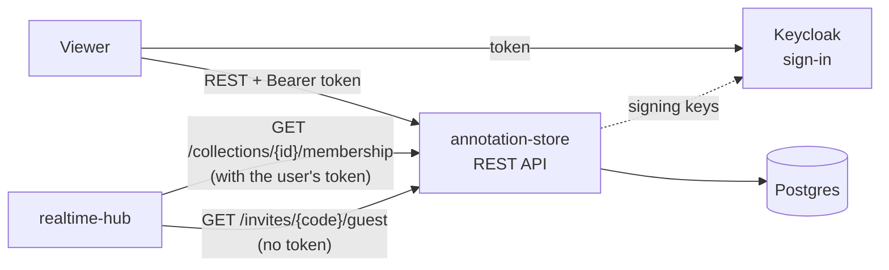
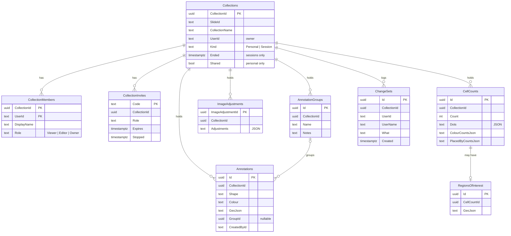
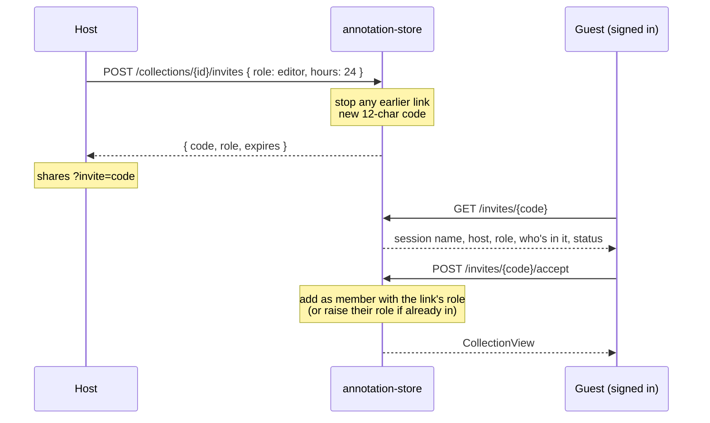
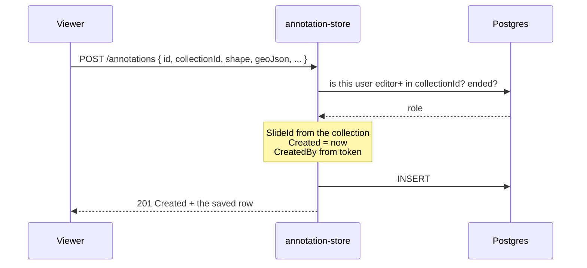
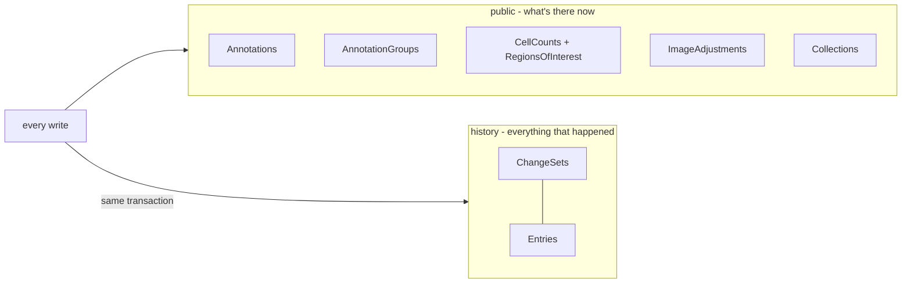
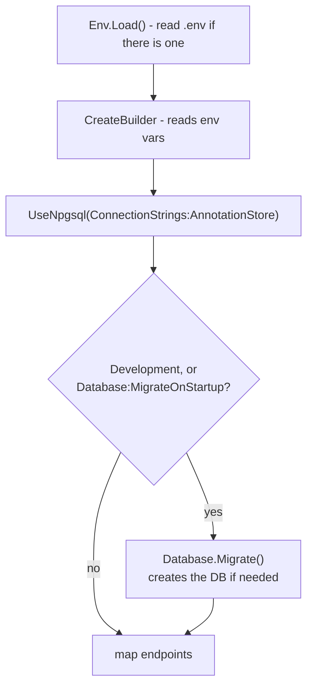

# annotation-store breakdown

annotation-store is the one place anything gets saved. Annotations, cell
counts, image adjustment presets, collections, who's in a session and invite
links all live here, in Postgres. Every other service is either stateless
(tiler) or only holds things in memory (realtime-hub).

.NET 10 · ASP.NET Core minimal API · EF Core + Npgsql · Postgres 17 ·
Keycloak JWT + guest JWT · port 5252

Every endpoint and field is listed in
[annotation-store/README.md](../../annotation-store/README.md). This page
explains how it all fits together.

## Contents

1. [Where it sits](#1-where-it-sits)
2. [Files](#2-files)
3. [The data model](#3-the-data-model)
4. [Collections - personal and session](#4-collections---personal-and-session)
5. [Who can do what](#5-who-can-do-what)
6. [Invite links](#6-invite-links)
7. [Saving an annotation](#7-saving-an-annotation)
8. [Cell counts and big payloads](#8-cell-counts-and-big-payloads)
9. [The Saved lists - paging, search, filters](#9-the-saved-lists---paging-search-filters)
10. [Groups and bulk changes](#10-groups-and-bulk-changes)
11. [History and change sets](#11-history-and-change-sets)
12. [Export and import](#12-export-and-import)
13. [Migrations and startup](#13-migrations-and-startup)
14. [Tests](#14-tests)
15. [Known gaps](#15-known-gaps)
16. [Glossary](#16-glossary)

## 1. Where it sits



- The **viewer** calls it directly for everything it loads and saves.
- The **realtime hub** asks two things. Is this person in this session, and
  is it still going? It passes on the user's own token (a guest's too), so
  the store answers exactly as it would for the viewer. And, before making a
  guest token, is this invite code still open?
- **Keycloak** is only asked for its public signing keys. Tokens are checked
  locally after that.

The store never calls the hub. Live updates are the viewer's job - it saves
here, then tells the hub (see
[realtime-hub.md](realtime-hub.md#6-drawing-an-annotation)).

## 2. Files

| File | What it does |
| ---- | ------------ |
| [Program.cs](../../annotation-store/Program.cs) | Startup, then the annotation, cell count and image adjustment endpoints. Loads `.env`, registers EF Core, Keycloak auth, CORS, JSON enum names and OpenTelemetry, and runs migrations on startup in Development. |
| [Collections/CollectionEndpoints.cs](../../annotation-store/Collections/CollectionEndpoints.cs) | Every collection, session, member and invite endpoint, plus sharing, export and import. The biggest file. |
| [Collections/CollectionAccess.cs](../../annotation-store/Collections/CollectionAccess.cs) | `RequireAsync` - the one check every endpoint uses: are you a member (or is it someone's shared collection), is your role high enough, has the session ended. |
| [Collections/Collections.cs](../../annotation-store/Collections/Collections.cs), [CollectionMember.cs](../../annotation-store/Collections/CollectionMember.cs), [CollectionInvite.cs](../../annotation-store/Collections/CollectionInvite.cs) | The collection, member and invite tables, plus the `CollectionRole` and `CollectionKind` enums. |
| [Annotations/Annotation.cs](../../annotation-store/Annotations/Annotation.cs) | The annotation table. |
| [Annotations/AnnotationGroup.cs](../../annotation-store/Annotations/AnnotationGroup.cs), [AnnotationGroupEndpoints.cs](../../annotation-store/Annotations/AnnotationGroupEndpoints.cs) | Groups of annotations, and the group, merge, bulk update and bulk delete endpoints. |
| [Annotations/AnnotationDbContext.cs](../../annotation-store/Annotations/AnnotationDbContext.cs) | The EF Core context: keys, indexes, cascades, the history schema, the save that writes history with every change, and a SQLite-only date converter for the tests. |
| [History/](../../annotation-store/History) | The history area (see [section 11](#11-history-and-change-sets)): `ChangeSet.cs` (the change set and entry tables), `HistoryLog.cs` (writes history from every save, and rebuilds rows from it), `AnnotationBulk.cs` (bulk annotation changes with their history), `ChangeSets.cs` (the `Change-Set-Id` header every write goes through, and the list and restore endpoints). |
| [CellCounts/CellCount.cs](../../annotation-store/CellCounts/CellCount.cs), [RegionOfInterest.cs](../../annotation-store/CellCounts/RegionOfInterest.cs) | The cell count table and its optional ROI box. |
| [CellCounts/CellCountSummary.cs](../../annotation-store/CellCounts/CellCountSummary.cs) | Works out each count's per-colour and per-person totals from its dots, once, when it's saved. |
| [ImageAdjustments/ImageAdjustments.cs](../../annotation-store/ImageAdjustments/ImageAdjustments.cs) | Saved brightness / contrast / colour presets. |
| [Paging/Paging.cs](../../annotation-store/Paging/Paging.cs) | Paging, search, filters and facets for the viewer's Saved lists. |
| [Auth/KeycloakAuth.cs](../../annotation-store/Auth/KeycloakAuth.cs) | JWT bearer setup, the issuer check, and `UserId()` / `DisplayName()` helpers. |
| [Auth/GuestAuth.cs](../../annotation-store/Auth/GuestAuth.cs) | The second scheme, for guest tokens from realtime-hub, the policy that lets them onto a few reads, and `IsGuest()` / `GuestSessionId()`. |
| [Migrations/](../../annotation-store/Migrations) | 19 EF Core migrations, from `InitialCreate` to `SoftDeleteAndChangeSets`. |
| [Tests/](../../annotation-store/Tests) | 177 tests, nearly all integration tests on in-memory SQLite, or Postgres when asked (see [section 14](#14-tests)). |

## 3. The data model



Collections also have `Deleted` (timestamptz, null until it's deleted) -
left off the diagram to keep it readable. Nothing else does: what changed,
and every row that was deleted, is in the `history` schema - see
[section 11](#11-history-and-change-sets).

A few rules that run through all of it:

- **Everything belongs to a collection.** Every annotation, cell count and
  preset has a `CollectionId`. That's the unit permissions are checked on.
- **The live tables only hold what's there now.** A delete takes the row
  out, and its history entry keeps the whole of it, so it can be put back.
  Deleting a collection only marks the collection - what's in it is left
  alone, and unreachable because nobody's role counts there any more. See
  [section 11](#11-history-and-change-sets).
- **`SlideId` is copied, never trusted.** Each row also stores its slide id
  so queries don't have to join back to the collection. On create it's
  taken from the collection, not from the request, so it can't drift.
- **Who saved it comes from the token.** `CreatedById` and `CreatedByName`
  are set from the token's `sub` and `name`, never the body. Rows from before
  sign-in existed have them empty.
- **Ids can come from the client.** The viewer makes ids with
  `crypto.randomUUID()` so it can send the realtime op straight away with
  the same id. If none is sent, the server makes one.
- **Shapes and dots are JSON text.** `GeoJson`, `Dots` and `Adjustments` are
  plain text columns. The store never looks inside them (apart from the
  dot summary, see [section 8](#8-cell-counts-and-big-payloads)), so the
  viewer can change their shape without a migration.
- **Mostly fixed once saved.** `PUT` only changes label, notes, colour (and
  for counts, the toggles, count and dot size). Geometry, dots and location
  are set once.
- **Enums as words.** Roles, kinds and statuses go over the wire as
  `"editor"` rather than `1`, and are stored as text so the tables read
  plainly in pgAdmin.

## 4. Collections - personal and session

A collection is someone's workspace on one slide. There are two kinds:

| | Personal | Session |
| - | -------- | ------- |
| Made by | Automatically, on first opening a slide (`POST /collections/ensure`) | Someone pressing start (`POST /sessions`) |
| How many | One per person per slide - enforced by a filtered unique index | One not ended per host per slide - `POST /sessions` gives back the one you have (409). Checked in the endpoint, not an index, since older data can have more |
| Who's in it | Only you - though you can share it read-only with everyone | The host, plus anyone who opens an invite link |
| Realtime | No - the viewer doesn't connect | Yes - the hub room id is the collection id |
| Ending | Can't be ended | Host ends it. It goes read-only and its links stop, but it's kept to look back at |

`GET /collections?slideId=` lists everything you're in on that slide: your
own first, then sessions still going (newest first), then ended ones, then
anyone else's shared collections (by owner). Each comes back as a
`CollectionView` with your role and the member list, so the viewer can show
who's in it without asking Keycloak, plus how many annotations and cell
counts it has and when one was last added - the outline the viewer's
Collections tab shows.

### Sharing a personal collection

`PUT /collections/{id}/sharing { shared }` - owner only, personal only. A
shared one turns up in everyone's list for that slide with `myRole: viewer`,
and `RoleAsync` counts anyone signed in as a viewer of it, without adding
them as a member. So every read works for them and every write is a 403.
Turning it off is a 404 for them again. The hub's membership check doesn't
follow this - a personal collection has no room anyway.

The thinking behind personal vs session is in
[thought-process.md](../thought-process.md#collections).

### Ensure, not create

The viewer calls `POST /collections/ensure` every time it opens a slide. If
you already have a personal collection there it's returned (and your display
name updated if it changed in Keycloak), otherwise one is made. The unique
index on `(SlideId, UserId) WHERE Kind = 'Personal'` means two tabs racing
can't make two. The one that loses gets the other's back rather than a 500:
the insert fails on the index, so it reads the one that was just made. The
viewer's first load of a slide can send two at once, so this happens for
real. A Postgres-only test (`EnsuresAtTheSameMoment_AllGetTheOneCollection`)
sends 20 together; without the catch it fails.

## 5. Who can do what

Roles are ordered, so "at least editor" is a simple comparison:

```
Viewer < Editor < Owner
```

| Role | Read | Add / change / delete | Manage people and links | End / delete |
| ---- | ---- | --------------------- | ----------------------- | ------------ |
| Viewer | ✓ | | | |
| Editor | ✓ | ✓ | | |
| Owner (host) | ✓ | ✓ | ✓ | ✓ |

Every endpoint goes through one helper:

```csharp
db.RequireAsync(collectionId, user, CollectionRole.Editor)
```

It returns `null` to carry on, or the response to send:

- **Not a member - 404**, not 403, so it doesn't give away that the
  collection exists. Someone else's shared personal collection counts as
  being a viewer.
- **Role too low - 403.**
- **Session ended - 409** "This session has ended", but only for writes.
  Reading an ended session still works.

For annotations and counts, update and delete look the row up first and
check against _its_ collection, so you can't edit something by sending its id
with a collection you do have access to.

Other rules from the endpoints:

- There's only ever one owner. You can't make someone else owner, change
  your own role, or be taken out.
- Anyone can leave (`DELETE .../members/{yourId}`). Only the host can take
  someone else out.
- Image adjustment presets are personal - the viewer keeps them in your own
  collection, not the session's.

### Guests

Someone without an account can join a session from its invite link as a
guest - always view only. The name they type is never saved: it isn't in
their token, and this service never sees it. The whole flow and contract is
in [guests.md](../guests.md).

- **A second scheme.** `Auth/GuestAuth.cs` adds a `Guest` JWT scheme
  alongside Keycloak's: HS256, signed with `GuestTokens:SigningKey` (shared
  with realtime-hub, which makes the tokens), issuer `realtime-hub`, audience
  `diss-guest`, in date. It also turns down a token without a `guest-` id, a
  `guest_session` guid, or with a `name` claim.
- **Keycloak only by default.** The fallback policy only tries Keycloak, so a
  guest token is a 401 on every endpoint unless it's marked `AllowGuests()`.
  Only these are: `GET /collections?slideId=`, `/collections/{id}/membership`,
  `/annotations` (and `/total`, `/facets`), `/cellcounts` (and `/total`,
  `/facets`, `/{id}`) and `/annotationgroups`. Every write, presets, exports
  and invites stay out of reach.
- **Same check as everyone.** `RoleAsync` gives a guest Viewer on the session
  in their token, if it's a session, and nothing on anything else - so
  `RequireAsync` is still the one place access is decided. A personal
  collection is a 404 for a guest, even a shared one.
- **No member row, ever.** A guest is never looked up in or added to
  `CollectionMembers`. `GET /collections` hands them their session with
  `myRole: viewer` and the real members; `/membership` answers Viewer for the
  hub.

## 6. Invite links



- **One working link per session.** Making a new one stops the old one.
  `PUT` on a link changes its role and expiry in place, keeping the code, so
  a link already shared still works.
- **The code is the secret.** 9 random bytes, base64url - 12 characters,
  72 bits. Nothing else stands between a link and the session.
- **Up to a week.** `hours` is 1 to 168.
- **Status** is worked out on read, in order: `ended` (session over),
  `stopped` (host stopped it), `expired`, else `open`. Accepting anything but
  `open` is a 410 Gone.
- **Can't invite an owner.** Links are viewer or editor only.
- **An edit link lets in a few editors.** The first `MaxEditors` people
  who can edit, the host included, are all an edit link lets in as editors
  - whatever the host picked when they started it (1 to 50,
  `POST /sessions { maxEditors }`, the viewer's box starts at its
  `maxEditors` option), or 6 if nothing was sent. Saved on the session's
  row. After that
  it lets people in view only, and the preview's `joinsAs` says so before
  they accept. It only limits joining: the host can still make anyone an
  editor, and nobody already editing is moved down. Someone leaving or
  being made view only lets the next person through the link edit again.
  Joins take a row lock on the session first, so two people can't both
  take the last place. Rules in
  [SessionSize.cs](../../annotation-store/Collections/SessionSize.cs).
- **Accepting twice is fine.** Someone already in keeps whichever role is
  higher.
- **Or as a guest.** `GET /invites/{code}/guest` needs no sign-in. It's
  what someone without an account sees first, and what realtime-hub checks
  before making them a guest token: `{ collectionId, slideId,
  collectionName, hostName, status, expires }` - no role, no people. See
  [Guests](#guests).

## 7. Saving an annotation



Cell counts and presets follow the same shape. Update and delete look the
row up, check its collection, then change it.

## 8. Cell counts and big payloads

A cell count is someone clicking on every cell of a kind (e.g. mitotic
figures) in an area. Each click is a dot, and every dot is kept so the count
can be redrawn later.

```
Dots: [{"x":123,"y":456,"colour":"#fff614"},
       {"x":130,"y":470,"colour":"#fff614","placedBy":{"userId":"...","name":"Alice"}}, ...]
```

`placedBy` only appears on dots from a shared count. It's inside the JSON,
which the store doesn't otherwise read, so adding it needed no migration.

### Large counts

Stress tests (see [scripts.md](scripts.md)) put up to a million dots on one
count. At about 60 bytes a dot, that's ~60MB in one request.

- **Upload limit.** Kestrel's default 30MB body limit capped counts at
  ~495k dots. `POST /cellcounts` alone is raised to 80MB. Everything else
  keeps the default.
- **Lists don't send dots.** `GET /cellcounts` selects every column but
  `Dots`, so Postgres never even reads them for a list. Each row instead
  has `colourCounts` (how many dots of each colour, for the swatch) and
  `placedByCounts` (how many each person placed, for "counted by").
- **Summaries worked out once.** `CellCountSummary.Stamp` reads the dots on
  save and stores both summaries as JSON on the row. Counts saved before this
  existed get stamped the first time they're listed, and kept.
- **Dots on demand.** `GET /cellcounts/{id}` returns one count with its dots
  and ROI box, for when the viewer actually draws it.

The summaries keep dots in the order they first turn up, the same as the
viewer's own `colourBreakdownFromDots`, so a list row and a drawn count agree.

### Region of interest

A count can be limited to a box (`WithRoi`). The box is its own table, one
to one with the count (unique index on `CellCountId`), saved in the same
request and fixed once made.

## 9. The Saved lists - paging, search, filters

The viewer's Saved tab can't load thousands of rows at once, so both lists
are paged on the server.

```
GET /annotations?collectionId=…&skip=40&take=20&search=tumour&shape=polygon&colour=#ff0000
GET /annotations/total?collectionId=…&search=tumour&shape=polygon&colour=#ff0000
GET /annotations/facets?collectionId=…
```

- **Leave everything out and you get the lot.** That's what the map still
  loads to draw every annotation.
- **Newest first, id breaks ties.** Rows saved in the same instant would
  otherwise swap between pages.
- **`take` is 1 to 500.** Bad values are a 400. Page size is the viewer's
  choice, the cap just stops silly requests.
- **Search** matches label, notes and (for annotations) shape, ignoring
  case. It becomes `strpos` in SQL, so `%` and `_` are matched literally.
- **Filters** - `createdBy`, `shape`, `colour`, `otherThan`, `group`,
  `hasNotes`, `withRoi`, `from`, `to`. Repeatable ones match any. `group` is
  group ids, or `none` for annotations not in one. `colour` and
  `otherThan` together mean "these colours, or anything not on the palette",
  which is how the viewer's Custom colour option works. Colour is matched
  ignoring case, because the palette saves upper case and the picker lower.
- **`/total`** takes the same search and filters, for the page count.
- **`/facets`** lists what there is to filter by: authors (with counts,
  folded together if someone changed their name) and, for annotations,
  colours (most used first).

## 10. Groups and bulk changes

A group is a named set of annotations inside one collection - one level, and
an annotation is in at most one (`GroupId`, nullable). Groups have the same
access as their collection.

- **A group has to be in the same collection.** `POST /annotations` and the
  bulk update both turn down a group from somewhere else with a 400.
- **Deleting a group keeps its annotations.** They're ungrouped first, each
  with an update in the history, so putting the group back puts them back in
  it. The foreign key is `SET NULL` as well.
- **Merge** (`POST /annotationgroups/{id}/merge { intoId }`) moves everything
  across and deletes the old group in one transaction, joining the notes.
  The group's delete entry says where it went (`MergedInto`), so an
  annotation deleted before the merge and put back after lands in `intoId`.
- **Bulk update and delete** (`PUT /annotations/bulk`,
  `POST /annotations/bulk-delete`) take a list of ids, up to 20,000, and only
  touch the ones in the collection given - the count that comes back says how
  many. They go through `AnnotationBulk`: the before values in one query, the
  change in one statement (`ExecuteUpdate` / `ExecuteDelete`), and the
  history in one `COPY` - see section 11 for how long 20,000 take.
- **Undo is a restore.** The viewer sends a bulk delete straight away, with
  one `Change-Set-Id` across all its batches, and its Undo is
  `POST /changesets/{id}/restore`.

## 11. History and change sets

Version control's first two steps (see [todo.md](../todo.md#1-version-control)):
a change set for every write, and a history of what each one did, kept in a
schema of its own apart from the data. [version-control.md](version-control.md)
follows it across the store, the viewer and the hub.



- **A change set is one change, like a commit.** Every write to annotations,
  groups, cell counts, image adjustments, an import or a collection delete
  goes in one (`ChangeSetAsync` in `History/ChangeSets.cs`). The client can
  send `Change-Set-Id` to choose it - the viewer does for anything sent in
  batches - or leave it out and get a new one. Either way it comes back in
  the response's `Change-Set-Id` header (let through CORS so the browser can
  read it).
- **Who and what.** A change set row has who made it (from the token), what
  the first request did (`delete annotations`, `merge groups`, `import`...)
  and when. It's one person in one collection - an id already used by
  someone else, or in another collection, is a 400. Made once access and
  validation have passed, before anything changes, so a turned-down write
  leaves no change set behind.
- **Batches at the same moment.** The viewer sends every batch at once, so
  two can try to make the same change set together. The second insert fails
  on the primary key and reads the first one's instead
  (`BatchesSentAtOnce_StillMakeOneChangeSet`, Postgres only).
- **An entry is what one change did to one row** (`history.Entries`). A
  delete keeps the whole row in `Before`; an update keeps just the columns
  that changed, before and after; a create keeps nothing, since the live
  row has it or a later delete will. So a 20,000-annotation recolour is
  20,000 small entries, not 20,000 copies of their GeoJSON.
- **Written with every save, without being asked.** `AnnotationDbContext`
  overrides `SaveChanges`: `HistoryLog.Capture` reads EF's change tracker
  for annotations, groups, cell counts, ROIs and image adjustments, and the
  entries are written in the same transaction as the change. A versioned row
  changing outside a change set throws, so a new endpoint can't forget. The
  cell count summary columns, stamped when a list first needs them, don't
  count as a change.
- **Bulk changes write their own.** Up to 20,000 annotations at once would be
  slow through the tracker, so `AnnotationBulk` reads the before values in
  one query, changes the rows in one statement and writes the history in one
  `COPY` (`HistoryLog.WriteAsync`). On SQLite, in the tests, the history goes
  through EF instead.
- **The live tables only hold what's there now.** No `Deleted`, no query
  filter - a delete takes the row out, and everything reading the table sees
  only what's live without having to remember. A deleted row is gone to the
  API: changing, deleting, merging into or putting an annotation in one is a
  404 or 400, same as one that never existed.
- **A collection is the exception.** Deleting one sets `Collections.Deleted`
  and logs a delete entry, but leaves it and everything in it where they are
  - it holds the lot, and its owner can bring it back. A query filter keeps
  it out of every read, and nobody's role counts in it, so membership, reads
  and writes are 404. Its links stop. The personal-collection unique index
  only counts ones that aren't deleted, so `POST /collections/ensure` makes
  a fresh one.
- **Restore** (`POST /changesets/{id}/restore`) puts it back how it was
  before that change, in one transaction:
  - every row it deleted comes back from its entry, unless it's back already
  - every column it changed on a row that's still here goes back - only if
    it's still what that change made it, so a later edit is never undone
  - so a deleted group comes back with what was in it, a merged one takes
    back what was moved, and a recolour is undone
  - an annotation whose group has gone since comes back ungrouped, or in the
    group it was merged into
  - it's rollback rather than undo: any editor can do it, for anyone's
    change, and it's a change of its own with its own entries
  - turned down for a viewer (403), someone not in the collection (404) and
    an ended session (409)
- **Restoring a collection** is the owner's alone, since nobody's role
  counts while it's deleted. A personal one can't come back while its owner
  has a newer one for that slide (409) - delete the newer one first.
- **`GET /changesets?collectionId=`** lists a collection's change sets,
  newest first, paged like the Saved lists, each with how many rows it
  deleted that still aren't back. A row put back and deleted again by a later
  change counts as that later change's - and putting the earlier one back
  leaves it alone, since that would undo the later delete. It can be narrowed
  to who made it, the kind of change (`ChangeKinds` - add, change, delete,
  merge, import, restore, worked out from `What`) and when, and turned round
  with `order=oldest`. `GET /changesets/total` is how many match, for the
  pager; `GET /changesets/facets` who's made changes and how many of each
  kind. Guests can read all three. The viewer's History tab is built
  on these (see [image-viewer.md](image-viewer.md)).
- **`GET /changesets/{id}/changes`** says what one change did, for the
  History tab's detail page (`History/ChangeSetChanges.cs`). Every column it
  changed, grouped by column, from and to - a recolour of 48 annotations
  from red to blue is one, with a count and the first few rows' names - and
  what it deleted, by name. It only reads the update entries and, for the
  deletes, the name out of each copy in SQL (`->>` on Postgres,
  `json_extract` on SQLite), never the whole copy - a deleted cell count can
  be megabytes of dots. Group ids come back with names, gone groups'
  included, from their deletes.
- **How long 20,000 take.** Postgres 17 in Docker on a dev laptop, 20,000
  freehand annotations of 120 points: a recolour about 1.5-2s, a delete
  2.5-3s, putting the delete back about 5s, listing the change sets 0.2-1s.
  Putting back is the slowest because it writes 60MB of rows back into the
  table - on Postgres they're rebuilt from their entries in the database
  (`jsonb_populate_record`), not sent through the app. Soft delete flipped a
  column instead, which was quicker; keeping deleted rows out of the live
  tables is what costs it.
- **The migration** (`HistoryArea`) turned every soft-deleted row into a
  delete entry, from Postgres' own `to_jsonb` of the row - the same shape
  `HistoryLog` writes - then took them out of the live tables and dropped
  `Deleted` and `DeletedIn`. Its `Down` puts them back, hidden. Tested both
  ways in `HistoryMigrationTests` (Postgres only).

What this doesn't do yet, and why:

- **A restore can't be put back.** It reverts deletes and updates; the
  creates a restore makes aren't undone by putting the restore back.
- **A column added later.** An old delete's copy of a row won't have a
  column added since. `Rebuild` leaves it at its default; the Postgres path
  leaves it null, so a new non-null column needs a default.
- **Nothing is purged.** History stays for good. A retention rule comes with
  the privacy question in
  [todo.md](../todo.md#things-to-decide-before-building).
- **Not logged:** renaming a collection, sharing, ending a session, members
  and invite links. They aren't the data being versioned.

## 12. Export and import

- **`GET /collections/{id}/export`** - the collection's annotations, cell
  counts (dots and ROI included) and groups, each its own query without
  tracking. The viewer turns it into GeoJSON. Anyone who can read the
  collection can export it.
- **`POST /collections/{id}/import`** - editors and the owner. Takes
  annotations and cell counts already turned into rows by the viewer, plus
  which belong in which group by name. Stamped as the caller, the same as a
  normal save, and saved in one `SaveChanges`, so it all goes in or none of
  it does. Groups are matched by name, made if missing, and their notes added.
- **`GET /collections/{id}`** loads everything with split queries. As one
  query it was a row for every member x annotation x count x preset, each
  repeating the GeoJSON and dots - exports took over a minute.

## 13. Migrations and startup



- **Connection string** comes from `ConnectionStrings__AnnotationStore`.
  Locally that's in a gitignored `.env`; in Docker or Azure it's a real
  environment variable. Same key either way, no code change.
- **Migrations run on startup** in Development, or anywhere with
  `Database__MigrateOnStartup=true` (the Docker image sets it). A fresh
  pull with schema changes just works.
- **`dotnet ef`** doesn't go through `Program.cs`, so it won't see `.env`.
  Export the variable in your shell first if you need to run it against a
  non-default database.

The 20 migrations tell the story of the project: annotations, then notes,
cell counts, ROI, dots, image adjustments, collections, members, created-by,
sessions, cell count summaries, the default colour moving onto the palette,
sharing a personal collection, groups, group notes, session sizes, soft
delete with change sets, and then the history schema that replaced soft
delete.

## 14. Tests

[Tests/](../../annotation-store/Tests) boots the real app with
`WebApplicationFactory` and calls it over HTTP. Two things are swapped:

- **SQLite in memory instead of Postgres.** Fast and needs nothing
  installed. SQLite can't sort `DateTimeOffset`, so `AnnotationDbContext`
  stores dates as UTC ticks there only. The partial unique index is plain
  SQL both databases accept.
- **A fake auth handler instead of Keycloak.** Tests pick who they are with a
  header. Guest tests send real HS256 tokens (`Tests/GuestTokens.cs`) through
  the real Guest scheme - the fake handler stands aside for any request with
  an `Authorization` header, as Keycloak would for a guest token.

Set `ANNOTATION_STORE_TEST_POSTGRES` to a Postgres connection string and the
same tests run on Postgres instead. Each test class gets a database of its
own (`annotationstore_test_<guid>`), built from the real migrations and
dropped afterwards. That catches what SQLite can't: the migrations
themselves, Npgsql's SQL, and requests at the same moment (`[PostgresFact]`
tests, skipped on SQLite). Test classes run in parallel, each with its own
pool, so each database is held to 8 connections (`PoolSizePerDatabase` in
`CellCountApiFactory`) - a stock Postgres, like CI's, takes 100, and a burst
test opening one per request ran out. `PostgresPoolTests` fails if adding a
test class would take them past it.

| File | Tests | Covers |
| ---- | ----- | ------ |
| AnnotationsTests | 10 | CRUD, server-set fields, access |
| AnnotationGroupsTests | 10 | Groups, bulk update and delete, merge, viewers turned down, import into groups |
| CellCountRegionOfInterestTests | 10 | ROI saved with the count, 1:1, deleted with it and put back with it |
| CellCountSummaryTests | 14 | Colour and placed-by totals, old rows stamped on list |
| CollectionsTests | 19 | Ensure (and ensures at the same moment), rename, delete (hides it, keeps what's in it), personal uniqueness, sharing, export, import |
| SessionsTests | 15 | Start, invite, accept, roles, end, 404 vs 403 vs 409 |
| SessionSizeTests | 15 | How many editors an edit link lets in |
| GuestAccessTests | 24 | Guests read their session, 404 elsewhere, 401 on every write and bad token, no member rows, the guest invite preview |
| GuestAuthTests | 7 | Signing key checks, what counts as a guest token |
| ImageAdjustmentsTests | 10 | Presets CRUD and access |
| PagingTests | 21 | Skip/take, tie-breaking, search, every filter, facets |
| KeycloakAuthTests | 7 | Issuer check accepts any host, only the right realm |
| PostgresPoolTests | 1 | Every test class's connections fit in a stock Postgres |
| HistoryTests | 38 (46 with the cases) | A delete leaves the live table and keeps the whole row, an edit keeps only what changed, a create copies nothing, saving what's there isn't a change, nothing versioned changes outside a change set, no history columns on the live tables. Batches in one change set (and at the same moment, Postgres only), restore - its own change set only, editors only, collections by their owner, answers with the rows, a group back with what was in it, a recolour undone but never a later edit, a count back with its dots and ROI, an annotation following a merged group, ten restores at once putting it back once (Postgres only). What a change did - an edit's from and to by name, a recolour as one line with a count, groups by name, deletes by name, adds counted. A row deleted again later belongs to the later delete. Narrowing by person, kind and date, oldest first, the facets, which kind each `What` is. Who and what on every write, header rules, the list and total |
| HistoryMigrationTests | 1 | Postgres only: soft-deleted rows become delete entries that rebuild exactly, and go back on the way down |

## 15. Known gaps

- **CORS allows any origin.** Same as the other services - needs a real
  list before deploying.
- **The guest signing key is a dev key.** It's in `appsettings.json` and
  realtime-hub's. Replace it in both before deploying.
- **Guests can't be stopped on one link.** Every invite link lets guests in -
  see [guests.md](../guests.md#not-done).
- **Search is a table scan.** `LOWER(...) LIKE` style matching can't use an
  index. Fine at stress-test sizes so far; a trigram index would be the fix.
- **History is never purged.** Every deleted row is kept whole in
  `history.Entries`, stress test runs included - `clean_stress.py` deletes
  through the API, so `sql/delete_stress_test.sql` clears its copies too.
- **The hub's ops aren't checked against here.** The hub trusts the viewer
  to have saved before broadcasting.
- **Dots are one big blob.** A million-dot count is one 60MB row. Fine to
  save and load whole, but you can't query or page individual dots.

## 16. Glossary

| Term | Meaning |
| ---- | ------- |
| Collection | One person's or one session's workspace on one slide. Everything saved belongs to one |
| Personal collection | Made automatically, one per person per slide, only theirs |
| Session | A collection started to work with others, joined by invite link, live through the hub |
| Shared | A personal collection its owner has let anyone signed in read |
| Group | A named set of annotations in one collection, with notes |
| Host | The owner of a session |
| Member | Someone in a collection, with a role |
| Guest | Someone without an account viewing a session from its invite link. Never a member |
| Role | Viewer (read), Editor (read and write) or Owner (everything) |
| Invite link | A random code that adds whoever opens it to a session with a set role |
| Ended | A session the host has finished - read-only, links stopped, kept |
| Cell count | A tally of clicked dots, one per cell, optionally inside an ROI |
| ROI | Region of interest - the box a count was limited to |
| Summary | Per-colour and per-person dot totals, stored so lists don't need the dots |
| Facets | The authors and colours a Saved list can be filtered by |
| Bulk | Changing or deleting many annotations in one request |
| Change set | One change, like a commit - one request, or several batches sent with the same `Change-Set-Id`. Who, what and when |
| History entry | What one change did to one row, in `history.Entries` - the whole row for a delete, the changed columns before and after for an edit |
| Restore | Putting it back how it was before one change set - what it deleted, and what it changed if nobody's changed it since |
| Soft delete | What step 1 did - marking a row deleted instead of removing it. Replaced by the history schema; only collections are still hidden this way |
| EF Core | Entity Framework Core, .NET's ORM. Maps C# classes to tables and writes migrations |
| Migration | A versioned schema change EF Core can apply to a database |
| JWT | JSON Web Token - the signed access token Keycloak issues |
