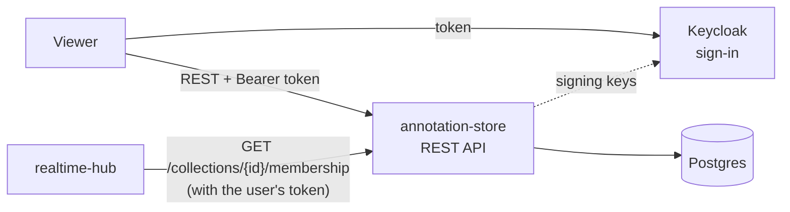
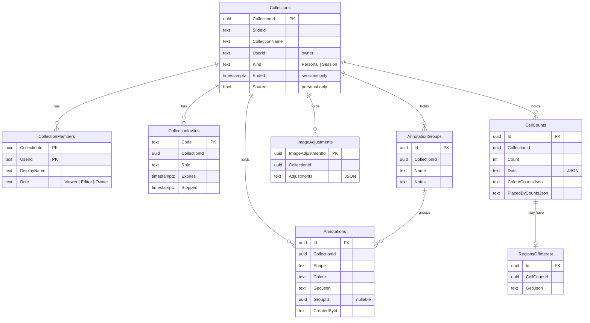
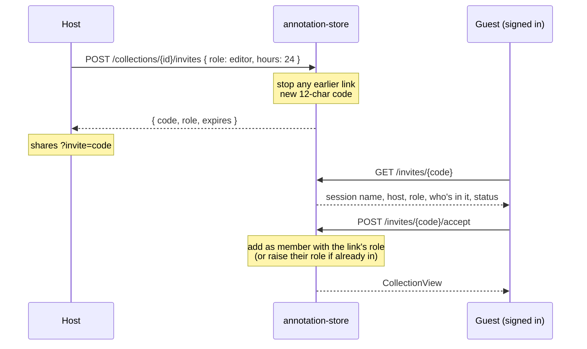
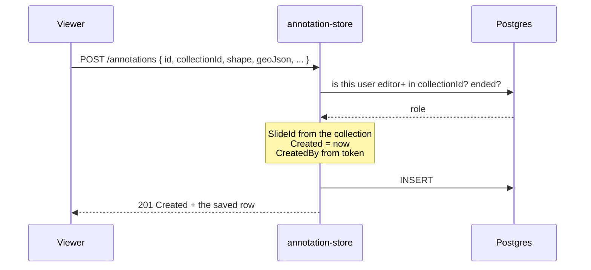
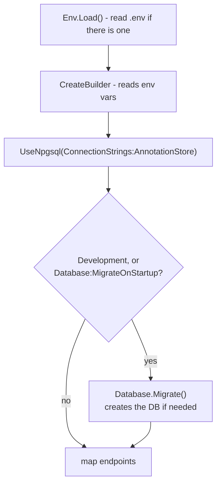

# annotation-store breakdown

annotation-store is the one place anything gets saved. Annotations, cell
counts, image adjustment presets, collections, who's in a session and invite
links all live here, in Postgres. Every other service is either stateless
(tiler) or only holds things in memory (realtime-hub).

.NET 10 · ASP.NET Core minimal API · EF Core + Npgsql · Postgres 17 ·
Keycloak JWT · port 5252

Every endpoint and field is listed in
[annotation-store/README.md](../../annotation-store/README.md). This page
explains how it all fits together.

## Contents

1. [Where it sits](#1-where-it-sits)
2. [Files](#2-files)
3. [The data model](#3-the-data-model)
4. [Collections - personal and session](#4-collections---personal-and-session)
5. [Who can do what](#5-who-can-do-what)
6. [Invite links](#6-invite-links)
7. [Saving an annotation](#7-saving-an-annotation)
8. [Cell counts and big payloads](#8-cell-counts-and-big-payloads)
9. [The Saved lists - paging, search, filters](#9-the-saved-lists---paging-search-filters)
10. [Groups and bulk changes](#10-groups-and-bulk-changes)
11. [Export and import](#11-export-and-import)
12. [Migrations and startup](#12-migrations-and-startup)
13. [Tests](#13-tests)
14. [Known gaps](#14-known-gaps)
15. [Glossary](#15-glossary)

## 1. Where it sits



- The **viewer** calls it directly for everything it loads and saves.
- The **realtime hub** only asks one thing: is this person in this session,
  and is it still going? It passes on the user's own token, so the store
  answers exactly as it would for the viewer.
- **Keycloak** is only asked for its public signing keys. Tokens are checked
  locally after that.

The store never calls the hub. Live updates are the viewer's job - it saves
here, then tells the hub (see
[realtime-hub.md](realtime-hub.md#6-drawing-an-annotation)).

## 2. Files

| File | What it does |
| ---- | ------------ |
| [Program.cs](../../annotation-store/Program.cs) | Startup, then the annotation, cell count and image adjustment endpoints. Loads `.env`, registers EF Core, Keycloak auth, CORS, JSON enum names and OpenTelemetry, and runs migrations on startup in Development. |
| [Collections/CollectionEndpoints.cs](../../annotation-store/Collections/CollectionEndpoints.cs) | Every collection, session, member and invite endpoint, plus sharing, export and import. The biggest file. |
| [Collections/CollectionAccess.cs](../../annotation-store/Collections/CollectionAccess.cs) | `RequireAsync` - the one check every endpoint uses: are you a member (or is it someone's shared collection), is your role high enough, has the session ended. |
| [Collections/Collections.cs](../../annotation-store/Collections/Collections.cs), [CollectionMember.cs](../../annotation-store/Collections/CollectionMember.cs), [CollectionInvite.cs](../../annotation-store/Collections/CollectionInvite.cs) | The collection, member and invite tables, plus the `CollectionRole` and `CollectionKind` enums. |
| [Annotations/Annotation.cs](../../annotation-store/Annotations/Annotation.cs) | The annotation table. |
| [Annotations/AnnotationGroup.cs](../../annotation-store/Annotations/AnnotationGroup.cs), [AnnotationGroupEndpoints.cs](../../annotation-store/Annotations/AnnotationGroupEndpoints.cs) | Groups of annotations, and the group, merge, bulk update and bulk delete endpoints. |
| [Annotations/AnnotationDbContext.cs](../../annotation-store/Annotations/AnnotationDbContext.cs) | The EF Core context: keys, indexes, cascades, and a SQLite-only date converter for the tests. |
| [CellCounts/CellCount.cs](../../annotation-store/CellCounts/CellCount.cs), [RegionOfInterest.cs](../../annotation-store/CellCounts/RegionOfInterest.cs) | The cell count table and its optional ROI box. |
| [CellCounts/CellCountSummary.cs](../../annotation-store/CellCounts/CellCountSummary.cs) | Works out each count's per-colour and per-person totals from its dots, once, when it's saved. |
| [ImageAdjustments/ImageAdjustments.cs](../../annotation-store/ImageAdjustments/ImageAdjustments.cs) | Saved brightness / contrast / colour presets. |
| [Paging/Paging.cs](../../annotation-store/Paging/Paging.cs) | Paging, search, filters and facets for the viewer's Saved lists. |
| [Auth/KeycloakAuth.cs](../../annotation-store/Auth/KeycloakAuth.cs) | JWT bearer setup, the issuer check, and `UserId()` / `DisplayName()` helpers. |
| [Migrations/](../../annotation-store/Migrations) | 17 EF Core migrations, from `InitialCreate` to `GroupNotes`. |
| [Tests/](../../annotation-store/Tests) | 101 integration tests on in-memory SQLite (see [section 13](#13-tests)). |

## 3. The data model



A few rules that run through all of it:

- **Everything belongs to a collection.** Every annotation, cell count and
  preset has a `CollectionId`, and deleting a collection cascades to all of
  them. That's the unit permissions are checked on.
- **`SlideId` is copied, never trusted.** Each row also stores its slide id
  so queries don't have to join back to the collection. On create it's
  taken from the collection, not from the request, so it can't drift.
- **Who saved it comes from the token.** `CreatedById` and `CreatedByName`
  are set from the token's `sub` and `name`, never the body. Rows from before
  sign-in existed have them empty.
- **Ids can come from the client.** The viewer makes ids with
  `crypto.randomUUID()` so it can send the realtime op straight away with
  the same id. If none is sent, the server makes one.
- **Shapes and dots are JSON text.** `GeoJson`, `Dots` and `Adjustments` are
  plain text columns. The store never looks inside them (apart from the
  dot summary, see [section 8](#8-cell-counts-and-big-payloads)), so the
  viewer can change their shape without a migration.
- **Mostly fixed once saved.** `PUT` only changes label, notes, colour (and
  for counts, the toggles, count and dot size). Geometry, dots and location
  are set once.
- **Enums as words.** Roles, kinds and statuses go over the wire as
  `"editor"` rather than `1`, and are stored as text so the tables read
  plainly in pgAdmin.

## 4. Collections - personal and session

A collection is someone's workspace on one slide. There are two kinds:

| | Personal | Session |
| - | -------- | ------- |
| Made by | Automatically, on first opening a slide (`POST /collections/ensure`) | Someone pressing start (`POST /sessions`) |
| How many | One per person per slide - enforced by a filtered unique index | One not ended per host per slide - `POST /sessions` gives back the one you have (409). Checked in the endpoint, not an index, since older data can have more |
| Who's in it | Only you - though you can share it read-only with everyone | The host, plus anyone who opens an invite link |
| Realtime | No - the viewer doesn't connect | Yes - the hub room id is the collection id |
| Ending | Can't be ended | Host ends it. It goes read-only and its links stop, but it's kept to look back at |

`GET /collections?slideId=` lists everything you're in on that slide: your
own first, then sessions still going (newest first), then ended ones, then
anyone else's shared collections (by owner). Each comes back as a
`CollectionView` with your role and the member list, so the viewer can show
who's in it without asking Keycloak, plus how many annotations and cell
counts it has and when one was last added - the outline the viewer's
Collections tab shows.

### Sharing a personal collection

`PUT /collections/{id}/sharing { shared }` - owner only, personal only. A
shared one turns up in everyone's list for that slide with `myRole: viewer`,
and `RoleAsync` counts anyone signed in as a viewer of it, without adding
them as a member. So every read works for them and every write is a 403.
Turning it off is a 404 for them again. The hub's membership check doesn't
follow this - a personal collection has no room anyway.

The thinking behind personal vs session is in
[thought-process.md](../thought-process.md#collections).

### Ensure, not create

The viewer calls `POST /collections/ensure` every time it opens a slide. If
you already have a personal collection there it's returned (and your display
name updated if it changed in Keycloak), otherwise one is made. The unique
index on `(SlideId, UserId) WHERE Kind = 'Personal'` means two tabs racing
can't make two.

## 5. Who can do what

Roles are ordered, so "at least editor" is a simple comparison:

```
Viewer < Editor < Owner
```

| Role | Read | Add / change / delete | Manage people and links | End / delete |
| ---- | ---- | --------------------- | ----------------------- | ------------ |
| Viewer | ✓ | | | |
| Editor | ✓ | ✓ | | |
| Owner (host) | ✓ | ✓ | ✓ | ✓ |

Every endpoint goes through one helper:

```csharp
db.RequireAsync(collectionId, user, CollectionRole.Editor)
```

It returns `null` to carry on, or the response to send:

- **Not a member - 404**, not 403, so it doesn't give away that the
  collection exists. Someone else's shared personal collection counts as
  being a viewer.
- **Role too low - 403.**
- **Session ended - 409** "This session has ended", but only for writes.
  Reading an ended session still works.

For annotations and counts, update and delete look the row up first and
check against _its_ collection, so you can't edit something by sending its id
with a collection you do have access to.

Other rules from the endpoints:

- There's only ever one owner. You can't make someone else owner, change
  your own role, or be taken out.
- Anyone can leave (`DELETE .../members/{yourId}`). Only the host can take
  someone else out.
- Image adjustment presets are personal - the viewer keeps them in your own
  collection, not the session's.

## 6. Invite links



- **One working link per session.** Making a new one stops the old one.
  `PUT` on a link changes its role and expiry in place, keeping the code, so
  a link already shared still works.
- **The code is the secret.** 9 random bytes, base64url - 12 characters,
  72 bits. Nothing else stands between a link and the session.
- **Up to a week.** `hours` is 1 to 168.
- **Status** is worked out on read, in order: `ended` (session over),
  `stopped` (host stopped it), `expired`, else `open`. Accepting anything but
  `open` is a 410 Gone.
- **Can't invite an owner.** Links are viewer or editor only.
- **Editor places are capped.** A session has at most `MaxEditors` people
  who can edit, the host included - 6 unless the viewer that started it
  asked for another number (1 to 50, `POST /sessions { maxEditors }`), saved
  on the session's row. Once they're full, an edit link lets people in view
  only, the preview's `joinsAs` says so before they accept, and the host
  can't make anyone else an editor (409). Nobody already editing is moved
  down, and someone leaving or being made view only frees a place. Joins
  and role changes take a row lock on the session first, so two people
  can't both take the last place. Rules in
  [SessionSize.cs](../../annotation-store/Collections/SessionSize.cs).
- **Accepting twice is fine.** Someone already in keeps whichever role is
  higher.
- **Still needs signing in.** There are no guest accounts yet - see
  [auth.md](../auth.md#invites).

## 7. Saving an annotation



Cell counts and presets follow the same shape. Update and delete look the
row up, check its collection, then change it.

## 8. Cell counts and big payloads

A cell count is someone clicking on every cell of a kind (e.g. mitotic
figures) in an area. Each click is a dot, and every dot is kept so the count
can be redrawn later.

```
Dots: [{"x":123,"y":456,"colour":"#fff614"},
       {"x":130,"y":470,"colour":"#fff614","placedBy":{"userId":"...","name":"Alice"}}, ...]
```

`placedBy` only appears on dots from a shared count. It's inside the JSON,
which the store doesn't otherwise read, so adding it needed no migration.

### Large counts

Stress tests (see [scripts.md](scripts.md)) put up to a million dots on one
count. At about 60 bytes a dot, that's ~60MB in one request.

- **Upload limit.** Kestrel's default 30MB body limit capped counts at
  ~495k dots. `POST /cellcounts` alone is raised to 80MB. Everything else
  keeps the default.
- **Lists don't send dots.** `GET /cellcounts` selects every column but
  `Dots`, so Postgres never even reads them for a list. Each row instead
  has `colourCounts` (how many dots of each colour, for the swatch) and
  `placedByCounts` (how many each person placed, for "counted by").
- **Summaries worked out once.** `CellCountSummary.Stamp` reads the dots on
  save and stores both summaries as JSON on the row. Counts saved before this
  existed get stamped the first time they're listed, and kept.
- **Dots on demand.** `GET /cellcounts/{id}` returns one count with its dots
  and ROI box, for when the viewer actually draws it.

The summaries keep dots in the order they first turn up, the same as the
viewer's own `colourBreakdownFromDots`, so a list row and a drawn count agree.

### Region of interest

A count can be limited to a box (`WithRoi`). The box is its own table, one
to one with the count (unique index on `CellCountId`), saved in the same
request and fixed once made.

## 9. The Saved lists - paging, search, filters

The viewer's Saved tab can't load thousands of rows at once, so both lists
are paged on the server.

```
GET /annotations?collectionId=…&skip=40&take=20&search=tumour&shape=polygon&colour=#ff0000
GET /annotations/total?collectionId=…&search=tumour&shape=polygon&colour=#ff0000
GET /annotations/facets?collectionId=…
```

- **Leave everything out and you get the lot.** That's what the map still
  loads to draw every annotation.
- **Newest first, id breaks ties.** Rows saved in the same instant would
  otherwise swap between pages.
- **`take` is 1 to 500.** Bad values are a 400. Page size is the viewer's
  choice, the cap just stops silly requests.
- **Search** matches label, notes and (for annotations) shape, ignoring
  case. It becomes `strpos` in SQL, so `%` and `_` are matched literally.
- **Filters** - `createdBy`, `shape`, `colour`, `otherThan`, `group`,
  `hasNotes`, `withRoi`, `from`, `to`. Repeatable ones match any. `group` is
  group ids, or `none` for annotations not in one. `colour` and
  `otherThan` together mean "these colours, or anything not on the palette",
  which is how the viewer's Custom colour option works. Colour is matched
  ignoring case, because the palette saves upper case and the picker lower.
- **`/total`** takes the same search and filters, for the page count.
- **`/facets`** lists what there is to filter by: authors (with counts,
  folded together if someone changed their name) and, for annotations,
  colours (most used first).

## 10. Groups and bulk changes

A group is a named set of annotations inside one collection - one level, and
an annotation is in at most one (`GroupId`, nullable). Groups have the same
access as their collection.

- **A group has to be in the same collection.** `POST /annotations` and the
  bulk update both turn down a group from somewhere else with a 400.
- **Deleting a group keeps its annotations.** They're ungrouped first, and
  the foreign key is `SET NULL` as well.
- **Merge** (`POST /annotationgroups/{id}/merge { intoId }`) moves everything
  across and deletes the old group in one transaction, joining the notes.
- **Bulk update and delete** (`PUT /annotations/bulk`,
  `POST /annotations/bulk-delete`) take a list of ids, up to 20,000, and only
  touch the ones in the collection given - the count that comes back says how
  many. Both are one `UPDATE` / `DELETE` in SQL (`ExecuteUpdate` /
  `ExecuteDelete`), so no rows are loaded.
- **Undo is the viewer's.** A bulk delete from the viewer isn't sent until
  its undo time is up, so there's nothing here to undo.

## 11. Export and import

- **`GET /collections/{id}/export`** - the collection's annotations, cell
  counts (dots and ROI included) and groups, each its own query without
  tracking. The viewer turns it into GeoJSON. Anyone who can read the
  collection can export it.
- **`POST /collections/{id}/import`** - editors and the owner. Takes
  annotations and cell counts already turned into rows by the viewer, plus
  which belong in which group by name. Stamped as the caller, the same as a
  normal save, and saved in one `SaveChanges`, so it all goes in or none of
  it does. Groups are matched by name, made if missing, and their notes added.
- **`GET /collections/{id}`** loads everything with split queries. As one
  query it was a row for every member x annotation x count x preset, each
  repeating the GeoJSON and dots - exports took over a minute.

## 12. Migrations and startup



- **Connection string** comes from `ConnectionStrings__AnnotationStore`.
  Locally that's in a gitignored `.env`; in Docker or Azure it's a real
  environment variable. Same key either way, no code change.
- **Migrations run on startup** in Development, or anywhere with
  `Database__MigrateOnStartup=true` (the Docker image sets it). A fresh
  pull with schema changes just works.
- **`dotnet ef`** doesn't go through `Program.cs`, so it won't see `.env`.
  Export the variable in your shell first if you need to run it against a
  non-default database.

The 17 migrations tell the story of the project: annotations, then notes,
cell counts, ROI, dots, image adjustments, collections, members, created-by,
sessions, cell count summaries, the default colour moving onto the palette,
sharing a personal collection, groups, and group notes.

## 13. Tests

[Tests/](../../annotation-store/Tests) boots the real app with
`WebApplicationFactory` and calls it over HTTP. Two things are swapped:

- **SQLite in memory instead of Postgres.** Fast and needs nothing
  installed. SQLite can't sort `DateTimeOffset`, so `AnnotationDbContext`
  stores dates as UTC ticks there only. The partial unique index is plain
  SQL both databases accept.
- **A fake auth handler instead of Keycloak.** Tests pick who they are with a
  header.

| File | Tests | Covers |
| ---- | ----- | ------ |
| AnnotationsTests | 10 | CRUD, server-set fields, access |
| AnnotationGroupsTests | 10 | Groups, bulk update and delete, merge, viewers turned down, import into groups |
| CellCountRegionOfInterestTests | 10 | ROI saved with the count, 1:1, cascade |
| CellCountSummaryTests | 9 | Colour and placed-by totals, old rows stamped on list |
| CollectionsTests | 18 | Ensure, rename, delete, personal uniqueness, sharing, export, import |
| SessionsTests | 14 | Start, invite, accept, roles, end, 404 vs 403 vs 409 |
| ImageAdjustmentsTests | 10 | Presets CRUD and access |
| PagingTests | 18 | Skip/take, tie-breaking, search, every filter, facets |
| KeycloakAuthTests | 2 | Issuer check accepts any host, only the right realm |

## 14. Known gaps

- **CORS allows any origin.** Same as the other services - needs a real
  list before deploying.
- **No guest access.** Invite links still need a Keycloak account.
- **Search is a table scan.** `LOWER(...) LIKE` style matching can't use an
  index. Fine at stress-test sizes so far; a trigram index would be the fix.
- **No history.** Updates overwrite. There's no audit trail of who changed
  what, only who created it. Deletes are hard deletes, so the viewer's undo
  for a bulk delete has to hold the request back rather than ask for it to
  be undone here.
- **The hub's ops aren't checked against here.** The hub trusts the viewer
  to have saved before broadcasting.
- **Dots are one big blob.** A million-dot count is one 60MB row. Fine to
  save and load whole, but you can't query or page individual dots.

## 15. Glossary

| Term | Meaning |
| ---- | ------- |
| Collection | One person's or one session's workspace on one slide. Everything saved belongs to one |
| Personal collection | Made automatically, one per person per slide, only theirs |
| Session | A collection started to work with others, joined by invite link, live through the hub |
| Shared | A personal collection its owner has let anyone signed in read |
| Group | A named set of annotations in one collection, with notes |
| Host | The owner of a session |
| Member | Someone in a collection, with a role |
| Role | Viewer (read), Editor (read and write) or Owner (everything) |
| Invite link | A random code that adds whoever opens it to a session with a set role |
| Ended | A session the host has finished - read-only, links stopped, kept |
| Cell count | A tally of clicked dots, one per cell, optionally inside an ROI |
| ROI | Region of interest - the box a count was limited to |
| Summary | Per-colour and per-person dot totals, stored so lists don't need the dots |
| Facets | The authors and colours a Saved list can be filtered by |
| Bulk | Changing or deleting many annotations in one request |
| EF Core | Entity Framework Core, .NET's ORM. Maps C# classes to tables and writes migrations |
| Migration | A versioned schema change EF Core can apply to a database |
| JWT | JSON Web Token - the signed access token Keycloak issues |
