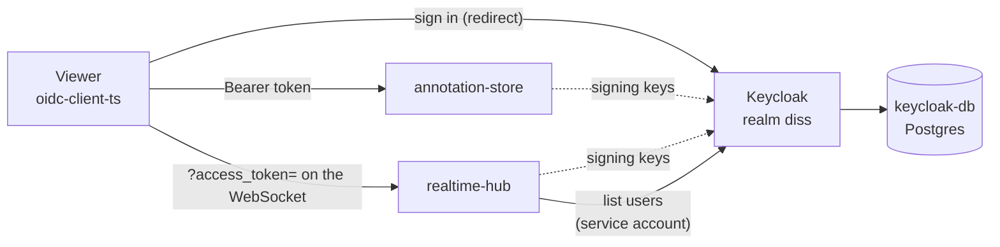
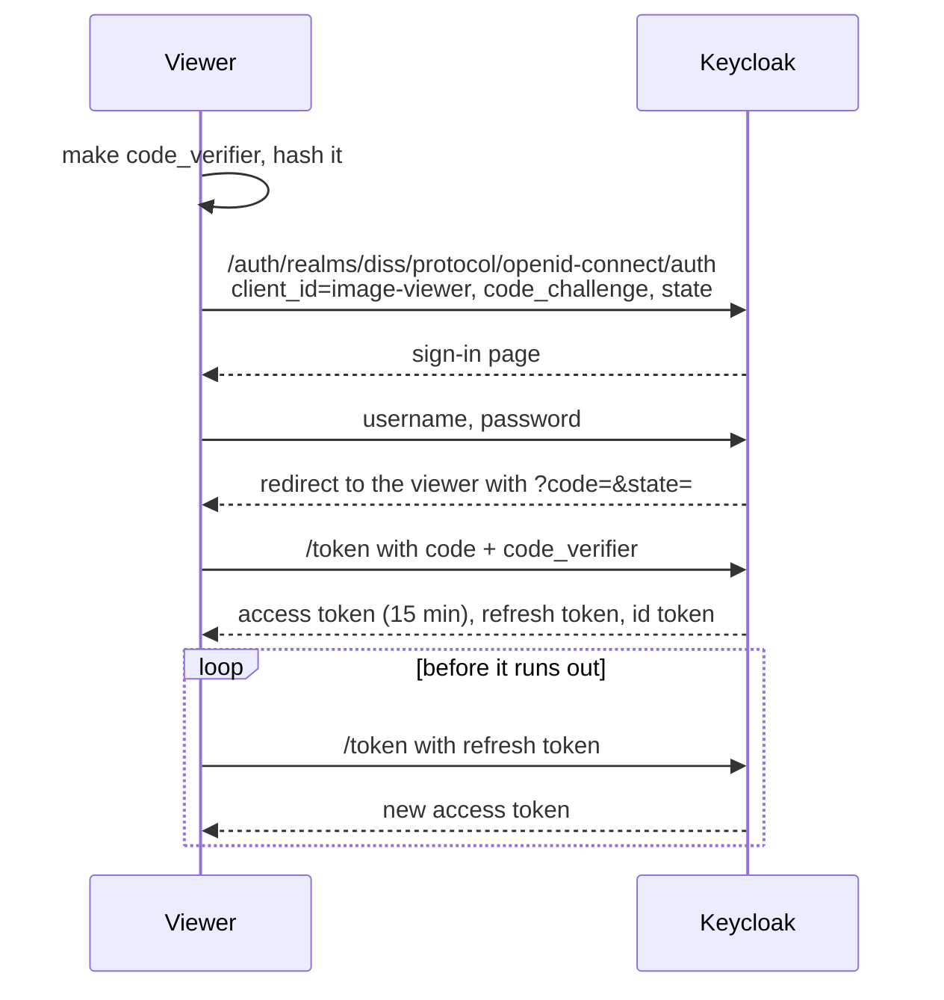
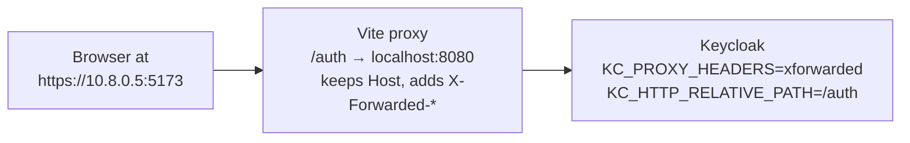
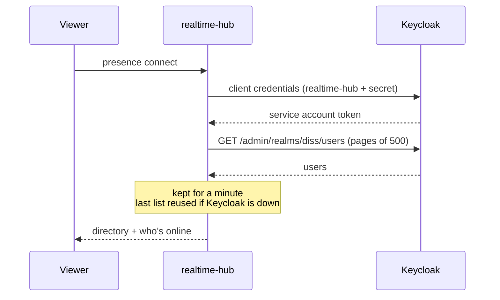

# auth breakdown

Sign-in is handled by Keycloak, an off-the-shelf identity server, run in
Docker. There's no code of our own in [auth/](../../auth) - just the
container setup, the realm (users, clients, settings) as JSON, and a script
for patching an older Keycloak. The code that _uses_ it lives in each
service.

Keycloak 26.3 · its own Postgres 17 · OIDC + PKCE · JWT · port 8080, under
`/auth`

Why Keycloak over Entra, and the plan for guests, are in
[docs/auth.md](../auth.md). Running it is in
[auth/README.md](../../auth/README.md). This page explains how it all fits
together.

## Contents

1. [Where it sits](#1-where-it-sits)
2. [Files](#2-files)
3. [The realm](#3-the-realm)
4. [Signing in](#4-signing-in)
5. [How each service checks the token](#5-how-each-service-checks-the-token)
6. [One address for everything](#6-one-address-for-everything)
7. [The user list](#7-the-user-list)
8. [Who you are vs what you can do](#8-who-you-are-vs-what-you-can-do)
9. [Known gaps](#9-known-gaps)
10. [Glossary](#10-glossary)

## 1. Where it sits

- The **viewer** is the only thing that signs people in.
- **annotation-store** and **realtime-hub** only ever check tokens. They
  fetch Keycloak's public keys once and verify each token's signature
  themselves, so Keycloak isn't asked on every request.
- **realtime-hub** also signs in as itself (a service account) to read the
  user list for the Users tab.

## 2. Files

| File | What it does |
| ---- | ------------ |
| [docker-compose.yml](../../auth/docker-compose.yml) | Keycloak in dev mode plus its own Postgres. Serves under `/auth`, trusts `X-Forwarded-*`, imports the realm on first start. |
| [realm/diss-realm.json](../../auth/realm/diss-realm.json) | The realm as config: settings, both clients, the audience mapper, test users. |
| [add-realtime-hub-client.sh](../../auth/add-realtime-hub-client.sh) | Adds the `realtime-hub` client to a Keycloak that was set up before it existed. Safe to run again. |

The code on each side:

| Where | File |
| ----- | ---- |
| Viewer | [AuthContext.tsx](../../image-viewer/src/context/AuthContext.tsx) |
| annotation-store | [Auth/KeycloakAuth.cs](../../annotation-store/Auth/KeycloakAuth.cs) |
| realtime-hub | [Auth/KeycloakAuth.cs](../../realtime-hub/Auth/KeycloakAuth.cs), [Presence/UserDirectory.cs](../../realtime-hub/Presence/UserDirectory.cs) |

The root [docker-compose.yml](../../docker-compose.yml) includes this one,
so `docker compose up` at the root brings Keycloak up with everything else.

## 3. The realm

A **realm** is Keycloak's word for one separate set of users and apps. Ours
is `diss`.

| Setting | Value | Why |
| ------- | ----- | --- |
| Self sign-up | Off | Accounts are made by hand for now |
| Access token lifespan | 15 minutes | Short, since the viewer renews it in the background |
| SSO idle timeout | 8 hours | A working day without signing in again |
| SSL required | External | Plain http is fine on localhost and the LAN, not from outside |

### Clients

A **client** is an app Keycloak knows about.

| Client | Type | Used by | Notes |
| ------ | ---- | ------- | ----- |
| `image-viewer` | Public (no secret) | The viewer, to sign people in | PKCE (S256). Redirect `/*` and web origin `+`, so it works from any address the viewer is opened on. Adds the `diss-api` audience to its tokens |
| `realtime-hub` | Confidential | realtime-hub, to list users | No sign-in flows. Service account with `view-users` only. Dev secret `realtime-hub-dev-secret` |

A browser app can't keep a secret, so `image-viewer` is public and uses
PKCE instead: the viewer makes a random value, sends a hash of it when
starting sign-in, and the real value when swapping the code for a token, so
a stolen code is no use on its own.

### Test users

`alice` (Alice Moore), `bob` (Bob Hughes) and `carol` (Carol Singh), all
with password `password`. Two or three people is enough to try every
session feature, using "Switch user" in a second tab.

### Import once

The realm file is only imported the first time Keycloak starts. After that
the realm lives in Keycloak's database, and the file is skipped while the
realm exists. So a change to the file needs the realm deleting (or
`docker compose down -v`), or a script like `add-realtime-hub-client.sh`
for an existing setup.

## 4. Signing in

The access token is a JWT. The parts the services use:

| Claim | Example | Used for |
| ----- | ------- | -------- |
| `sub` | `3f2a…` | The user's id. What collections, members and presence key on |
| `name` | `Alice Moore` | Display name everywhere |
| `preferred_username` | `alice` | Fallback name |
| `aud` | `diss-api` | Checked by both services - the token was meant for them |
| `iss` | `https://192.168.1.20:5173/auth/realms/diss` | Checked loosely - see [section 6](#6-one-address-for-everything) |

The viewer side is covered in
[image-viewer.md](image-viewer.md#4-signing-in).

## 5. How each service checks the token

Both .NET services use ASP.NET Core's JWT bearer handler, set up the same
way:

- **Keys** from `Auth:MetadataAddress` - Keycloak's
  `.well-known/openid-configuration`. In Docker this is Keycloak's address
  inside the compose network, not the one the browser used.
- **Audience** must be `diss-api`.
- **Issuer** must end in `/realms/diss` (see below).
- **Claim names kept as Keycloak sends them** (`MapInboundClaims = false`),
  so it's `sub` and `name`, not .NET's long URIs.
- **Every endpoint needs a user** by default (a fallback policy). Only the
  dev API reference and the hub's debug endpoints are open.

The hub has one extra step. Browsers can't add an `Authorization` header to
a WebSocket, so the SignalR client sends the token as `?access_token=` and
the hub reads it from there - only on `/hubs/*` paths, so it can't be used
to sneak a token into anything else.

The user always comes from the token, never from the request body. A client
can't save something as someone else, or join a room as someone else.

## 6. One address for everything

The viewer is opened on different addresses - `localhost`, a LAN IP, a VPN
IP - and Keycloak is reached through the viewer's own dev server at `/auth`.
That causes two problems, and the setup solves both:

1. **Keycloak's links have to point back to the address the browser used**,
   not `localhost:8080`, or the redirect after sign-in goes nowhere. The
   proxy passes the browser's `Host` and adds `X-Forwarded-*`, and Keycloak
   is told to trust them. It's served under `/auth` so the proxy can pass
   paths straight through.
2. **The token's issuer then changes with the address.** A token from
   `https://localhost:5173/auth/realms/diss` and one from
   `https://10.8.0.5:5173/auth/realms/diss` are both real. So the services
   accept any http(s) issuer whose path ends in `/realms/diss`. That's safe
   because the signature is still checked against the realm's own keys -
   a token from another Keycloak or realm wouldn't verify.

The viewer's redirect URI is `/*` (relative) for the same reason - no list
of addresses to keep up to date.

Https on the viewer is needed because the browser's crypto (used for PKCE)
only works on https or localhost.

## 7. The user list

The Users tab shows everyone with an account, online or not. Only Keycloak
knows that, so realtime-hub asks it:

- The service account can **only view users** - nothing else in
  `realm-management`.
- The hub only keeps each user's id, username and name - no emails.
- If Keycloak can't be reached the hub uses the last list it had, and if it
  never had one the viewer shows just who's online.
- `GET /users` on the hub (dev only) shows the list, for checking it works.

## 8. Who you are vs what you can do

Keycloak only answers **who you are**. Everything about **what you can do**
is in annotation-store:

| Question | Answered by |
| -------- | ----------- |
| Is this a real, signed-in user? | Keycloak (token signature, audience, realm) |
| What's their id and name? | The token (`sub`, `name`) |
| Are they in this collection? | annotation-store's `CollectionMembers` |
| Can they edit, or only view? | annotation-store's role (viewer / editor / owner) |
| Can they join this live room? | realtime-hub asks annotation-store |

Roles are per session, not global, so they don't belong in Keycloak. See
[annotation-store.md](annotation-store.md#5-who-can-do-what).

## 9. Known gaps

- **Dev mode only.** `start-dev` means plain http inside, no hostname
  locked down, and a slower start. Production needs `start` with a proper
  hostname, a build step (`kc.sh build`) and TLS.
- **Dev passwords everywhere.** `admin` / `admin`, `password` for the test
  users, and the client secret are all in the repo.
- **No guests.** Invite links still need an account. The plan is for the hub
  to mint its own short-lived guest tokens - see [docs/auth.md](../auth.md).
- **Loose issuer check** - safe given the signature check, but a real
  deployment with one address should pin the issuer exactly.
- **Realm changes don't apply themselves** to an existing Keycloak - they
  need a script or a reset.
- **Java and memory.** Keycloak takes 10-30s to start and 512MB-1GB, so it
  can't scale to zero when deployed (see [azure.md](../azure.md)).

## 10. Glossary

| Term | Meaning |
| ---- | ------- |
| Keycloak | Open-source identity server - sign-in, users, tokens |
| Realm | One separate set of users, clients and settings in Keycloak |
| Client | An app Keycloak knows about and issues tokens for |
| Public client | One that can't keep a secret, like a browser app |
| Confidential client | One with a secret, like a server |
| Service account | A client signing in as itself, not as a person |
| OIDC | OpenID Connect - the sign-in standard on top of OAuth 2 |
| PKCE | Proof Key for Code Exchange - stops a stolen sign-in code being used |
| JWT | JSON Web Token - a signed token holding claims about the user |
| Claim | One fact in a token - `sub`, `name`, `aud` |
| Audience (`aud`) | Who a token is meant for. Ours is `diss-api` |
| Issuer (`iss`) | Who made the token - the realm's address |
| Refresh token | A longer-lived token used to get new access tokens without signing in again |
