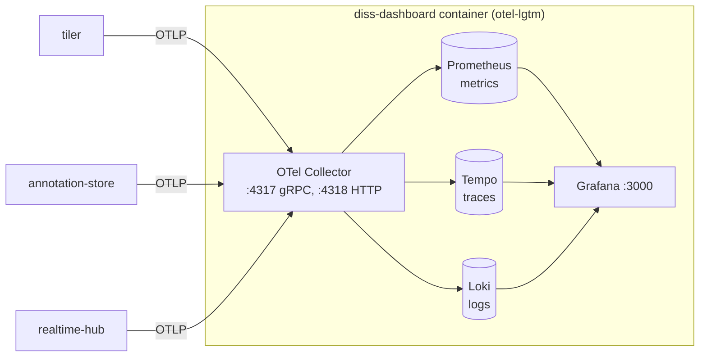

# dashboard breakdown

The dashboard is Grafana in a single Docker container, collecting
telemetry from the .NET services: how many requests, how long they take,
what's failing, and how hard the machine is working. It's how the
performance numbers in [rendering.md](../rendering.md) were found and
checked.

grafana/otel-lgtm (Grafana + Prometheus + Tempo + Loki + OTel Collector) ·
OpenTelemetry · port 3000, OTLP on 4317 / 4318

Running it is in [dashboard/README.md](../../dashboard/README.md). This page
explains how it all fits together.

## Contents

1. [Where it sits](#1-where-it-sits)
2. [Files](#2-files)
3. [Three kinds of telemetry](#3-three-kinds-of-telemetry)
4. [What each service sends](#4-what-each-service-sends)
5. [The Services dashboard](#5-the-services-dashboard)
6. [Optional by design](#6-optional-by-design)
7. [What it found](#7-what-it-found)
8. [Known gaps](#8-known-gaps)
9. [Glossary](#9-glossary)

## 1. Where it sits



Each service pushes its own telemetry with the OpenTelemetry SDK. Nothing
scrapes them and nothing in the dashboard calls them, so they don't need to
know the dashboard exists beyond an address to send to.

`grafana/otel-lgtm` bundles the whole stack - **L**oki, **G**rafana,
**T**empo, **M**imir/Prometheus - plus an OpenTelemetry Collector in one
image. For a dissertation project that's far less to set up than five
containers, at the cost of nothing being kept between restarts.

## 2. Files

| File | What it does |
| ---- | ------------ |
| [docker-compose.yml](../../dashboard/docker-compose.yml) | The one container. Opens ports 3000, 4317, 4318, mounts the dashboards, and sets the Services dashboard as Grafana's home page. |
| [grafana/dashboards.yaml](../../dashboard/grafana/dashboards.yaml) | Grafana provisioning - load every JSON file in `/diss-dashboards` on startup. |
| [grafana/dashboards/services.json](../../dashboard/grafana/dashboards/services.json) | The Services dashboard itself, as code. |

The sending side is a block in each service's `Program.cs` - the same in
all three (see [section 4](#4-what-each-service-sends)).

Not part of the root `docker-compose.yml` - it's started separately with
`cd dashboard && docker compose up -d`. Services running in the root compose
reach it through `host.docker.internal:4317`.

## 3. Three kinds of telemetry

| Kind | Stored in | Answers | Seen in |
| ---- | --------- | ------- | ------- |
| **Metrics** | Prometheus | How many, how fast, how much - numbers over time | The Services dashboard |
| **Traces** | Tempo | What happened during one request, step by step, and how long each took | Explore → Tempo |
| **Logs** | Loki | What the service wrote out, tied to the trace it happened in | Explore → Loki |

All three go over **OTLP** (the OpenTelemetry protocol), so the services
use one SDK and one exporter for everything rather than a Prometheus client,
a tracing client and a log shipper.

## 4. What each service sends

```csharp
builder.Services.AddOpenTelemetry()
    .ConfigureResource(r => r.AddService("tiler"))   // the "job" label
    .WithTracing(t => t.AddAspNetCoreInstrumentation().AddOtlpExporter())
    .WithMetrics(m => m.AddAspNetCoreInstrumentation()
                       .AddMeter("System.Runtime")
                       .AddOtlpExporter(... 5000ms ...))
    .WithLogging(l => l.AddOtlpExporter());
```

| Service | Metrics | Traces | Logs |
| ------- | ------- | ------ | ---- |
| tiler | ASP.NET requests, .NET runtime | Every request | Yes |
| annotation-store | Same | Every request | Yes |
| realtime-hub | Same, plus SignalR connections (`Microsoft.AspNetCore.Http.Connections`) and each hub method call | Every request and hub call | Yes |

- **Every 5 seconds** rather than OpenTelemetry's default 60, so the charts
  keep up while you're watching a test run.
- **`System.Runtime`** is .NET's built-in meter: CPU time, memory, garbage
  collection, thread pool. That's the Machine row.
- **Service name** becomes Prometheus' `job` label, which the dashboard
  filters on.
- **`OTEL_EXPORTER_OTLP_ENDPOINT`** changes where it's sent. It defaults to
  `localhost:4317`; the Docker setups point it at the host.

## 5. The Services dashboard

One dashboard, refreshing every 5 seconds. The **Service** picker at the top
lists every `job` Prometheus has seen, so a new service shows up on its
own. Pick one, several or all.

| Row | Panels | Built from |
| --- | ------ | ---------- |
| **Load** | Requests/sec, slowest 5% time, server error %, in flight now, requests/sec and in flight by service | `http_server_request_duration_seconds_count`, `http_server_active_requests` |
| **Timing** | Median, p95 and p99 request time per service | `histogram_quantile` over `http_server_request_duration_seconds_bucket` |
| **Endpoints** | Table of every route: count, rate, median, p95, over the last 5 minutes | Same, grouped by `http_route` |
| **Errors** | 4xx and 5xx per minute, by status code | Same, filtered on `http_response_status_code` |
| **Machine** | CPU as % of all cores, memory, thread pool threads, GC pause time | `dotnet_process_*`, `dotnet_thread_pool_*`, `dotnet_gc_*` |

Every panel has a description - hover the (i) by its title.

Things worth knowing when reading it:

- **Percentiles, not averages.** One slow tile in a hundred hides in an
  average. p95 and p99 show the slow ones people actually notice.
- **Some tiler 404s are normal** - the viewer asks for tiles past the
  slide's edge.
- **In flight is sampled** every 5 seconds, so a short burst (one pan) can
  fall between samples. Requests/sec is the better load signal.
- **CPU is a share of all cores**, so 100% means every core is flat out,
  not one.

### Editing it

The dashboard is a file, so it's in Git like everything else. Changes made
in Grafana's UI are lost when the container is recreated. To keep one:
Export → Export as JSON, save over `services.json`, and restart.

## 6. Optional by design

The dashboard is meant to be left off most of the time:

- **Nothing breaks without it.** Telemetry is sent in the background in
  batches. If nothing is listening on 4317 the batches are dropped and the
  service carries on.
- **Start it whenever.** Before or after the services - they just start
  being recorded.
- **Nothing kept.** Data lives inside the container. `down` and `up` again
  starts empty, which is fine for comparing one test run with the next.
- **Console output is off.** `Telemetry__Console=true` also prints
  everything to the service's terminal, but that's ~40 lines per tile
  request.

## 7. What it found

The stats for tracking down the panning delay are here (see
[rendering.md](../rendering.md#panning-delay---what-it-turned-out-to-be)).
Two of the three causes were on the server side:

1. **The console exporter.** Printing telemetry to the terminal was adding
   30-60ms to every pan. Now off by default.
2. **The tiler's per-slide lock.** Every tile for a slide was read one at a
   time. Replaced with a pool of handles - see
   [tiler.md](tiler.md#6-reading-in-parallel).

## 8. Known gaps

- **No browser telemetry.** Port 4318 (OTLP over HTTP) is open for it, but
  the viewer doesn't send anything yet - frame times come from
  `scripts/map_bench.js` instead.
- **Database queries aren't traced.** annotation-store's EF Core calls show
  as part of the request, not as their own spans. Adding EF Core
  instrumentation would split them out.
- **No custom metrics** for things specific to this project (ops per second,
  doc sizes, dots per count). The hub has debug endpoints for some of that
  instead.
- **Nothing persists** between container restarts.
- **`latest` image tag**, so a rebuild can pull a different version.
- **Not deployed.** Azure would use its own monitoring (see
  [azure.md](../azure.md)).

## 9. Glossary

| Term | Meaning |
| ---- | ------- |
| Telemetry | Data a running service sends about itself - metrics, traces, logs |
| OpenTelemetry (OTel) | The open standard and SDKs for producing telemetry |
| OTLP | OpenTelemetry's wire protocol. 4317 is gRPC, 4318 is HTTP |
| Collector | The process that receives OTLP and passes it to the right store |
| Prometheus | Time-series database for metrics, queried with PromQL |
| Tempo | Grafana's trace store |
| Loki | Grafana's log store |
| Grafana | The dashboard UI over all three |
| Span | One timed step in a trace |
| Histogram | A metric that counts values into buckets, so percentiles can be worked out |
| p95 / p99 | The time 95% / 99% of requests are faster than |
| Job | Prometheus' label for which service a metric came from |
| Provisioning | Grafana loading dashboards and settings from files on startup |
