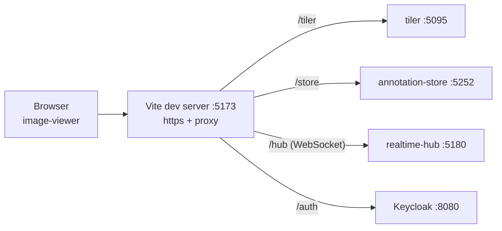
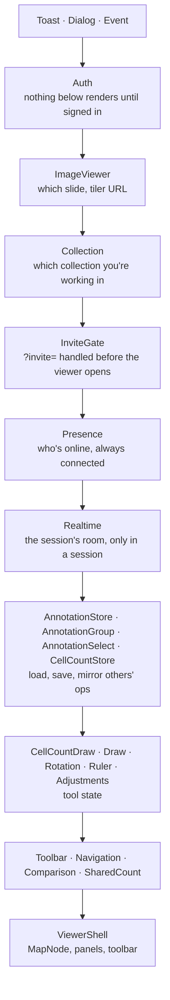
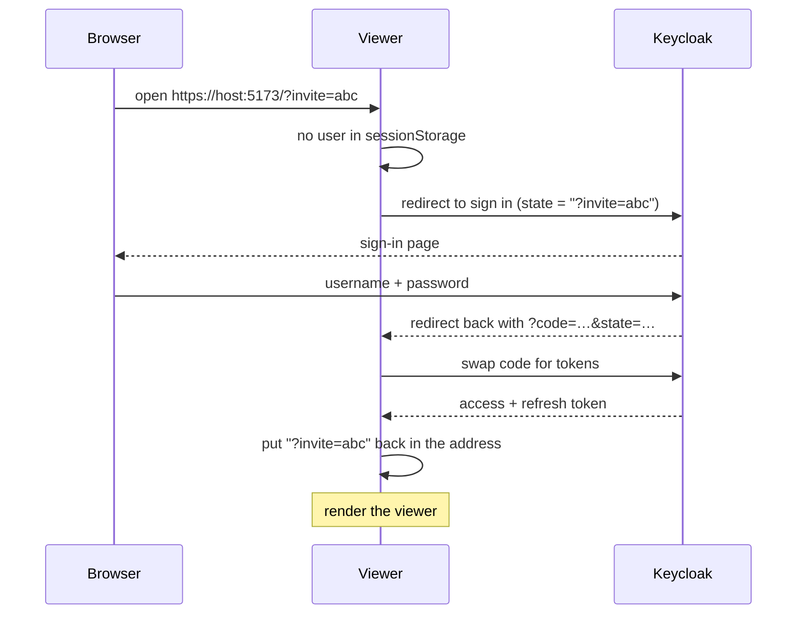
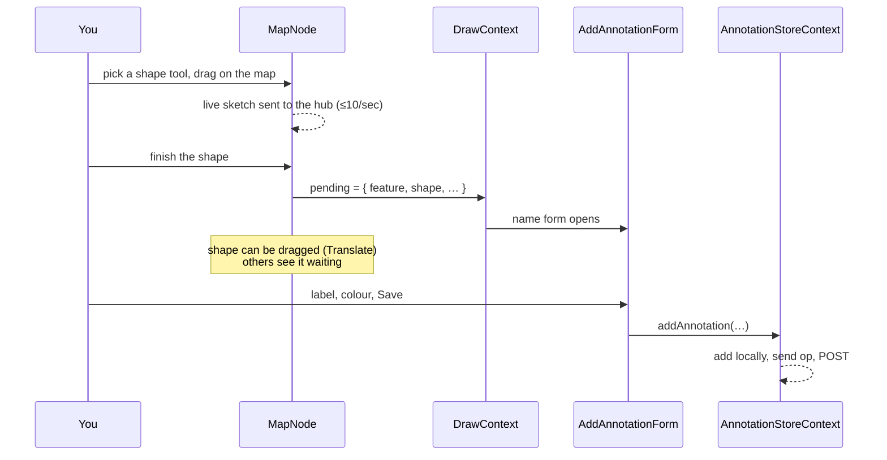
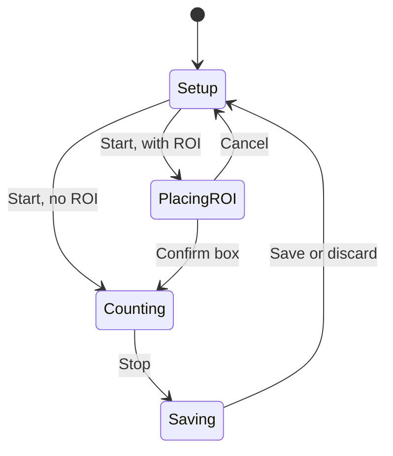
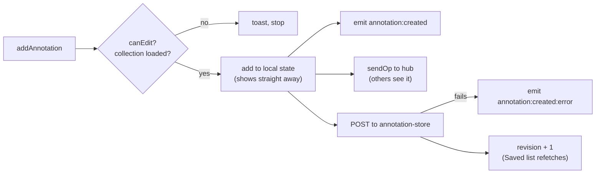

# image-viewer breakdown

The image-viewer is the part people actually use. It's a React app that
shows a whole-slide image you can pan and zoom, with tools for drawing
annotations, counting cells, measuring, rotating and adjusting the image -
on your own, or live with other people in a session.

React 19 · TypeScript · Vite · OpenLayers 10 (WebGL layers) ·
oidc-client-ts · SignalR client · Yjs · dnd-kit · Vitest · port 5173

Setup and the tool list are in
[image-viewer/README.md](../../image-viewer/README.md). This page explains
how it all fits together.

## Contents

1. [Where it sits](#1-where-it-sits)
2. [Folders](#2-folders)
3. [Start-up - the provider tree](#3-start-up---the-provider-tree)
4. [Signing in](#4-signing-in)
5. [Collections and invite links](#5-collections-and-invite-links)
6. [The map](#6-the-map)
7. [Drawing an annotation](#7-drawing-an-annotation)
8. [Counting cells](#8-counting-cells)
9. [The other tools](#9-the-other-tools)
10. [Saving - optimistic writes](#10-saving---optimistic-writes)
11. [The Saved lists](#11-the-saved-lists)
12. [Working together](#12-working-together)
13. [Panels and docking](#13-panels-and-docking)
14. [Events, toasts and popups](#14-events-toasts-and-popups)
15. [Tests](#15-tests)
16. [Known gaps](#16-known-gaps)
17. [Glossary](#17-glossary)

## 1. Where it sits



Everything goes through the page's own address. Vite's dev server proxies
each prefix to its service ([vite.config.ts](../../image-viewer/vite.config.ts)),
so another machine on the LAN or VPN only needs to reach port 5173. The
services can stay on localhost.

The dev server runs **https** with a self-signed certificate. Sign-in uses
the browser's crypto, which only works on https or localhost, so without it
nobody connecting over the VPN could sign in. `npm run dev:http` skips it
for localhost-only use.

What each service is for, from the viewer's side:

| Service | Used for | If it's down |
| ------- | -------- | ------------ |
| tiler | Slide size and tiles | No image |
| annotation-store | Collections, everything saved | Can't load or save - toasts say so |
| realtime-hub | Seeing other people live, presence | Works alone, shows "Offline", keeps retrying |
| Keycloak | Signing in | Can't get past "Signing in…" |

## 2. Folders

```
src/
  index.tsx          entry - slide id, service URLs, which tools show
  App.tsx            the provider tree, then the shell: map, panels, docking, toolbar
  newId.ts           UUIDs that work over plain http too
  interfaces/        Annotation, CellCount, ImageAdjustment, ImageSource
  context/           21 providers, one per concern (section 3)
  components/
    MapNode.tsx      the OpenLayers map and everything drawn on it (~1500 lines)
    open-layers/     map, view, tile layer, overview, scale bar, styles, GeoJSON
    annotation/      Free Form tab (tool picker, name form), Select tab (picking, groups) and Saved tab
    cell-count/      counter, saved counts, comparison/, shared/
    saved/           paging, search, filters - shared by both Saved lists
    realtime/        Collaboration panel, invite gate, sketches, shared text, autosave
    collections/     Collections panel - yours, sessions, shared ones, GeoJSON in and out
    users/           Users tab, presence state, join with a code
    presence/        who's here, top left
    rotation/ ruler/ adjustments/   one panel each, plus their maths
    toolbar/         toolbar, draggable panels, docking
    colour-picker/   wrapper round the vendored react-colour-palette
    toast/ dialog/   notifications and popups
  icons/             every fixed icon as an .svg file, and Icon.tsx to draw one
```

**Icons are files, not inline SVG.** Each one in `icons/` (`shapes/` for the
shape tools, `changes/` for the History list) draws in `currentColor` and
carries only a `viewBox`. A component imports it as text and hands it to
`Icon` with a size - `<Icon svg={pencilSvg} size={14} />`, after
`import pencilSvg from '../icons/pencil.svg?raw'` - so it takes the colour
of the text around it, hover included. The toolbar's own icons go through
`Toolbar.tsx` the same way. Only two SVGs stay inline, because they're drawn
from live values: `LinePreview` (the annotation's thickness, colour and
dashes) and the rotation dial. `icons/icons.test.ts` fails if any other
component draws an `<svg>` inline, or an icon file has no viewBox or a fixed
colour (only `roi.svg` keeps its cyan, since that's what an ROI looks like
on the map).

The pattern throughout: **maths and rules in a plain `.ts` file with tests
next to it, React in the `.tsx`**. `compare.ts`, `sharedFields.ts`,
`dock.ts`, `paging.ts`, `presence.ts` and so on can all be tested without a
browser or a map.

## 3. Start-up - the provider tree

[App.tsx](../../image-viewer/src/App.tsx) wraps the viewer in a stack of
React context providers. The order matters - each one can use the ones
above it.



| Provider | Holds |
| -------- | ----- |
| `Auth` | The signed-in user, `authFetch` (fetch with the token), sign out, switch user |
| `ImageViewer` | The slide id and tiler URL |
| `Collection` | Your collections on this slide, which one is active, sessions, invites, roles |
| `Presence` | Everyone with an account, who's online and what they're doing |
| `Realtime` | The SignalR connection to the session's room - see [realtime-hub.md](realtime-hub.md#10-viewer-side) |
| `AnnotationStore` | Every annotation in the collection, plus the OpenLayers source they're drawn from. Bulk updates and deletes (each one change set, undone by restoring it), and the Saved list's filter the map draws by |
| `AnnotationGroup` | The collection's groups, and which are hidden on the map while the Select tab's open |
| `AnnotationSelect` | What's picked on the Select tab, and box or lasso. Your own, not shared |
| `CellCountStore` | Counts loaded so far (not all - see [section 11](#11-the-saved-lists)) |
| `Draw` | Selected shape tool, colour, thickness, line style, the shape waiting to be named, quick draw |
| `CellCountDraw` | Whether you're counting, the tally, dot size, colour, ROI settings, the count waiting to be saved |
| `Rotation`, `Ruler`, `Adjustments` | Each tool's state. Adjustments also loads and saves presets |
| `Toolbar` | Which panels are open and which tab each is on |
| `Navigation` | Follow and Present - whether your map should follow the host |
| `Comparison`, `SharedCount` | The two group counting modes |
| `Toast`, `Dialog`, `Event` | Notifications, popups, and the public `on` callback |

`MapNode` is the one place that holds the OpenLayers map, so tools that
need it (cell count undo, ruler clear) ring a counter in their context and
`MapNode` notices it went up - a "request bell" rather than calling the map
directly.

## 4. Signing in

[AuthContext.tsx](../../image-viewer/src/context/AuthContext.tsx) uses
`oidc-client-ts` to sign in to Keycloak with the authorization code flow and
PKCE.



- **Nothing renders until there's a user.** Every request needs a token,
  so there's no point showing the viewer without one.
- **The address survives the trip.** Whatever was in the query string
  (an invite link's `?invite=`) is sent as the OIDC `state` and put back
  afterwards.
- **One tab, one person.** Tokens are kept in `sessionStorage`, so two tabs
  can be signed in as two people. "Switch user" signs in again asking which
  account - handy for testing a session alone.
- **Renewed in the background** with the refresh token. If renewing fails
  (signed out elsewhere) it sends you back to sign in.
- **Code swapped once.** React runs effects twice in development, and a code
  can only be used once, so the first attempt is kept and shared.

`authFetch` adds `Authorization: Bearer …` to every annotation-store call.
The hub gets the token in the query string, since WebSockets can't send the
header.

## 5. Collections and invite links

[CollectionContext.tsx](../../image-viewer/src/context/CollectionContext.tsx)
decides where everything is read from and saved to.

- **On load** it calls `POST /collections/ensure` for your personal
  collection, then `GET /collections?slideId=` for everything else you're in.
- **Active collection.** Your own, unless you're in a session. Which one is
  active is kept in `sessionStorage` per slide, so a reload stays in the
  same session.
- **Room.** When the active collection is a session that hasn't ended, its
  id is the realtime room. Working alone there's no room at all and the
  viewer doesn't connect to it.
- **Presets stay personal.** Image adjustments always go to your own
  collection, whichever one is active.
- **Role.** `canEdit` is false for viewers and in ended sessions. The stores
  check it before saving, so a viewer gets a "read only" toast rather than a
  403.
- **Being taken out or the session ending** - someone in the room tells
  everyone to refetch, and if you're no longer in it (or it's ended) you get
  a popup and go back to your own collection.
- **Shared personal collections.** The owner can turn on "Let others view"
  for their own collection. It then comes back in everyone's
  `GET /collections` on that slide with `myRole: viewer`, so it opens the
  same way an ended session does - read-only. If they turn it off while
  you're looking, the next list load sends you back to your own with a popup.

### The Collections panel

[CollectionsPanel.tsx](../../image-viewer/src/components/collections/CollectionsPanel.tsx)
lists every collection you can see on the slide, each with how many
annotations and cell counts it has and when something was last added. It has
three tabs, kept in the panel itself so Present doesn't follow the host's:

- **Mine** - your own. Rename it, turn sharing on or off, export, import.
- **Shared** - two lists:
  - **Sessions** - the ones you host or joined, moved here from RealTime.
    Rejoin or view, export, import (if you can edit and it hasn't ended),
    leave for good, or delete one you host once it's ended.
  - **Shared with everyone** - other people's shared collections. View and
    export only.
- **History** - every change made in the collection you're in, newest first.
  See below.

The counts reload whenever an annotation or cell count is added or deleted.

**Export** fetches `GET /collections/{id}/export` and writes a FeatureCollection
([collectionGeoJson.ts](../../image-viewer/src/components/collections/collectionGeoJson.ts)):
annotations as their line or polygon, cell counts as one MultiPoint of their
dots with each dot's colour alongside, and the ROI box in the properties.
Coordinates are slide pixels from the top left with y going down - what
QuPath and most slide tools use - so y is flipped from the map's.

**Import** reads a file, shows what it found and what it can't use, then
sends everything to `POST /collections/{id}/import` in one go. Lines and
polygons become annotations (each part of a Multi- one on its own), points
become cell counts. Names and colours are taken from `label`/`name`/QuPath's
`classification` and `colour`/`color`. A file where nothing has y above 0
is taken to be in the map's own space already and isn't flipped.

### History - putting deletes back

How this fits with the store's change sets is in
[version-control.md](version-control.md).

[HistoryList.tsx](../../image-viewer/src/components/collections/history/HistoryList.tsx)
lists `GET /changesets?collectionId=` for the collection you're in, a page of
50 at a time with the Saved lists' pager (`useSavedPage` with path
`changesets`, and `GET /changesets/total` for the page count). It's kept
compact - one line a change, under day headings (Today, Yesterday, then the
date - `dayHeading` in savedDates). Above it, the Saved lists' **Filter**
popout (`SavedFilterMenu` with a Kind section, "Made by" and "When", and no
Notes), with `kinds` in `SavedFilters` sent as `kind`, and **Newest first /
Oldest first**, sent as `order` on the page only. Changing either goes back
to the first page. Each row:

- An icon for the kind of change (`changeKind` in
  [history.ts](../../image-viewer/src/components/collections/history/history.ts),
  drawn by `ChangeIcon`). A delete whose rows are still deleted gets a red
  bin, so what can be put back stands out; once it's back the bin goes grey.
- What it did - the change set's `what` read out (`changeLabel`):
  `delete annotations` with 2,140 still deleted is "Deleted 2,140
  annotations".
- Who, as initials, and the clock time. Hovering gives the name and the
  full date.

Clicking a row opens it
([HistoryDetail.tsx](../../image-viewer/src/components/collections/history/HistoryDetail.tsx)),
in place of the list, with a way back:

- Who, with their full name.
- When, to the second (`formatFullDate`), and how long ago (`timeAgo`).
- What's still deleted ("300 annotations still deleted", or "Already put
  back") - `restoreStatus`.
- The change set's id, shortened, with the whole id on hover.
- **What changed**
  ([ChangeList.tsx](../../image-viewer/src/components/collections/history/ChangeList.tsx)),
  loaded when it's opened from `GET /changesets/{id}/changes`, and turned
  into lines by [changes.ts](../../image-viewer/src/components/collections/history/changes.ts):
  each field from and to - "Label  Region 4 -> Region 4 (checked)", nothing
  as *(empty)*, colours as swatches, groups by name, yes or no, an image
  adjustment's settings one by one. Rows that all went to the same thing are
  one line ("10 annotations", the colours they started as -> the one they
  went to). One row's name is said once at the top. What it deleted is named
  ("Region 15, Region 11 ... and 20 more"). A change from before history was
  kept says nothing was recorded for it.
- **Put back** and **Cancel**, for editors and the owner, when something's
  still deleted (`canRestore` - the one place that says who can, so it's one
  line to change if restore is narrowed to the author and the host). A line
  above says what happens, and that a group comes back with what was in
  it. This page is
  the confirm - there's no popup on top. Viewers and guests get the same
  page without the buttons.

Put back calls `POST /changesets/{id}/restore` through
[useRestoreChangeSet.ts](../../image-viewer/src/components/collections/history/useRestoreChangeSet.ts).
annotation-store answers with the rows it put back, so nothing is loaded
again:

1. Groups, annotations, cell counts (without dots) and image adjustments go
   back into their contexts with each one's `addRestored`, which also clears
   them from the deleted ids, so the Saved lists show them again, and bumps
   the revisions so those lists refetch. `changedAnnotations` - ones that
   were already there and went back how they were, like being put back in a
   group - replace the copy the annotation context has.
2. Everyone else gets a create op per row and an update op for each changed
   annotation (`restoredOps` - groups first, so an annotation never arrives
   before its group). Image adjustments are personal, so they're not sent.
   Receiving a create also clears that id from the other person's deleted
   ids.
3. A toast says what came back ("Put back 2,140 annotations"), or that
   someone else had already put it back. A failure is the usual
   `annotations:restored:error` toast.

The page stays open and says it's back, keeping the title it opened with.
If you move to another collection while it's on its way, the rows aren't put
in the new one's lists. The list reloads after a restore - the restore is a
change of its own ("Put back a change"). What's picked on the Select tab
forgets anything deleted, so putting it back later doesn't pick it again.

### The invite gate

[InviteGate.tsx](../../image-viewer/src/components/realtime/InviteGate.tsx)
sits above the realtime providers. If the address has `?invite=code` it:

1. fetches `GET /invites/{code}` and shows a card - which session, who's
   hosting, what role you'll get, who's already in it
2. on Join, calls `POST /invites/{code}/accept` and makes that session
   active
3. if it's expired, stopped or ended, says which
4. takes `?invite=` out of the address so a reload doesn't ask again

Working alone, **Join with a code** in the Collaboration tab takes either the code
or the whole link and brings up the same card over the viewer.

The server side is in
[annotation-store.md](annotation-store.md#6-invite-links).

## 6. The map

### Building it

[OpenLayers.ts](../../image-viewer/src/components/open-layers/OpenLayers.ts)
builds the map once the slide's size has come back from the tiler:

- **Pixel projection.** A slide has no geography, so the map's coordinates
  are the slide's own level-0 pixels, with y flipped (OpenLayers' y goes
  up). Annotations are saved in these coordinates.
- **Zoomify tile source** on a `WebGLTileLayer`. Its tiers match the
  tiler's exactly - see [tiler.md](tiler.md#4-tiers---the-zoom-ladder).
- **Zoom ladder.** Zoom is limited to the same tiers, so you can't zoom past
  full resolution or out past the whole slide.
- **No pan limit.** You can pan past the slide's edge, because annotations
  can be drawn outside it.
- **Overview map** top right, with its own copy of the tile layer (layers
  can't be shared between maps), a viewport box that never shrinks below a
  few pixels, and a status bar showing magnification (x1, x40).
- **Scale bar** bottom right, in µm or mm (or pixels on slides with no
  microns per pixel), always a round number.
- `preload: Infinity` on the tile layer, so blurry lower-res tiles fill in
  while sharper ones load rather than leaving white gaps.

### What's drawn on it

[MapNode.tsx](../../image-viewer/src/components/MapNode.tsx) adds every
layer and keeps them in step with the contexts. Big sets of features go on
WebGL layers; small ones that need things WebGL can't do (text, a shape at a
line's end, style functions) stay on canvas.

| Layer | Renderer | Shows |
| ----- | -------- | ----- |
| Slide tiles | WebGL | The image. Brightness, contrast, gamma and colour gains run in its shader |
| Saved annotations | WebGL | Every annotation in the collection - minus hidden groups, and anything the open Saved list's search and filters leave out. Drawn with less detail zoomed out ([LessDetail.ts](../../image-viewer/src/components/open-layers/LessDetail.ts), see [rendering.md](../rendering.md#less-detail-zoomed-out---2026-10-25)) |
| Selected annotations | Canvas | A teal halo round what's picked on the Select tab |
| Arrowheads | Canvas | The heads of arrow annotations |
| Viewed annotation | Canvas | A halo round the one picked with View on map |
| Draw | Canvas | The shape being drawn or waiting to be named |
| Cell count dots, ROI | WebGL | Your live count |
| Viewed dots, viewed ROI | WebGL | A saved count picked with View |
| Shared dots | WebGL | Everyone's dots in a shared count |
| Double counts, comparison results | Canvas | Rings round problem cells |
| Ruler | Canvas | Your measurement and its label |
| Remote sketches, rulers, counts | Canvas | What other people are part way through |
| Remote viewports | Canvas | Coloured boxes where other people are looking, on both maps |

Layers for a tool are hidden while its panel is closed. Closing a panel
also drops anything picked with View on map, so it doesn't come back on
reopening.

The measured limits (smooth to ~10k annotations, dots fine to 450k+) and
why are in [rendering.md](../rendering.md).

### Coordinates and GeoJSON

[GeoJSON.ts](../../image-viewer/src/components/open-layers/GeoJSON.ts)
turns an OpenLayers feature into a GeoJSON string and back, using
OpenLayers' own GeoJSON format. GeoJSON has no circles, so the circle tool
draws a 50-sided polygon and the rectangle tool a box polygon
([Tools.ts](../../image-viewer/src/components/annotation/Tools.ts)) - every
shape is a plain line or polygon by the time it's saved. That string is what
goes in annotation-store's `GeoJson` column, with coordinates rounded to a
tenth of a slide pixel (`CoordinateDecimals`) - full doubles nearly doubled
what the map loads, and a tenth of a pixel never shows. The store rounds
anything else saved the same way.

## 7. Drawing an annotation



- **Six shapes** - line, freehand, polygon, arrow, rectangle, circle - each
  an OpenLayers `Draw` interaction, with thickness, solid or dashed, and a
  colour from the palette or a custom one.
- **The arrowhead follows the sketch** while drawing, not just when done.
- **Naming.** Finishing opens a label and colour form. While it's open the
  shape can be dragged to move it before saving.
- **Quick draw** skips the form - every shape drawn while it's on saves
  straight away with a set label and notes.
- **Drawing is paused** while the Annotations panel is closed, while a shape
  waits to be named, and while you're counting cells, so one click only
  ever means one thing.
- **Editing.** In the Saved tab, opening an annotation shows its label,
  notes and colour. Label and notes are shared text - see
  [realtime-hub.md](realtime-hub.md#7-two-people-typing-in-the-same-box) -
  and everything autosaves a second after you stop (`TEXT_SAVE_MS` in
  [autosave.ts](../../image-viewer/src/components/realtime/autosave.ts)).
  Colour changes show live on the map as you drag the picker. Every save
  while the form's open goes in one change set, so the History tab shows
  one row for the whole edit (see
  [version-control.md](version-control.md#3-change-sets)).

### The Select tab - many at once

[SelectTab.tsx](../../image-viewer/src/components/annotation/Select/SelectTab.tsx)
picks annotations on the map to change together. The map side is
[useMapSelection.ts](../../image-viewer/src/components/annotation/Select/useMapSelection.ts),
which MapNode calls; what's picked is in `AnnotationSelectContext`, your own
and not shared.

- **Picking.** Drag a box (OpenLayers' `DragBox`) or draw a lasso (a
  freehand `Draw`) - everything *fully* inside it is picked
  ([selection.ts](../../image-viewer/src/components/annotation/Select/selection.ts)).
  Shift adds to what's picked. Clicking a shape puts it in or takes it out,
  the smallest one under the click winning. Esc or clicking empty space
  clears. Picked shapes get a teal halo on a canvas layer under the
  annotations. Only while the tab's open and you're not counting cells.
- **Recolour** and **group** go to `PUT /annotations/bulk` in one request,
  with an update op per annotation for everyone else. On first change wins,
  any someone else changed first are left as they are, and a card says how
  many, with **Use mine for those**.
- **Delete** asks first, then takes them off the map and sends the delete
  straight away, every batch with the same `Change-Set-Id`
  ([bulk.ts](../../image-viewer/src/components/annotation/bulk.ts)), so
  annotation-store keeps it as one change set. Nothing's removed there, only
  hidden. The Undo toast (8s) restores that change set
  (`POST /changesets/{id}/restore`) once the delete has landed, then puts
  them back on the map and sends a create op each - same ids and authors.
  After the toast's gone it can be put back from the Collections panel's
  [History](#history---putting-deletes-back) tab. See
  [annotation-store.md](annotation-store.md#11-history-and-change-sets).
- **Groups** (`AnnotationGroupContext`) - named sets of annotations in the
  collection, one level. Make one from what's picked, move things between
  them or out, rename (double-click), delete (the annotations stay), pick
  everything in one, or hide one from the map - hiding is just for you, and
  only lasts while the tab's open. Clicking a group's name opens its page
  ([GroupPage.tsx](../../image-viewer/src/components/annotation/Select/GroupPage.tsx)):
  rename it, notes (saved as you type), recolour everything in it, pick it
  on the map, merge it into another group, delete its annotations (with
  Undo), or delete the group and keep them. Viewers see the name and notes.
  Viewers get the tab as **Groups**, to show and hide only. Group changes
  go out as `annotationGroup` ops. The Saved list's filter has a **Group**
  section too - any of the groups, and **No group** - sent as `group`.

## 8. Counting cells

A cell count is a tally of clicks, one per cell. Its state is in
[CellCountDrawContext.tsx](../../image-viewer/src/context/CellCountDrawContext.tsx);
the clicking itself is in `MapNode`.



- **Before starting** you pick whether clicks drop a visible dot ("with
  annotation") and whether to limit counting to a box ("with ROI"). Both are
  locked once counting starts, since they change what a click does.
- **The ROI box** is a fixed size in microns (500µm by default). It can be
  dragged into place, and clicks only start counting once it's confirmed -
  otherwise placing it would count as clicks. Clicks outside it are refused
  with a toast.
- **Each dot keeps its own colour**, so changing colour mid-count works as
  categories.
- **Undo and redo** with buttons or Z and Y. Every click goes on a history
  stack (the dot, or null if dots are off); a new click after undoing clears
  redo.
- **Stopping** freezes the count into a save form with the dots, ROI box,
  location (the view or box centre) and dot size. Saving goes to
  annotation-store like an annotation.
- **Viewing a saved count** fetches its dots (lists don't have them - see
  [section 11](#11-the-saved-lists)), draws them and the box on their own
  layers, and fits the map to them.

Comparison counts and shared counts reuse the same counter with extra rules
on top - see
[realtime-hub.md](realtime-hub.md#8-comparison-count). The matching
([compare.ts](../../image-viewer/src/components/cell-count/comparison/compare.ts))
and double-count check
([sharedCount.ts](../../image-viewer/src/components/cell-count/shared/sharedCount.ts))
happen in the viewer.

## 9. The other tools

| Tool | How it works |
| ---- | ------------ |
| **Rotate** | A dial and buttons in the panel, plus OpenLayers' own Alt+Shift+drag and pinch. Map and panel stay in sync both ways, compared with a small tolerance so they don't fight over rounding. |
| **Ruler** | A two-point line `Draw`. Distance in µm using the slide's microns per pixel, or pixels without. One measurement at a time; closing the panel clears it. |
| **Image adjustments** | Brightness, contrast, gamma and red/green/blue gain. Sliders update WebGL style variables on the tile layer - no shader rebuild, so dragging is smooth. Settings can be saved as named presets in your personal collection. |
| **Fullscreen** | The browser's Fullscreen API. |
| **RealTime** | Session and Users tabs - see [section 12](#12-working-together). |
| **Collections** | Yours, your sessions and other people's shared ones, GeoJSON export and import - see [section 5](#the-collections-panel). |

Which tools show is set by `index.tsx`'s `tools` list.

## 10. Saving - optimistic writes

[AnnotationStoreContext.tsx](../../image-viewer/src/context/AnnotationStoreContext.tsx)
and `CellCountStoreContext` save the same way:



- **Shown before it's saved.** The UI doesn't wait for the server. If the
  save fails you get an error toast, but it isn't rolled back - fine for a
  proof of concept.
- **The op goes out before the save**, to keep the delay down for everyone
  else. The id is made in the browser (`newId()`) so the op and the saved
  row match.
- **Other people's ops** come in through `onOp` and go through `applyOp`
  (add, merge or remove), with no toast - those are for your own actions.
- **Deleted ids are remembered.** An edit form closing because its
  annotation was deleted still flushes its last autosave, which has to be
  dropped rather than sent to something that's gone.
- **Updates send label, notes and colour together**, because
  annotation-store's `PUT` replaces all three - with the colour it started
  from (`wasColour`), so the store can tell a colour change from one that's
  just along for the ride.
- **Two people changing the same thing.** In a session on first change wins
  the op goes out after the save instead, saves to one annotation or group
  go one at a time, and a save turned down (409) shows theirs and a card -
  "Bob Hughes changed the colour of Region 4 just now, before your change
  got there" - with **Use mine** and **Keep theirs**. Each item's colour,
  group, name and notes as the store last had them are kept to send as the
  was. See
  [version-control.md](version-control.md#8-two-people-changing-the-same-thing)
  and [editPolicy.ts](../../image-viewer/src/components/realtime/editPolicy.ts).
- **Bulk changes** from the Select tab go in one request
  (`PUT /annotations/bulk`), with an op per annotation for everyone else. A
  bulk delete is shown and sent straight away, and Undo restores it - see
  [the Select tab](#the-select-tab---many-at-once).

`newId()` uses `crypto.randomUUID()` where it exists and builds a v4 UUID
from `getRandomValues` where it doesn't (plain http from another machine).

## 11. The Saved lists

Both Saved tabs (annotations and cell counts) page through annotation-store
rather than loading everything. The shared code is in
[components/saved/](../../image-viewer/src/components/saved).

- **50 a page**, newest first (`SAVED_PAGE_SIZE` in `paging.ts`).
- **Search and filters run on the server**, across every row, not just the
  page. Typing waits 250ms after the last key before asking.
- **Filters** - who saved it, shape, colour (palette colours or Custom),
  group (or No group), has notes, has an ROI, date range. The Filter button
  shows how many are on.
- **The tab's count follows the list.** While the Saved tab is open its
  label is the list's own count - so it follows the search and filters, and
  says `Saved (0)` when they find nothing. On other tabs it's the whole
  collection's.
- **The map follows the list too.** While the annotations Saved tab is open,
  the map only draws what its search and filters let through
  (`mapFilter` in `AnnotationStoreContext`, checked with the same `passes`
  and `matchesSearch`). Leaving the tab draws everything again.
- **Live changes merge into the page** (`mergePage`) until the next fetch:
  an edit shows straight away, a delete drops out, and something new goes to
  the top of page 1 if it passes the filters (and there's no search, since
  whether that matches is the server's call).
- **Refetch on `revision`.** The stores bump it each time a create or delete
  settles, and a burst of them turns into one refetch.
- **Deletes come off the counts straight away.** Each fetch remembers the
  revision it was made at. A bulk delete that hasn't been sent yet (or was
  sent after that fetch) is taken off its count, if it would have matched
  the search and filters, until a fetch arrives that already leaves it out -
  so nothing's taken off twice.
- **Page kept in range.** Deleting the last row on the last page moves you
  back a page rather than leaving you on an empty one.

### Annotations vs cell counts

The map still loads **every annotation**, so all of them can be drawn - only
the list pages. Cell counts aren't drawn unless you View one, so
`CellCountStoreContext` only loads the newest (for the counter's "Recent"
card) plus whatever pages you go through. List rows come **without dots**,
with a colour and placed-by summary instead. Dots load only for the count on
the map, fetched by id if it isn't loaded (e.g. following a host who's
viewing one you've never paged to).

## 12. Working together

Three providers deal with other people. The hub side is in
[realtime-hub.md](realtime-hub.md).

| Provider | Connection | What for |
| -------- | ---------- | -------- |
| `Presence` | Its own, the whole time | The Users tab: everyone with an account, who's online, what they're doing. Inviting someone online |
| `Realtime` | Only in a session | The room: viewports, sketches, ops, shared text, comparison and shared counts |
| `Navigation` | Uses `Realtime` | Follow and Present |

### The Collaboration panel

[RealTimePanel.tsx](../../image-viewer/src/components/realtime/RealTimePanel.tsx)
shows one of four things on its Session tab, kept to what you reach for
during a session:

- **Working alone** - start a session, or join with a code. Rejoining one
  you're already in is in the Collections panel. Starting one picks how many
  editors a link lets in and "when two people change the same thing" - last
  change wins or first change wins - starting from the viewer's
  `maxEditors` and `editPolicy` options in `index.tsx`. Neither can change
  once it's started; Settings says which it is.
- **Hosting** - the quick controls: the invite link and code to copy, making
  a (new) link, a line saying what it lets people do with **Change** (which
  opens Settings), navigation, and ending the session.
- **Joined** - what the host has everyone doing, and leaving.
- **Ended** - read-only, to look back at.

The other tabs:

- **Active** (in a session) - for the host, Ask people to…; who's here
  right now, guests included; and every member, with the host's role
  changes and remove.
- **Settings** (the host, while the session's live) - who the link lets in
  as, when it runs out, stopping it, and what was fixed when the session
  started (editors through the link, and when two people change the same
  thing). The link's two parts share `useSessionInvite` in
  [SessionInvite.tsx](../../image-viewer/src/components/realtime/SessionInvite.tsx).
- **Users** - everyone in Keycloak, online first. The host can invite
  anyone online on the same slide - they get a popup with the invite card.
  Presence messages can arrive out of order, so `presence.ts` only takes
  something newer than what it has.

### Navigation modes

[NavigationContext.tsx](../../image-viewer/src/context/NavigationContext.tsx):

- **Free** - everyone moves on their own. Other people's viewports show as
  coloured boxes on the main map and the overview.
- **Follow** - your map follows the host's, fitted to your screen. Moving it
  yourself breaks away; the Follow button by the presence list puts you
  back.
- **Present** - like Follow, but you can't break away (pan and zoom are
  turned off), and you also get the host's open panels, the tab each is on,
  the annotation or count they're viewing, and their image adjustments.
  Your own adjustments come back when it ends. Panels and tabs you're busy
  in (part way through drawing or counting) catch up once you're done.

The host can also **ask** everyone, or one person, to look where they are or
open a panel. It comes up as a toast with Go / Not now.

Everyone sends a small **screen** message (open panels, tabs, adjustments,
what's being viewed or edited) whenever it changes, which is what Present
copies.

## 13. Panels and docking

Each tool opens a panel ([DraggablePanel.tsx](../../image-viewer/src/components/toolbar/DraggablePanel.tsx))
that can float anywhere or dock to an edge. Dragging uses dnd-kit.

- **Floating panels** open in columns from the top left
  (`placeInColumns`), stay clamped on screen and above the toolbar, and
  come back where they were when reopened.
- **Docking** - drag a panel to an edge and a preview shows where it'll
  land. Two panels on one edge split it; which half you drop on decides
  the order. Top and bottom take the full width; left and right stop short
  of them.
- **Undocking** keeps the panel under the cursor even though its width
  changes (a top dock spans the screen, a floating panel is 20em). A ghost
  stands in for it during the drag, because dnd-kit would otherwise undo the
  position change.
- **Stacking** - the last one clicked is in front (`focusOrder.ts`).

The geometry is in [dock.ts](../../image-viewer/src/components/toolbar/dock.ts),
[panelPlacement.ts](../../image-viewer/src/components/toolbar/panelPlacement.ts)
and [focusOrder.ts](../../image-viewer/src/components/toolbar/focusOrder.ts),
all tested without a browser.

## 14. Events, toasts and popups

- **`on` callback.** `App` takes an `on(event, payload)` prop, so a page
  hosting the viewer can react to it - `annotation:created`,
  `cellcount:deleted:error`, `annotations:load-error` and so on.
  [EventContext.tsx](../../image-viewer/src/context/EventContext.tsx) is the
  one place every user action goes through: it calls `on` and shows the
  matching toast.
- **Toasts** for most things, some with buttons (Go / Not now).
- **Popups** ([DialogContext.tsx](../../image-viewer/src/context/DialogContext.tsx))
  for things too easy to miss as a toast, like being taken out of a session.
  One at a time; Escape runs the last button.
- **Info boxes** ([InfoNote.tsx](../../image-viewer/src/components/info/InfoNote.tsx))
  - an (i) beside a label opens a small box saying how something works, so
  the explanation's there when wanted without taking up the panel. What you
  need before acting stays on the page as a short line instead ("Neither can
  change once the session's started"). The box is a fixed-position portal
  placed with `computePopupPosition`, like the colour picker's, since a
  docked panel clips anything that spills out of it, and takes the viewer's
  text size from `.app`. One open at a time across the viewer
  ([oneOpen.ts](../../image-viewer/src/components/info/oneOpen.ts)); a
  press outside, Esc (back to the button), a scroll or a resize closes it.
  Used in the Collaboration panel for editors through the link, the edit
  policy, navigation and guests.

## 15. Tests

44 test files, 711 tests, run with Vitest (`npm test`). They sit next to
the code they cover and test the plain `.ts` logic, not React components or
a live map.

| Area | Files | Covers |
| ---- | ----- | ------ |
| open-layers | OpenLayers, Styles, GeoJSON | Zoom ladder, styles, GeoJSON round trips |
| realtime | realtime, sharedFields, sketch, autosave, editPolicy | `applyOp`, caret moves, Yjs merges, sketch simplifying, what to autosave; reading a 409, the conflict card's wording, saves one at a time |
| cell-count | CellCountDots, CellCountView, compare, sharedCount | Dot parsing, view extent, comparison matching, double counts |
| saved | paging, filters, savedBy, savedDates, sheetPlacement, useSavedTotal | Page maths, `mergePage` (pending deletes too), filter query strings, live filtering, search matching, the tab label, History's day headings and times |
| annotation | selection, bulk | Fully inside a box or lasso, which shape a click is on; batches and one change set per bulk change |
| collections | collectionGeoJson, history | Export and import, y flipping, QuPath-style files, groups, what's skipped; History labels, icons, initials, what's still deleted, day headings, who can put back, the ops sent |
| toolbar | dock, focusOrder, panelPlacement | Docking, splitting, stacking, placing |
| other | adjustments, rotation, ruler, popupPosition, presence, newId, icons | Clamping, angles, distances, out-of-order presence, every icon is a file with a viewBox and no fixed colour |

CI (`.github/workflows/image-viewer.yml`) runs lint (oxlint), tests and a
build on every push that touches the viewer.

## 16. Known gaps

- **The map loads every annotation.** Zoomed out it now draws a simplified
  copy, which cuts what the GPU draws at the fitted view to about a fifth,
  but the whole collection is still loaded and held. Loading by extent is
  the rest - see [rendering.md](../rendering.md#what-would-move-the-limits).
- **Viewing a big count freezes the page** while its dots are parsed and
  made into features in one go. Chunks or a worker would fix it.
- **Saves aren't rolled back** if they fail - you get a toast, but the item
  stays on screen (and on everyone else's).
- **`MapNode.tsx` is ~1500 lines.** It's the one place with the map, so
  everything that touches it ends up there.
- **Dev server only.** It's run with `vite`, whose proxy is what joins the
  services up. A production build would need something else doing that
  (see [azure.md](../azure.md)).
- **One slide, set in code.** `index.tsx` picks it (`003`); there's no slide
  picker.
- **Guests only look.** Someone joining from a link without an account is
  view only, and has no collection of their own - see
  [guests.md](../guests.md).
- **No component tests.** Logic is well covered; the React side and the map
  are checked by hand and by `scripts/map_bench.js`.

## 17. Glossary

| Term | Meaning |
| ---- | ------- |
| Context / provider | React's way of sharing state down the tree without passing props through every level |
| OpenLayers | A JavaScript mapping library. Used here with a pixel projection instead of geography |
| Layer / source | In OpenLayers, a source holds features or tiles, a layer draws a source |
| WebGL layer | A layer drawn on the GPU - much faster for thousands of features |
| Interaction | An OpenLayers mouse/touch behaviour - `Draw`, `Translate`, `DragPan` |
| Feature | One drawn thing on the map - a shape, a dot, a box |
| Sketch | A shape someone is part way through drawing |
| Pending | A finished shape or count that's waiting on its save form |
| View on map | Picking a saved annotation or count to fly to and highlight |
| Optimistic write | Showing a change before the server has confirmed it |
| Revision | A counter the stores bump when a save settles, so the Saved list knows to refetch |
| Shared collection | Someone's own collection they've let anyone signed in look at, read-only |
| Group | A named set of annotations in a collection, with notes - made and managed on the Select tab |
| Picked | Annotations selected on the Select tab, to change together |
| OIDC / PKCE | The sign-in standard Keycloak speaks, and the extra check that makes it safe in a browser |
| Present / Follow | Navigation modes where your view follows the host's |
| Dock | Snapping a panel to an edge of the screen |
