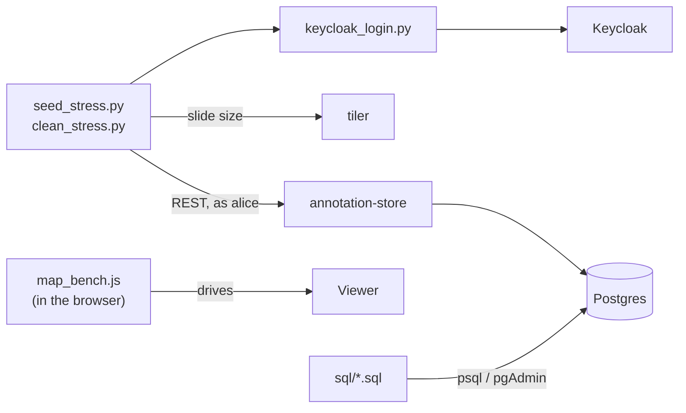
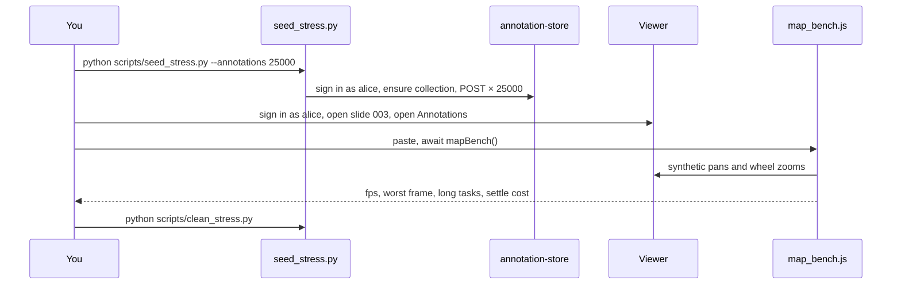
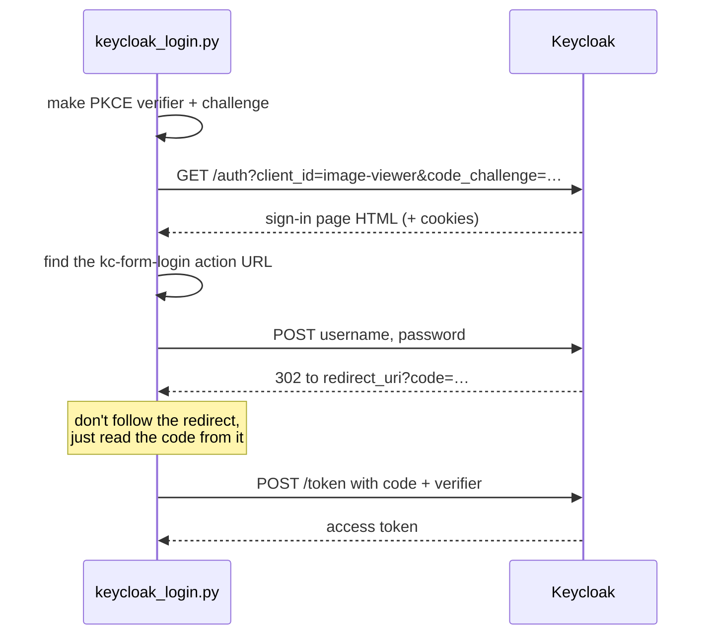

# scripts breakdown

The scripts folder is the tooling around the services rather than part of
them: filling a slide with test data, cleaning it up again, measuring how
the map copes, and resetting the database. It's what produced the numbers
in [rendering.md](../rendering.md).

Python 3 (standard library only) · browser JavaScript · Postgres SQL ·
unittest + ruff in CI

Usage and options are in [scripts/README.md](../../scripts/README.md). This
page explains how it all fits together.

## Contents

1. [Where it sits](#1-where-it-sits)
2. [Files](#2-files)
3. [A stress test from start to finish](#3-a-stress-test-from-start-to-finish)
4. [Signing in without a browser](#4-signing-in-without-a-browser)
5. [Seeding](#5-seeding)
6. [Cleaning up](#6-cleaning-up)
7. [Measuring the map](#7-measuring-the-map)
8. [SQL scripts](#8-sql-scripts)
9. [Tests](#9-tests)
10. [Known gaps](#10-known-gaps)
11. [Glossary](#11-glossary)

## 1. Where it sits



The Python scripts go through annotation-store's API exactly as the viewer
does - signed in as a real test user, into that user's own collection. So
anything they add obeys the same rules, gets the same server-set fields,
and shows up in the viewer when you sign in as that user.

The SQL scripts go straight to the database, for when you want something
gone without caring about the API.

## 2. Files

| File | What it does |
| ---- | ------------ |
| [seed_stress.py](../../scripts/seed_stress.py) | Adds lots of annotations and cell counts to a user's collection on a slide. Defaults: slide 003, alice, 2000 annotations, counts of 1k, 10k and 50k dots. |
| [clean_stress.py](../../scripts/clean_stress.py) | Removes exactly what `seed_stress.py` added, and nothing else. |
| [keycloak_login.py](../../scripts/keycloak_login.py) | Signs the Python scripts in through Keycloak's real sign-in page. Not run on its own. |
| [map_bench.js](../../scripts/map_bench.js) | Pasted into the browser console. Pans and zooms the map and reports frame times. |
| [sql/](../../scripts/sql) | Row counts, targeted deletes and a full reset for the annotation-store database. |
| [test_keycloak_login.py](../../scripts/test_keycloak_login.py), [test_seed_stress.py](../../scripts/test_seed_stress.py) | Unit tests for the parts that don't need anything running. |

## 3. A stress test from start to finish



Raise the load one step at a time and run the bench at each step - that's
how the limits in
[rendering.md](../rendering.md#where-the-map-breaks---measured-2026-10-13)
were found (smooth to ~10k annotations, unusable at 50k).

## 4. Signing in without a browser

Every annotation-store endpoint needs a Keycloak token. The easy way to get
one from a script is Keycloak's password grant, but the `image-viewer`
client has that turned off - it's a browser app and should only use the
code flow.

So [keycloak_login.py](../../scripts/keycloak_login.py) does what a browser
does, with `urllib` and a cookie jar:



That means no extra Keycloak client or setting just for scripts, and the
scripts get a token exactly like the viewer's - same audience, same `sub`.

## 5. Seeding

[seed_stress.py](../../scripts/seed_stress.py):

1. Checks no count asks for more than 1,000,000 dots (see below).
2. Gets the slide's size from the tiler, and keeps a 10% margin so shapes
   land on the slide.
3. Signs in and calls `POST /collections/ensure` for the user's own
   collection.
4. Posts the annotations, 8 at a time.
5. Posts one cell count per `--dots` value, one at a time.

### What it makes

- **Annotations** in the same mix the viewer draws: polygons (6-20 sides),
  rectangles, 50-sided circles (like the circle tool), lines, arrows and
  120-point freehand traces, weighted towards polygons. Colours from the
  viewer's palette, so the colour filter works on them. A third are dashed.
  That mix averages about 36 points a shape.
- **Cell counts** with dots clustered in blobs, like cells in tissue, around
  a random centre. Dot colours from the palette. Every second count also
  gets an ROI box round the blobs, so both kinds are covered.

### Tagged and repeatable

- **Notes are always `stress-test`** and labels start with "Stress". That's
  the only thing `clean_stress.py` and `delete_stress_test.sql` go by, so
  real work is never touched.
- **Fixed random seed** (`--seed`, default 42). The same options give the
  same shapes every run, so before-and-after numbers compare like with like.

### The dot limit

annotation-store takes a new count of up to 80 MiB, and a dot is about 60
bytes once sent, so 1,000,000 dots per count. Far over that, Kestrel drops
the connection rather than answering 413, which would fail half way. So the
script refuses before it adds anything, and suggests splitting:
`--dots 1000000 1000000`. A test checks the largest allowed count really
does fit under 80 MiB.

## 6. Cleaning up

[clean_stress.py](../../scripts/clean_stress.py) signs in as the same user,
loads every annotation and cell count in their collection on the slide,
deletes the ones whose notes are `stress-test` (8 at a time), and says how
many it removed and how many it left.

Going through the API means each delete is checked like any other. For a
faster clean that doesn't need annotation-store running,
`sql/delete_stress_test.sql` does the same in two `DELETE`s.

## 7. Measuring the map

[map_bench.js](../../scripts/map_bench.js) runs in the viewer's own page:

```js
// paste into devtools, then
await mapBench()                  // pan, zoom in, zoom out
await mapBench({ seconds: 5 })    // longer pans
await mapBench({ zoomTicks: 3 })  // zoom in less far
```

- **Real events.** It sends `PointerEvent` drags and `WheelEvent` ticks to
  OpenLayers' viewport - what a mouse sends - so it measures the real
  interaction code, not a shortcut.
- **Frame gaps.** It records the time between animation frames. 16.7ms is
  60fps; gaps over 50ms are stutter people notice.
- **Long tasks.** Main-thread work over 50ms, which blocks input too.
- **Settle cost.** On the dev server, `MapNode` puts the map on
  `window.viewerMap`, so the bench can time the redraw when the view stops -
  when WebGL layers rebuild their buffers. `viewerMap.layers` also lets you
  turn single layers off to see what each costs.
- **Ends where it started.** Pans are circles and it zooms back out by the
  same amount.

Things that skew it: the tab must be visible (hidden tabs don't draw), and
the first run after loading data is slower - run twice and use the second.

## 8. SQL scripts

For the annotation-store database, run from psql, pgAdmin or VS Code. Each
runs in one transaction, so it either all happens or none of it does.

| Script | Does | Scope |
| ------ | ---- | ----- |
| `counts.sql` | Rows per table, then per slide | Read-only |
| `delete_stress_test.sql` | Annotations and counts with notes `stress-test` | Every user, every slide |
| `delete_all_annotations.sql` | Every annotation | Everything |
| `delete_all_cell_counts.sql` | Every cell count (ROI boxes cascade) | Everything |
| `delete_all_image_adjustments.sql` | Every preset | Everything |
| `delete_slide_data.sql` | Annotations, counts and presets for one slide - edit the id | One slide |
| `reset_all.sql` | Empties the tables, collections included. Schema and migrations stay | Everything |

Only `reset_all.sql` removes collections. The viewer copes with any of
these while it's open, since annotation-store makes a new personal
collection the next time a slide is opened - just reload.

## 9. Tests

```bash
python -m unittest discover -s scripts
```

| File | Covers |
| ---- | ------ |
| `test_keycloak_login.py` | Finding the login form's action in Keycloak's HTML (either attribute order, HTML-escaped), and reading the code from the redirect |
| `test_seed_stress.py` | The dot limit - what's refused, the message, and that a million-dot count fits under 80 MiB |

Nothing that needs a running service is tested here. CI
([scripts.yml](../../.github/workflows/scripts.yml)) runs these and lints
with ruff.

## 10. Known gaps

- **`reset_all.sql` misses two tables.** It truncates `Collections` but not
  `CollectionMembers` or `CollectionInvites`, which reference it. Postgres
  refuses to truncate a table other tables point at unless they're included
  (or `CASCADE` is used), so it would fail as it stands.
- **One user at a time.** Seeding fills one person's personal collection.
  There's nothing yet for seeding a session, or for load from several
  people at once.
- **No realtime load.** Nothing stress-tests the hub - many people in a room,
  op rates, or what happens when a big count goes over the hub's 1MB
  message limit.
- **`map_bench.js` is manual.** Paste, run, copy the table. It isn't wired
  into CI or a headless browser.
- **Hard-coded ports and dev credentials** as defaults (`alice` /
  `password`, `localhost:5252`) - fine for local use, all overridable.

## 11. Glossary

| Term | Meaning |
| ---- | ------- |
| Stress test | Deliberately loading a system far past normal use to find where it breaks |
| Seed | Add test data. Also the random number seed that makes it repeatable |
| Password grant | Swapping a username and password straight for a token - off for the viewer's client |
| PKCE | The proof that makes the browser-style code flow safe - see [auth.md](auth.md#3-the-realm) |
| Frame gap | Time between two drawn frames. Lower is smoother |
| Long task | Main-thread work over 50ms, which freezes the page |
| Settle | The redraw once the map stops moving |
| Transaction | A group of database changes that all happen or none do |
| TRUNCATE | Empties a table in one go, much faster than `DELETE` |
