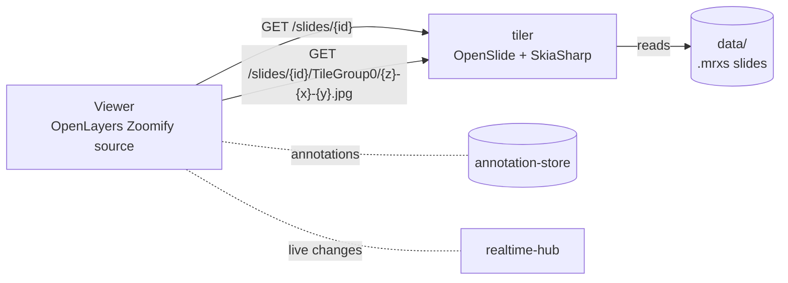
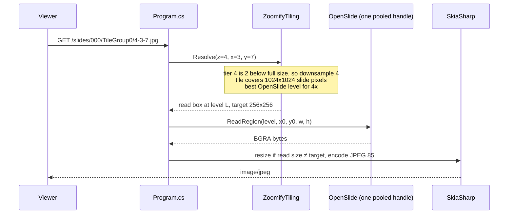

# tiler breakdown

The tiler turns whole-slide images into small square pictures (tiles) the
viewer can load a few at a time. A slide is far too big to send whole - the
smallest sample is 7436x15494 pixels and real ones run to 100,000+ - so the
viewer asks only for the tiles on screen, at the zoom it's at.

.NET 10 · ASP.NET Core minimal API · OpenSlide (via OpenSlideSharp) ·
SkiaSharp · stateless · port 5095

The setup and API list are in [tiler/README.md](../../tiler/README.md). This
page explains how it all fits together.

## Contents

1. [Where it sits](#1-where-it-sits)
2. [Files](#2-files)
3. [What a slide is](#3-what-a-slide-is)
4. [Tiers - the zoom ladder](#4-tiers---the-zoom-ladder)
5. [Serving one tile](#5-serving-one-tile)
6. [Reading in parallel](#6-reading-in-parallel)
7. [Windows and Linux](#7-windows-and-linux)
8. [Viewer side](#8-viewer-side)
9. [Known gaps](#9-known-gaps)
10. [Glossary](#10-glossary)

## 1. Where it sits



The tiler is the one service that knows nothing about users, sessions or
annotations. It doesn't need a token, doesn't talk to any other service and
keeps no state between requests beyond open file handles. That means it can
be cached, copied or moved without touching the rest.

Annotations are stored in the slide's own pixel coordinates (level 0), so
they line up with the tiles no matter what zoom either is at.

## 2. Files

| File | What it does |
| ---- | ------------ |
| [Program.cs](../../tiler/Program.cs) | Startup and the three endpoints. The tile endpoint borrows a slide handle, reads a region, resizes it if needed and encodes it as JPEG (quality 85). Also wires up CORS and OpenTelemetry. |
| [Slides/SlideCatalog.cs](../../tiler/Slides/SlideCatalog.cs) | Finds every `.mrxs` under `data/` at startup, using the file name as the slide id. Reads each slide's size, magnification and microns per pixel once, then caches it. |
| [Slides/SlideHandlePool.cs](../../tiler/Slides/SlideHandlePool.cs) | Up to 8 open OpenSlide handles per slide, each used by one thread at a time (see [section 6](#6-reading-in-parallel)). |
| [Slides/ZoomifyTiling.cs](../../tiler/Slides/ZoomifyTiling.cs) | The maths. Works out the tier ladder the same way OpenLayers does, and turns a `(z, x, y)` tile into "read this box from this OpenSlide level, resize to this". |
| [Slides/OpenSlideNative.cs](../../tiler/Slides/OpenSlideNative.cs) | Points OpenSlideSharp at the right native library on Linux (see [section 7](#7-windows-and-linux)). |
| [Dockerfile](../../tiler/Dockerfile) | Linux image with slide 003 built in - what's deployed (see [azure.md](../azure.md)). |

There's no test project. The maths in `ZoomifyTiling` is checked from the
other side, by the viewer's
[OpenLayers.test.ts](../../image-viewer/src/components/open-layers/OpenLayers.test.ts).

## 3. What a slide is

A whole-slide image is a scan of a glass slide, stored as a **pyramid**: the
full-resolution image plus a few smaller copies (each usually half or a
quarter the size of the one below), so zoomed-out views don't have to shrink
billions of pixels on the fly.

The samples here are MIRAX (`.mrxs`), which stores a slide as a small
`.mrxs` file plus a folder of the same name holding the actual image data.
Both have to be there. Dropping another pair into `data/` is enough to make
it available - no config.

| id | Source | Notes |
| -- | ------ | ----- |
| `000` | CMU-1, 1/16 downsample | H&E brightfield, 7436x15494, 6 levels |
| `001` | Mirax2-Fluorescence-1 | 3-channel fluorescence |
| `002` | Mirax2-Fluorescence-2 | 3-channel fluorescence |
| `003` | HPS stain | Brightfield, 101832x219976, ~2.9GB on disk. The viewer's default, and the one baked into the Docker image and deployed. Kept in Git LFS |

`GET /slides/{id}` returns the size, tile size (256) and, where the scanner
recorded them, objective power and microns per pixel (`mppX`, `mppY`). The
viewer needs microns per pixel for the ruler and for sizing a region of
interest in real units. Slides without it fall back to pixels.

## 4. Tiers - the zoom ladder

The viewer uses OpenLayers' Zoomify source, which has its own idea of the
zoom levels (tiers) a slide has. The tiler has to agree exactly, or the
viewer asks for tiles that don't exist or land in the wrong place.

`ComputeTiers` copies OpenLayers' calculation: start at full size, halve
the width and height until both fit in one 256px tile, then reverse the
list so tier 0 is the smallest.

```
slide 000: 7436 x 15494

tier 0   1 x 1   tiles   (whole slide in one tile)
tier 1   1 x 2
tier 2   2 x 4
...
tier 6   30 x 61 tiles   (full resolution)
```

Every tier is exactly twice the one before. The slide's own pyramid levels
usually aren't - MIRAX might have 1x, 2x, 4x, 8x and then jump. So the
tiler doesn't serve pyramid levels directly. It serves Zoomify tiers, built
from whichever pyramid level is closest.

## 5. Serving one tile



1. **Check the tile exists.** A tier or column/row outside the ladder is a
   404.
2. **Work out the box.** The tier's downsample is `2^(tiers below full
   size)`. The tile covers `256 x downsample` slide pixels, clipped at the
   right and bottom edges (so edge tiles are smaller than 256).
3. **Pick a pyramid level.** `GetBestLevelForDownsample` gives the nearest
   level that's at least as detailed. Reading from there is much cheaper
   than reading full resolution and shrinking.
4. **Read.** OpenSlide gives back premultiplied BGRA, which matches Skia's
   `Bgra8888 / Premul` exactly, so the bytes are copied straight in.
5. **Resize if needed.** Only when the level's scale doesn't match the
   tier's. Linear filtering.
6. **Encode** as JPEG at quality 85 and send.

`TileGroup{n}` in the URL is Zoomify's way of splitting static tiles into
folders of 256. The tiler makes tiles on the fly, so it accepts any `n` and
ignores it.

## 6. Reading in parallel

When you pan, the browser fires off about six tile requests at once. An
OpenSlide handle can't be read from two threads at the same time - it
crashes the whole process with an access violation, not a .NET exception.

Two fixes were possible:

- **One handle, locked.** Safe, but every tile in a pan waits for the one
  before it.
- **A pool of handles.** What's used. Each slide gets up to 8 handles
  (6 for one viewer, with room for a second). A request takes an idle one,
  opens a new one if none are idle and the pool isn't full, or waits.

```
SlideHandlePool (per slide)
 ├─ slots    semaphore, 8   - how many reads at once
 ├─ idle     handles nobody is using
 └─ all      every handle opened, for disposing
```

Opening a handle isn't thread safe either, so opening is behind a single
lock. Reading isn't. Handles are opened lazily, so a slide nobody looks at
costs nothing.

Slide info (size, mpp) is read once through the pool and cached, since every
tile request needs it.

## 7. Windows and Linux

OpenSlide is a native C library, so it comes from a different place on each:

- **Windows** - the `OpenSlideSharp.runtime.win` NuGet package bundles the
  DLLs. `Tiler.csproj` only references it when building on Windows.
- **Linux** - the distro's `libopenslide0` (OpenSlide 3.4 on Ubuntu 24.04).
  OpenSlideSharp asks for `libopenslide-0`, the Windows DLL's name, which
  Linux doesn't have. `OpenSlideNative.Register()` runs before anything
  opens a slide and points that name at `libopenslide.so.1` or `.so.0`.

SkiaSharp needs its own Linux native package too. Tiles come out byte for
byte the same on both.

The Docker image copies the ~3GB slide in before the app, so a code change
only rebuilds the small app layer on top.

## 8. Viewer side

[OpenLayers.ts](../../image-viewer/src/components/open-layers/OpenLayers.ts)
builds the map from `GET /slides/{id}`:

- A **Zoomify source** pointed at `/slides/{id}/TileGroup0/...`, with the
  slide's width and height so it computes the same tiers.
- A **pixel projection** - no geography, the map's units are slide pixels
  with y flipped, so annotations saved as GeoJSON are in level-0 pixels.
- **Capped zoom.** `computeResolutionLadder` limits zoom to the same
  ladder, so you can't zoom past full resolution or out past one tile.
  `capResolutionsAtNativeScale` also drops in-between tiers that would show
  the slide below x1 magnification, but always keeps the whole-slide tier so
  you can still see all of a big slide.

The viewer's Vite server proxies `/tiler/*` to the tiler (and `/store`,
`/hub`, `/auth` to the others), so other machines on the network only need
to reach the viewer. See
[rendering.md](../rendering.md) for what panning costs and where the delay
came from.

## 9. Known gaps

- **Transparent corners show black.** OpenSlide returns transparent pixels
  outside the scanned area. They're encoded straight to JPEG without being
  laid on white first, so they come out black.
- **No caching.** Every tile is read and encoded every time. The browser
  caches what it's seen, but two people looking at the same place both pay
  for it. A response cache or CDN in front would fix it.
- **CORS allows any origin.** Left over from LAN testing. Needs a real
  origin list before deploying.
- **No sign-in.** Anyone who can reach the tiler can load any slide in
  `data/`. Fine while the slides are public test data.
- **Slides found at startup only.** Adding a slide needs a restart.
- **Only `.mrxs`.** OpenSlide reads SVS, NDPI, TIFF and others too, but the
  catalog only looks for `*.mrxs`.

## 10. Glossary

| Term | Meaning |
| ---- | ------- |
| Whole-slide image | A scan of a whole glass slide at microscope resolution, often gigapixels |
| Pyramid | The full image plus smaller copies, so zoomed-out views are cheap |
| Level | One layer of the pyramid. Level 0 is full resolution |
| Downsample | How many times smaller than level 0 a level or tier is |
| MIRAX / `.mrxs` | 3DHISTECH's slide format - a small index file plus a folder of image data |
| OpenSlide | A C library that reads most whole-slide formats |
| Zoomify | A tile URL scheme (`TileGroup{n}/{z}-{x}-{y}.jpg`) that OpenLayers understands |
| Tier | One Zoomify zoom level. Each is twice the size of the one before |
| Tile | A 256x256 (or smaller, at the edges) JPEG for one tier, column and row |
| Microns per pixel (mpp) | Real size of one level-0 pixel. Lets the viewer measure in µm |
| Premultiplied | Colour values already multiplied by alpha - how OpenSlide hands them back |
