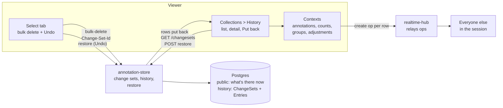
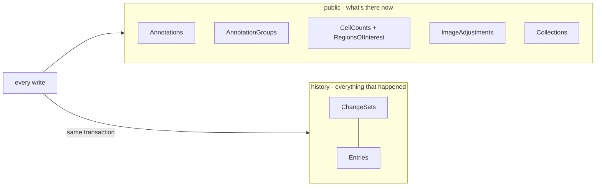
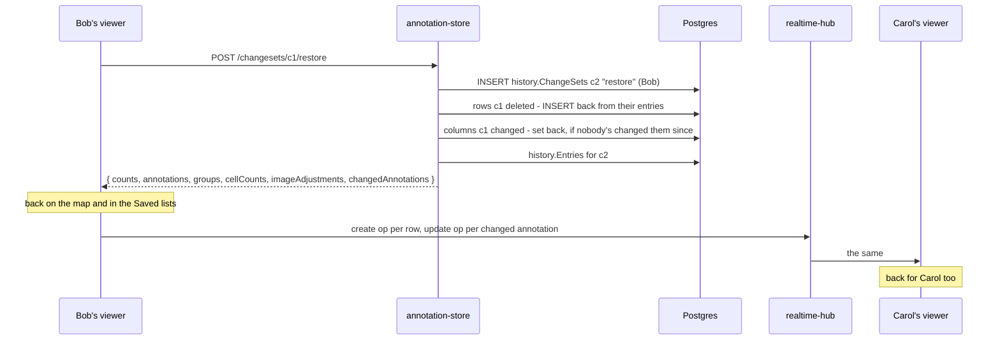
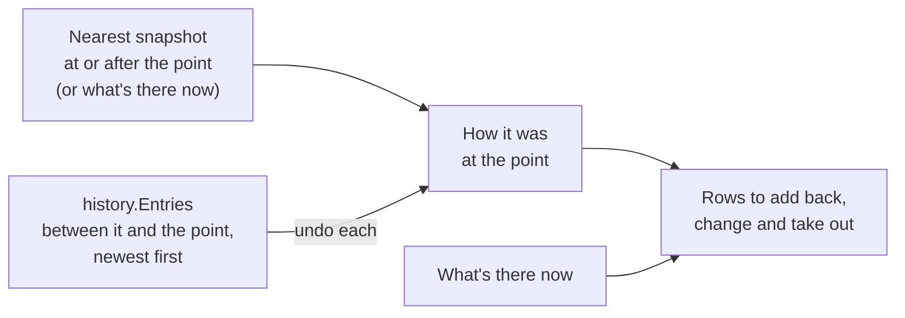
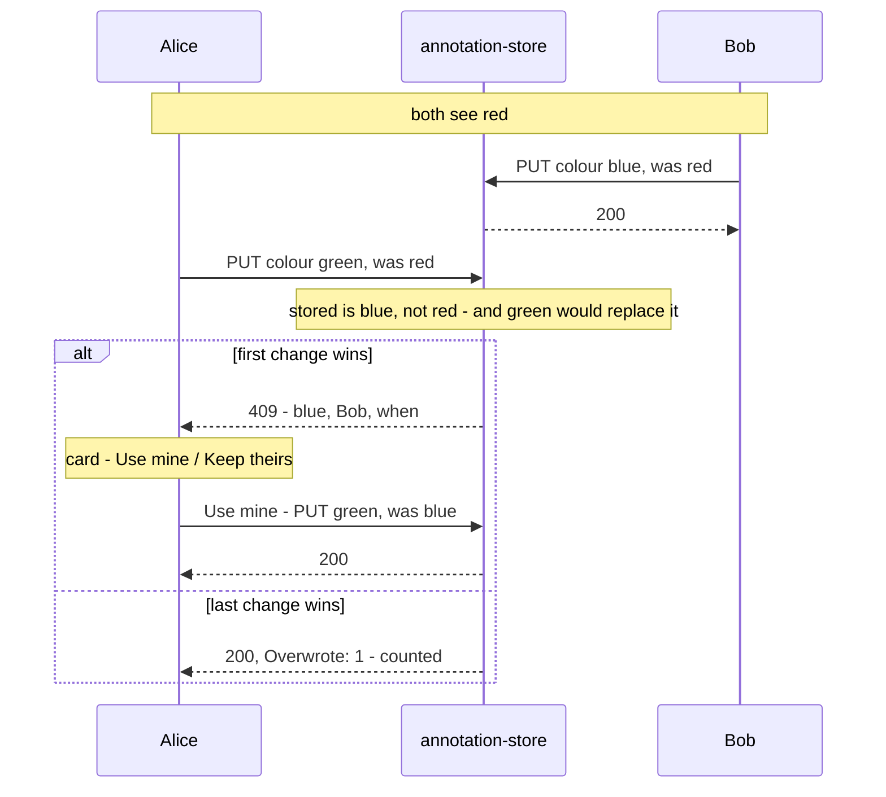
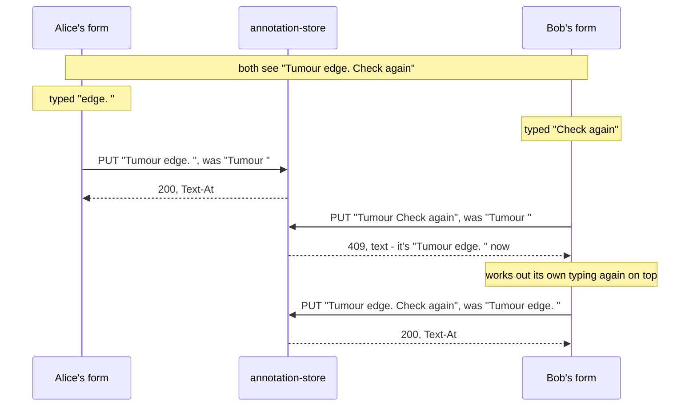

# Version control breakdown

Version control is the dissertation's focus: every change to a collection
is kept, with who made it, and can be taken back. It isn't one service. It
runs through annotation-store (what's kept and how it comes back), the
viewer (the History tab, Undo, live updates) and realtime-hub (telling
everyone else). This page follows it across all three. The per-service
breakdowns have the detail for each part, and
[todo.md](../todo.md#1-version-control) has the plan and the decisions
still to make.

## Contents

1. [Where it's up to](#1-where-its-up-to)
2. [How the pieces fit](#2-how-the-pieces-fit)
3. [Change sets](#3-change-sets)
4. [The history area](#4-the-history-area)
5. [Putting a change back](#5-putting-a-change-back)
6. [In the viewer](#6-in-the-viewer)
7. [Who can put things back](#7-who-can-put-things-back)
8. [Two people changing the same thing](#8-two-people-changing-the-same-thing)
9. [Test data](#9-test-data)
10. [Tests](#10-tests)
11. [What's next](#11-whats-next)
12. [Known gaps](#12-known-gaps)
13. [Files](#13-files)
14. [Glossary](#14-glossary)

## 1. Where it's up to

The steps from [todo.md](../todo.md#the-steps-in-order), each building on
the one before:

| #   | Step                                  | State                                                                                                                                                                                                                                                                          |
| --- | ------------------------------------- | ------------------------------------------------------------------------------------------------------------------------------------------------------------------------------------------------------------------------------------------------------------------------------ |
| 1   | Soft delete                           | Done, then replaced by step 2 - every write is in a change set, and a change set can be put back any time                                                                                                                                                                      |
| 2   | History log                           | Done in the store - a `history` schema, apart from the data, with what every change did to every row: a delete keeps the whole row, an edit the columns it changed, before and after. The live tables only hold what's there now. The History tab shows it (step 4)            |
| 3   | Periodic snapshots                    | Done - what can change in a collection, every 5,000 entries, so a whole collection can go back without undoing everything since                                                                                                                                                |
| 4   | Viewing history                       | Done - the collection's timeline is the History tab, opening a change shows what it changed, from and to, and every annotation and count has a timeline of its own                                                                                                             |
| 5   | Rollback                              | Done for a change set and for one row - putting a change set back brings back what it deleted and undoes what it changed, unless someone's changed it since. Going back on one row puts it how it was at any point on its timeline. A whole collection goes back to any change |
| 6   | Policy for two people editing at once | Done - picked per session, last change wins or first change wins, for colour, group and a group's name and notes. Labels and notes are merged live with Yjs. See [section 8](#8-two-people-changing-the-same-thing)                                                            |
| 7   | Evaluate it                           | Measured - see [evaluation.md](../evaluation.md). Everything's simulated, so real people are still to come                                                                                                                                                                     |

What works today, end to end: delete 21,000 annotations in one go, see it in
the History tab as one change, and put it all back days later - for
everyone in the session, live. Delete a group and put it back, and what was
in it goes back in. Every edit's before and after is kept, and opening it in History shows
each field from and to. Open one annotation's or count's timeline, and put it
back to how it was at any point - or bring back one row out of a delete. Put the
whole collection back to how it was after any change, for everyone, live.

## 2. How the pieces fit

- **annotation-store owns it all.** It decides what a change set is, writes
  the history with every save, and puts things back from it. The viewer never
  works out what to restore - it asks for a change set to be put back and is
  told what came back.
- **One API, two areas.** History is its own schema with its own tables,
  but annotation-store is the only way in. A second service with its own
  database would need its own copy of who can see what, couldn't put
  something back in one transaction, and could fall behind - see
  [Why not a separate service](#why-not-a-separate-service).
- **realtime-hub is only a relay.** It doesn't know about change sets. Whoever
  puts something back sends a create op per row, the same as an import, and
  the hub passes them on.
- **No polling.** The viewer doesn't watch for other people's restores; their
  create ops arrive live, and anything that wrote without telling realtime
  shows up on the next refetch.

## 3. Change sets

A change set is one change someone made, like a commit or a Perforce
changelist. It's a row in `history.ChangeSets`
([ChangeSet.cs](../../annotation-store/History/ChangeSet.cs)):

| Field                | What it is                                          |
| -------------------- | --------------------------------------------------- |
| `Id`                 | A GUID - chosen by the client, or made by the store |
| `CollectionId`       | The collection it was made in                       |
| `UserId`, `UserName` | Who made it, from their token                       |
| `What`               | What the first request in it did                    |
| `Created`            | When                                                |

- **Every write makes one.** Annotations, groups, cell counts, image
  adjustments, an import, deleting a collection and changing its settings all
  go through
  `ChangeSetAsync` in
  [ChangeSets.cs](../../annotation-store/History/ChangeSets.cs) once the
  access check and validation have passed, so a turned-down write leaves no
  change set behind.
- **Several requests can be one change.** A request can send a
  `Change-Set-Id` header. Every batch of a 21k bulk delete goes with the same
  id ([bulk.ts](../../image-viewer/src/components/annotation/bulk.ts)), so
  it's one change to read and one to put back. The response always says
  which change set it went in.
- **One person, one collection.** An id already used by someone else, or in
  another collection, is a 400.
- **One edit is one change.** An edit form (an annotation's or a count's
  label, notes and colour, or a group's name and notes) makes a change set
  id when it opens and sends it with every autosave. The store folds a
  repeat update to a row in the same change set into the entry already
  there (`FoldRepeatsAsync` in
  [HistoryLog.cs](../../annotation-store/History/HistoryLog.cs)): the first
  before stays, the latest after wins, a column that's back where it
  started drops out, and an edit that undid itself leaves no entry. It only
  folds into the row's latest entry from anyone, and only if that's an
  update. So nothing folds across a delete, or across someone else's change -
  that entry would span theirs, and say you'd made it. Two people taking turns
  in the same box are an entry a turn. Two saves of one row can't fold at the same
  moment - each has already updated the live row, and Postgres holds that
  row until the first commits.
- **Batches at the same moment.** The viewer sends batches all at once, so
  two can try to make the same change set together. The second insert fails
  on the primary key and reads the first one's instead.
- **What a change can be.** `add`, `change` and `delete` for an annotation,
  a group, a cell count and an image adjustment, plus `change annotations`
  and `delete annotations` (bulk), `merge groups`, `import`,
  `delete collection` and `restore`. The collection's settings are
  `rename collection` and the ones in `PeopleChanges`: sharing it or not,
  ending a session, joining and leaving, a role changing, someone removed, and
  a link made, changed or stopped. Saving a setting as it already is, or
  opening a link to what you already are, isn't a change.

## 4. The history area

- **An entry is what one change did to one row** (`history.Entries`): which
  row, create, update or delete, and `Before` / `After` as `jsonb`.
  - **Delete:** `Before` is the whole row, so it can be put back. A merged
    group's delete also says where it went (`MergedInto`).
  - **Update:** just the columns that changed, before and after - a recolour
    of 20,000 shapes is 20,000 small entries, not 20,000 copies of GeoJSON.
  - **Create:** nothing. The live row has it, or a later delete's copy will.
- **Written with every save.** The context's `SaveChanges` reads EF's change
  tracker and writes the entries in the same transaction as the change
  ([HistoryLog.cs](../../annotation-store/History/HistoryLog.cs)), for
  annotations, groups, cell counts, ROIs and image adjustments. A versioned
  row changing outside a change set throws, so nothing can change without
  its history.
- **Settings are a record only.** A collection's name, who's in it and its
  links are logged by the same save (`Settings` in `HistoryLog.cs`): the
  columns that changed, and for joining or leaving who it was and as what. Put
  back and rollback leave them alone, and a change that's only settings is a
  409 to put back, since putting back an old change must never let someone in
  again. They don't count as something you hadn't seen when rolling a
  collection back either.
- **A link's code is never logged.** It's the only secret there is, and anyone
  who can read the collection can read its history. Its entry is under a hash
  of the collection and the code, which can't be turned back into it. Joining
  as a guest, and making a collection, aren't logged.
- **Bulk changes in bulk.** Up to 20,000 annotations at once go through
  [AnnotationBulk.cs](../../annotation-store/History/AnnotationBulk.cs):
  before values in one query, the change in one statement, the history in
  one Postgres `COPY`.
- **The live tables only hold what's there now.** A delete takes the row
  out. No `Deleted` column, no query filter - nothing reading the tables has
  to remember to skip anything.
- **A collection is the exception.** It holds everything in it, so deleting
  one hides it (`Collections.Deleted`) rather than copying the lot into the
  history. Its owner can bring it back.
- **Moving off soft delete.** The `HistoryArea` migration turned every
  soft-deleted row into a delete entry, using Postgres' own `to_jsonb` - the
  same shape `HistoryLog` writes - then took them out of the live tables and
  dropped the columns. It can be run back down.
- **Nothing's purged.** History stays for good. A retention rule is future
  work - see [ethics.md](../ethics.md#keeping-history).

### Why not a separate service

The cleanest-looking split is a history service with its own database, fed
events by annotation-store. It was ruled out because the two would share
data they both need:

- **Who can see it.** Only annotation-store knows members, roles, guests and
  ended sessions. History would have to ask it every time, or keep a copy
  that goes stale - someone taken out of a session could still read it.
- **Putting back crosses the line.** The old rows would be in one service
  and the live ones in the other, so a restore could half happen.
- **It drifts.** Events need an outbox, de-duplicating and ordering, and
  history would be a moment behind - delete something, open History, and
  it isn't there yet.
- **Reads that need both.** "300 still deleted" depends on what's live now,
  and two databases can't be joined.
- **Two copies of an annotation's shape.** Old entries keep the shape from
  when they were written, and the other service can't see the migrations.

A schema of its own, behind the one API and written in the same
transaction, keeps the separation without any of that. `HistoryLog` is the
seam if it ever needs to be split out.

More in [annotation-store.md section 11](annotation-store.md#11-history-and-change-sets).

## 5. Putting a change back

`POST /changesets/{id}/restore` puts it back how it was before that change.

- **Rollback, not undo.** Any editor can put back anyone's change, and the
  restore is a change of its own - "Put back a change" in the History list,
  made by whoever did it.
- **What comes back.** Every row the change deleted, unless it's back
  already. And every column it changed on a row that's still here - but only
  if it's still what the change made it, so a later edit is never undone.
- **So groups work.** A deleted group comes back with what was in it (the
  delete ungrouped them, and each of those is an update to put back). A
  merge put back takes back what was moved. An annotation whose group has
  gone since comes back ungrouped, or in the group it was merged into.
- **It answers with the rows.** How many of each came back, the rows
  themselves as the reads give them (cell counts without their dots), and
  `changedAnnotations` - ones that were already there and went back how they
  were. The viewer shows them and tells everyone else without loading
  anything again.
- **Text goes into open forms too.** The answer's `textWas` says what each label
  and notes it put back over said. If anyone has that form open, the old text
  goes into the box for everyone, with what they're typing kept - see
  [Labels and notes](#labels-and-notes).
- **One transaction.** All of it comes back or none of it does.
- **Again is harmless.** Putting back something already back answers zeros
  and empty lists - someone else got there first.
- **Turned down:** a viewer or guest (403), someone not in the collection or
  a change set that doesn't exist (404), an ended session (409), a change
  that's only settings (409), and a personal collection whose owner has a newer
  one for that slide (409).
- **How long.** 20,000 annotations put back take about 5 seconds on
  Postgres 17 in Docker - the rows are rebuilt from their entries in the
  database, not sent through the app. Soft delete flipped a column instead,
  which was quicker; keeping deleted rows out of the live tables costs that.

### Slices go back together

An annotation on a volume has a first and a last slice, and both can be moved. An
entry only has the end that changed, so putting one back a column at a time, the
way a colour is, could undo one end after someone's moved the other: slices 4 to 9
moved to 1 to 9, then to 1 to 2, and putting the first move back would give 4 to 2.
Or a first slice with no last one.

So the range is one value. Putting a move back works out the whole range either
side of it, by walking the row back, and only sets it if the annotation's still on
exactly the slices that move left it on. Anything else in the same change goes
back as usual. Going back on one row and putting a whole collection back undo
everything since, so they land on a range that was really there.

### Going back on one row

`POST /annotations/{id}/history/{entryId}/restore`, and the same on
`/cellcounts`, puts one row how it was just after that entry. The two kinds of
putting back do opposite things when someone's edited since:

|                              | A change set's Put back               | Going back on one row               |
| ---------------------------- | ------------------------------------- | ----------------------------------- |
| What it's for                | Take back that one change             | Put it how it was then              |
| A later edit by someone else | Left alone                            | Undone                              |
| What it touches              | Every row in the change               | One row                             |
| Row deleted since            | Comes back, if this change deleted it | Comes back, as it was at that point |

- **How it was isn't stored, it's worked out.** Each entry says what it
  changed, so going through the entries since, newest first and undoing each,
  lands on how it was - through deletes and put backs too.
- **It can't undo what you haven't seen.** The request says the newest entry
  the person was looking at. A newer one is a 409 under either edit policy, with
  the row locked for the check, and the viewer shows them the timeline again.
  Nothing's lost either way, but silently undoing a change made a moment ago is
  the one thing this shouldn't do.
- **It's a change of its own** (`restore annotation`, `restore cell count`), so
  it's on the timeline and in the History tab, and can be gone back on.
- **Going back to a delete** means how it was when it was deleted, so a row with
  only its delete recorded can still come back.
- **A group that's gone isn't brought back with it.** It's one row, so it goes
  in the group that one was merged into, or none, and the confirm page says so.

### Putting a whole collection back

`POST /changesets/{id}/rollback` puts everything how it was just after that
change: rows added since are taken out, rows deleted since come back, the rest go
back whoever changed them. Image adjustments stay as they are - they're one
person's own presets, not the work being versioned. So do the collection's name,
who's in it and its links.

- **It only goes backwards.** Entries say what an update and a delete changed, but
  a create's entry has nothing in it - the row's contents are in the live row or a
  later delete's copy. So it can't replay forwards from an earlier snapshot. It
  starts from the nearest snapshot at or after the point, or from what's there now
  if there isn't one, and undoes entries down to the point. That's the difference
  from the usual snapshot-plus-replay, and it means a snapshot only helps a point
  older than it.
- **What it saves.** Without a snapshot it undoes everything since the point. With
  them it only undoes what's between the point and the next snapshot, so that
  stops growing with the history. That stretch is 5,000 entries or more: the check
  runs every 30 seconds, and one bulk change can be 20,000. Measured with 20,000
  annotations, with 120,000 entries after the snapshot: 953ms undoing 140,000
  entries from what's there now, 331ms undoing 20,000 from the snapshot. So it's
  about three times as quick there and the gap grows with the history, but it isn't
  free either way, since both still read everything in the collection. See
  [evaluation.md](../evaluation.md#rolling-back).
- **A snapshot only holds what can change** - label, notes, colour, group and
  slices; a group's name and notes; a count's details. Shapes and dots are fixed once saved,
  and they're nearly all of a row. For those 20,000 annotations a snapshot is 820KB
  as stored (2.2MB of JSON), against 25MB for the whole rows - about 30 times
  smaller (measured before slices were in it - they add about 1% stored, and 31% to
  the JSON). Rows brought back get their
  shape from their latest delete's copy, which a row that's gone always has.
- **One from before slices were in it is passed over**, as it can't say which
  slices anything was on. It looks for a later one that has them, or works from
  what's there now, which is slower and lands on the same answer. Nothing has to be
  taken again by hand.
- **Nothing's stamped wrong.** Entry ids are handed out before a save commits, so
  a snapshot could say it's up to an entry whose earlier neighbour hasn't landed.
  Taking one locks `history.Entries` in `SHARE` mode while it reads, so that can't
  happen. A Postgres-only test takes snapshots during saves and checks going back
  from them lands on the same as without. It gives up after 2 seconds rather than
  hold saves up, and tries again 30 seconds later - nothing depends on one.
- **Nothing can land half way through.** The rollback takes the collection's row
  `FOR UPDATE`, which every new row and change set needs left alone. So anything
  part way through finishes first, anything new waits, and the `latest` check is
  right: if there's an entry the person hadn't seen, it's a 409.
- **It's a change of its own** (`restore collection`), and can be gone back on from
  the change before it. A test goes back to every point in a story of 14 changes in
  turn, checks it matches what was recorded there at the time, shapes and dots
  included, then goes forward to the end again and checks that too.
- **How long.** On a collection of 20,000 annotations, about 300ms for one row, up to
  about 7 seconds to bring back all 20,000. Most of the cost for small changes is
  working it out, which reads the whole collection however little changed. Full numbers
  in [evaluation.md](../evaluation.md#rolling-back).

## 6. In the viewer

### Undo on a bulk delete

The Select tab's delete asks first, takes them off the map, and sends the
delete straight away as one change set. The toast's **Undo** (8 seconds)
puts that change set back. The delete isn't held back for the 8 seconds any
more - it's in annotation-store at once, with its history, so closing the
tab during the toast doesn't lose it. After the toast's gone, the History
tab can still put it back. See
[image-viewer.md](image-viewer.md#the-select-tab---many-at-once).

### The History tab

In the Collections panel, for the collection you're in.

- **The list** - one line a change, newest first, under day headings (Today,
  Yesterday, then the date): an icon for the kind of change, what it did
  ("Deleted 2,140 annotations"), the person's initials and the clock time.
  A red bin marks a delete that still has something to put back. Paged 50 at
  a time with the Saved lists' pager. **Filter** narrows it to who made the
  change, the kind (added, changed, deleted, merged, imported, put back, people
  and sharing) and when, with the Saved lists' filter popout; **Newest first / Oldest first**
  turns it round.
- **The detail** - clicking a row opens it in place of the list: who, when to
  the second and how long ago, what's still deleted, the change set's id,
  and **what changed** - each field from and to ("Label Region 4 ->
  Region 4 (checked)", colours as swatches, groups by name), many rows as
  one line ("10 annotations", the colours they started as -> the one they
  went to), and what it deleted by name. Past the first 5, **Show all 60** lists
  every row it deleted, a page at a time with a search, and an annotation or
  count opens its timeline. Back goes to the same page and search. Someone joining is
  "Access Not in it -> Can edit" under their name.
  **Put back** and **Cancel** are there for editors, with a line saying what
  will happen. This page is the confirm - there's no popup. Once put back it
  stays open and says so.
- **After a restore** the rows go back into the annotation, cell count, group
  and adjustment contexts (an annotation already there is replaced, so it
  moves back into its group), the Saved lists refetch, everyone else gets a
  create op per row and an update for each changed one, and a toast says
  what came back.

See [image-viewer.md](image-viewer.md#history---putting-deletes-back) for
how it's built.

### One row's timeline

**History** on a Saved row opens everything that's happened to that annotation
or count, newest first, each change from and to. **Go back to this** opens a
page saying what would change, which is the confirm. A deleted row is reached
from its name on the change that deleted it. See
[image-viewer.md](image-viewer.md#one-rows-timeline).

### A whole collection

A change opened in the History tab has **Put whole collection back to here…** for
editors. It says what would happen in plain lines, and that's the confirm. Every
viewer then loads the collection again - there can be too many rows to send - and
everyone else gets a toast saying someone did it. See
[image-viewer.md](image-viewer.md#a-whole-collection-back-to-a-change).

### Small things that had to change for it

- Someone else's create op clears that id from your deleted ids - otherwise
  the Saved list kept hiding a row that had been put back.
- The Select tab forgets annotations once they're deleted, so putting them
  back doesn't pick them again.
- `POST /collections/ensure` hands back the other request's collection when
  two arrive together, instead of a 500 - the viewer's first load can send
  two.

## 7. Who can put things back

Any editor, for anyone's change. The other option is only the person who
made it plus the host. It's still to be decided (see
[todo.md](../todo.md#things-to-decide-before-building)), so it's kept to one
check each side:

- the viewer's `canRestore` in
  [history.ts](../../image-viewer/src/components/collections/history/history.ts)
- the Editor check on `POST /changesets/{id}/restore` in
  [ChangeSets.cs](../../annotation-store/History/ChangeSets.cs)

Going back on one row and putting a whole collection back are the same rule,
though a whole collection undoes far more - see
[todo.md](../todo.md#things-to-decide-before-building). The first is `canGoBack` in
[itemVersions.ts](../../image-viewer/src/components/collections/history/itemVersions.ts)
and the Editor check in
[ItemHistory.cs](../../annotation-store/History/ItemHistory.cs).

## 8. Two people changing the same thing

What happens when two people change the same thing at about the same time.
The host picks it when they start a session, and it's saved on it
(`Collections.EditPolicy`). Personal collections are one person, so they're
always last change wins. The code is in
[Conflicts/EditConflicts.cs](../../annotation-store/Conflicts/EditConflicts.cs)
and [editPolicy.ts](../../image-viewer/src/components/realtime/editPolicy.ts).

| Kind of field                                              | Policy                                             | Why                                                                                          |
| ---------------------------------------------------------- | -------------------------------------------------- | -------------------------------------------------------------------------------------------- |
| Labels and notes on annotations and cell counts            | Merged live (Yjs), each saving only their own      | Two people can type in the same box at once and nothing's lost, so there's nothing to choose |
| An annotation's colour and group, a group's name and notes | Last change wins or first change wins, per session | One value - only one person's can stay                                                       |
| Deletes                                                    | Not checked                                        | Anything deleted can be put back from History                                                |
| Cell counts' other fields, image adjustment presets        | Not checked                                        | Fixed once saved, or one person's own                                                        |

- **Per field, not per row.** A save sends the value it started from (its
  "was") with the value it wants. It's in the way of someone else only when
  the stored value isn't its was any more - someone's changed it since -
  and the save would change it again. A row version would have called a
  regroup and a recolour of the same annotation a conflict, and counted it
  as a lost change under last change wins, which it isn't.
- **A field that isn't changing is left alone.** The viewer always sends
  colour with a label edit. When the colour is the same as its was, the
  save isn't changing it, so the stored colour - maybe someone else's newer
  one - stays. A label edit from an old copy never puts an old colour back,
  under either policy.
- **No was, no check.** Scripts and older clients leave it out and save as
  they always did.
- **One at a time.** The check and the save happen with the row locked
  (`FOR UPDATE`), so two saves from the same was can't both get through. A
  Postgres-only test sends ten together and exactly one wins; without the
  lock it fails.
- **Turned down before it joins a change set.** A refused save makes no
  change set and no history, like any other turned-down write. A bulk
  change refused for every row returns before it joins one; one partly
  through joins it for the rows that changed.
- **The viewer under first change wins:**
  - Saves to one item go one at a time
    (`oneAtATime`), and each one's was is what the store last confirmed,
    not what's on screen - otherwise dragging the colour picker would
    conflict with itself.
  - A change goes out to everyone else only once it's saved, so nobody sees
    one that's then turned down.
  - On a 409, theirs is shown straight away, and a card says who changed
    what and when - "Bob Hughes changed the colour of Region 4 just now,
    before your change got there" - with **Use mine** (save again over it)
    and **Keep theirs**.
  - A bulk change that's partly turned down changes the rest, and the card
    says how many were left alone, with **Use mine for those**.
- **The viewer under last change wins:** as before - ops go out straight
  away, except text, which goes once it's saved - but saves send their was too, so the store can count what they
  overwrite.
- **Counted.** `annotation_store.conflicting_saves` (an OpenTelemetry
  counter, by policy, entity and outcome) goes up for every save in the way
  of someone else's: "refused" under first change wins, "overwrote" under
  last change wins. The dashboard's Edits row graphs it. A single save that
  overwrote someone also answers with an `Overwrote: 1` header, and a bulk
  change with `overwrote`, so a script can count without the dashboard.
- **Measuring it.**
  [simulate_conflicts.py](../../scripts/simulate_conflicts.py) has
  simulated people recolour a few shared annotations from their own copies,
  each seeing other people's changes `--notice` seconds late. It prints how
  many saves collided and what happened to them, and save times. Run it
  against a last change wins session and a first change wins one with the
  same settings and the same number of editors.
- **Locking** - whoever starts editing holds it - is the other policy in
  [todo.md](../todo.md#policies-for-two-people-editing-the-same-thing). It's
  for the write-up rather than built: it's the most code, and worst on the
  large sessions this is for.

### Labels and notes

Everyone with a form open sees the same text, merged live. What's saved is
another matter: if each form saved the whole box, your change would have
someone else's typing in it, and a form open since before a put back would save
the old text over it. So each person saves only what they typed themselves. The
code is in [ownText.ts](../../image-viewer/src/components/realtime/ownText.ts).

- **A save is the stored text with your typing in it.** Each form keeps every
  character with who put it there and whether it's stored. Someone else's
  typing that isn't stored yet is left out, and follows in their own save.
- **A stale one is turned down, whatever the policy.** A save says what label
  and notes it started from (`wasLabel`, `wasNotes`). If that's not what's
  stored any more and the save would change it, it's a 409 with `text: true` and
  the text there now. Nobody's asked anything: the viewer works its own typing
  out again and saves on top at its next pause. This is what stops a form left
  open putting old text back, even if it never heard about the put back. A
  closing form tries again straight away.
- **No was, no check**, so scripts save as they always did.
- **Which is newer.** Answers and messages can arrive in any order, so every
  answer about a row's text has a `Text-At` header: when that was what's stored,
  in microseconds, taken with the row locked. The viewer sends it on with the op
  and ignores anything older than what it has.
- **Which characters.** Two people writing sentences in one box repeat letters
  all the time, and from the text alone there's no telling whose "e" was stored.
  So the op also says which characters the saved text is made of, by their Yjs
  ids, run together (`textIds`). Only the viewers use it - the store never sees
  them, and the hub passes it on with the rest of `data`. Where nobody says, it's
  worked out from what it spells, and a repeated letter can be a guess. Without
  the ids, simulated people writing ordinary sentences saved a letter of someone
  else's in 178 runs of 400; with them, none.
- **Putting old text back reaches open forms.** Whoever does it puts the old
  text in the box itself, marked so nobody's form takes it for typing. What
  anyone's typed since is kept: it changes what the text was to what it should
  be, and merges that with what's in the box. A whole collection rollback closes
  open forms, as everything's loaded again, and what was typed is saved on top of
  the rolled back text.
- **Nothing's left behind.** Typing that's not been saved for 6 seconds
  (`LEFT_BEHIND_MS`) is from someone who's gone, so whoever still has the form
  open saves it. The last one to close a form saves whatever's in it.
- **A box that's out of step** with what's stored for 4 seconds with nobody typing
  (`PUT_RIGHT_MS`) is put right by one of the people in it, whoever's connection
  id is lowest.
- **Counted.** `annotation_store.text_saves_refused` goes up for every save worked
  out again, and the dashboard's Edits row graphs it. A few are normal with two
  people in a box. A lot means saves are chasing each other.

Simulated in
[sharedTyping.test.ts](../../image-viewer/src/components/realtime/sharedTyping.test.ts):
two or three people with the real form code, a store and a hub made of timers,
messages and answers arriving late and out of order, people joining, leaving and
vanishing, put backs landing mid sentence. Between them they check everyone ends
up with what's stored, nothing's lost, nothing old comes back and nobody saves more
of a letter than they typed. 8 seeds run every time, and
it's been run over 400 (`VITE_TYPING_SEEDS=400`).

## 9. Test data

[seed_history.py](../../scripts/seed_history.py) makes a session called
"History test" on the slide, with about 20 changes from alice, bob and carol
over the last four and a half days: an import, adds, a recolour, edits,
groups made, merged and deleted, cell counts, a bulk delete that's put back
and one that isn't. Five still have something to put back.

The changes go through the API, so the change sets are real. The store
stamps them all as now, so the script then moves them - and the history's
copies of rows deleted since - back in Postgres with `psql`, and reads the oldest one back through the API to check it landed in
the store's database. See the
[scripts README](../../scripts/README.md#history-test-data).

## 10. Tests

| Where                                      | Tests          | Covers                                                                                                                                                                                                                                                                                                                                                                                                                                                                                                                                                                                                                                                                                                                                                                                                                                                                                                                                                                                                                                                                                                                                                                                                                                                                                                                                                                                                                                                                                                                                  |
| ------------------------------------------ | -------------- | --------------------------------------------------------------------------------------------------------------------------------------------------------------------------------------------------------------------------------------------------------------------------------------------------------------------------------------------------------------------------------------------------------------------------------------------------------------------------------------------------------------------------------------------------------------------------------------------------------------------------------------------------------------------------------------------------------------------------------------------------------------------------------------------------------------------------------------------------------------------------------------------------------------------------------------------------------------------------------------------------------------------------------------------------------------------------------------------------------------------------------------------------------------------------------------------------------------------------------------------------------------------------------------------------------------------------------------------------------------------------------------------------------------------------------------------------------------------------------------------------------------------------------------- |
| annotation-store `HistoryTests`            | 80             | A delete leaves the live table and keeps the whole row, an edit keeps only what changed, a create copies nothing, nothing versioned changes outside a change set, no history columns on the live tables. Batches in one change set (and at the same moment, Postgres only). Restore - its own change set only, editors only, collections by their owner, answers with the rows, a group back with what was in it, a recolour undone but never a later edit, a slice move back as one range or not at all if either end's moved since (through deletes too, and the rest of its change still going back), a count back with its dots and ROI, an annotation following a merged group, ten restores at once putting it back once (Postgres only). What a change did, from and to. A row deleted again later belonging to the later delete. Narrowing by person, kind and date, oldest first, the facets. Who and what on every write, header rules, the list and total. One edit saved many times as one entry - columns back where they started dropping out, separate edits staying separate, nothing folding across a delete, a folded edit putting back to before it, saves at the same moment (Postgres only), and the fold itself. Renames, sharing, ending, joining, leaving, roles and links, never a link's code and nothing for saving what's there, not put back or rolled back. Everything a change deleted, a page at a time and searched. Nothing folding across someone else's change. What the text was before a put back |
| annotation-store `ItemHistoryTests`        | 30             | The walk back through edits, a delete and the create that put it back. A timeline for that row only, newest first, with who and what, paged, groups by name, never a deleted copy. Going back undoing everything since whoever did it, as its own change, which can itself be gone back on. A later change not seen turned down with nothing changed and no change set. Already how it was not being a change. The preview changing nothing. A deleted annotation coming back at that point, and its change set then having nothing left to put back. A delete entry meaning how it was when deleted, going back past a delete that was put back, a count with its dots and region, a gone group coming back as none and a merged one as where it went. Every point of slices moving going back to exactly those slices, deleted or from before slices included, and a flat slide's preview saying nothing about them. Every column being one that goes back or one that's fixed. Who can look and who can go back, an entry from another row, the History filter counting it as put back. Bringing back and going back at the same moment (Postgres only)                                                                                                                                                                                                                                                                                                                                                                              |
| annotation-store `CollectionRollbackTests` | 22             | Every point in a story of 20 changes, slices moving included, going back to exactly what was recorded there, shapes, dots and regions included, and forward to the end again. From a snapshot landing on the same as from what's there now, undoing fewer entries. The preview changing nothing, a later change not seen turned down, already how it was not being a change, its own change set counted as put back. Image adjustments left alone, who can look and who can go back. A slice move going back, after a delete too, and a snapshot from before slices passed over. A snapshot holding exactly what can change and no shapes, none for an empty collection, which collections are due. Snapshots taken during saves still agreeing, and rollbacks at the same moment with only one through (Postgres only). Settings left alone, and one changing not counting as a change you hadn't seen                                                                                                                                                                                                                                                                                                                                                                                                                                                                                                                                                                                                                                 |
| annotation-store `HistoryMigrationTests`   | 1              | Postgres only: soft-deleted rows become delete entries that rebuild exactly, and go back on the way down                                                                                                                                                                                                                                                                                                                                                                                                                                                                                                                                                                                                                                                                                                                                                                                                                                                                                                                                                                                                                                                                                                                                                                                                                                                                                                                                                                                                                                |
| annotation-store `CollectionsTests`        | 1 of 19        | 20 ensures at the same moment all get the one collection (Postgres only)                                                                                                                                                                                                                                                                                                                                                                                                                                                                                                                                                                                                                                                                                                                                                                                                                                                                                                                                                                                                                                                                                                                                                                                                                                                                                                                                                                                                                                                                |
| annotation-store `PostgresPoolTests`       | 1              | Every test class's connections fit in a stock Postgres                                                                                                                                                                                                                                                                                                                                                                                                                                                                                                                                                                                                                                                                                                                                                                                                                                                                                                                                                                                                                                                                                                                                                                                                                                                                                                                                                                                                                                                                                  |
| viewer `changes.test.ts`                   | 25             | From and to for every kind of field - text, (empty), colours, groups by name, flags, numbers, image adjustment settings one by one - many rows on one line, deletes by name. A name, someone's access, a link and an ended session, and when there's more deleted to show                                                                                                                                                                                                                                                                                                                                                                                                                                                                                                                                                                                                                                                                                                                                                                                                                                                                                                                                                                                                                                                                                                                                                                                                                                                               |
| viewer `history.test.ts`                   | 37             | Labels for every kind of change, icons, initials, what's still deleted, who can put back, toast and note wording, day grouping, the ops sent to everyone else (creates, and updates for changed annotations). People and sharing, groups that went back, and text left out of ops an open form already has                                                                                                                                                                                                                                                                                                                                                                                                                                                                                                                                                                                                                                                                                                                                                                                                                                                                                                                                                                                                                                                                                                                                                                                                                              |
| annotation-store `EditConflictsTests`      | 35             | The policy per session (and personal always last change wins), a colour from an old copy turned down with who and what, "use mine", last change wins letting it through and counting it, a label edit never putting back an old colour or conflicting, the same colour not a conflict, a save with no `was` isn't checked, bulk recolour and regroup under each policy, a group rename, no change set for a refused save, checked batches at the same moment in one change set and saves from one copy at the same moment with only one through (Postgres only). Labels and notes started from text that's changed since turned down in any session, with what's there now and who changed it, the same for counts, one that isn't changed left alone, every answer saying when the text was that, and sixteen people saving one box at once losing no one's letter (Postgres only)                                                                                                                                                                                                                                                                                                                                                                                                                                                                                                                                                                                                                                                     |
| viewer `ownText.test.ts`                   | 44             | Which of a box is yours: typing, taking out, pasting, two people on one word, a save on its way, one turned down and worked out again, put backs landing on typing, characters by id, over the limit                                                                                                                                                                                                                                                                                                                                                                                                                                                                                                                                                                                                                                                                                                                                                                                                                                                                                                                                                                                                                                                                                                                                                                                                                                                                                                                                    |
| viewer `sharedTyping.test.ts`              | 10             | The simulation in [section 8](#labels-and-notes), 8 seeds each                                                                                                                                                                                                                                                                                                                                                                                                                                                                                                                                                                                                                                                                                                                                                                                                                                                                                                                                                                                                                                                                                                                                                                                                                                                                                                                                                                                                                                                                          |
| viewer `textMerge.test.ts`                 | 4              | The same edit made to text that's changed since                                                                                                                                                                                                                                                                                                                                                                                                                                                                                                                                                                                                                                                                                                                                                                                                                                                                                                                                                                                                                                                                                                                                                                                                                                                                                                                                                                                                                                                                                         |
| viewer `storedText.test.ts`                | 10             | The newest text whatever order it's heard in, ids run together and back, a rollback forgetting the lot                                                                                                                                                                                                                                                                                                                                                                                                                                                                                                                                                                                                                                                                                                                                                                                                                                                                                                                                                                                                                                                                                                                                                                                                                                                                                                                                                                                                                                  |
| viewer `putText.test.ts`                   | 6              | Old text into an open form, typing kept, two people not putting it in twice                                                                                                                                                                                                                                                                                                                                                                                                                                                                                                                                                                                                                                                                                                                                                                                                                                                                                                                                                                                                                                                                                                                                                                                                                                                                                                                                                                                                                                                             |
| viewer `textSaves.test.ts`                 | 9              | The pauses, what's left behind, putting a box right, closing                                                                                                                                                                                                                                                                                                                                                                                                                                                                                                                                                                                                                                                                                                                                                                                                                                                                                                                                                                                                                                                                                                                                                                                                                                                                                                                                                                                                                                                                            |
| viewer `sharedFields.test.ts`              | 26             | Carets, joining late, reconnecting to a different copy without replacing anyone's text, a put back not being typing                                                                                                                                                                                                                                                                                                                                                                                                                                                                                                                                                                                                                                                                                                                                                                                                                                                                                                                                                                                                                                                                                                                                                                                                                                                                                                                                                                                                                     |
| viewer `itemVersions.test.ts`              | 32             | Paths, a version's title and icon by what happened to that row, who can go back and when, lines from and to with groups by name, the confirm's wording, the toast by what it's called now                                                                                                                                                                                                                                                                                                                                                                                                                                                                                                                                                                                                                                                                                                                                                                                                                                                                                                                                                                                                                                                                                                                                                                                                                                                                                                                                               |
| viewer `rollback.test.ts`                  | 6              | Paths, who can, the plain lines for each kind of row, nothing to do                                                                                                                                                                                                                                                                                                                                                                                                                                                                                                                                                                                                                                                                                                                                                                                                                                                                                                                                                                                                                                                                                                                                                                                                                                                                                                                                                                                                                                                                     |
| viewer `realtime.test.ts`                  | 2 of its tests | The nudge that says the whole collection wants loading again, and that nothing else counts as one                                                                                                                                                                                                                                                                                                                                                                                                                                                                                                                                                                                                                                                                                                                                                                                                                                                                                                                                                                                                                                                                                                                                                                                                                                                                                                                                                                                                                                       |
| scripts `test_time_rollback.py`            | 10             | Shapes, batches to the store's limit, colours that always record a change, the comparison and its report                                                                                                                                                                                                                                                                                                                                                                                                                                                                                                                                                                                                                                                                                                                                                                                                                                                                                                                                                                                                                                                                                                                                                                                                                                                                                                                                                                                                                                |
| viewer `editPolicy.test.ts`                | 11             | The option's default, reading a 409, the card's wording (fields, who, when, singular and plural), when ops go out, saves to one item in order and carrying on after one fails                                                                                                                                                                                                                                                                                                                                                                                                                                                                                                                                                                                                                                                                                                                                                                                                                                                                                                                                                                                                                                                                                                                                                                                                                                                                                                                                                           |
| scripts `test_simulate_conflicts.py`       | 9              | Each person's copy - others' saves only once they're old enough, what they heard for themselves - picking a new colour, the summary under each policy                                                                                                                                                                                                                                                                                                                                                                                                                                                                                                                                                                                                                                                                                                                                                                                                                                                                                                                                                                                                                                                                                                                                                                                                                                                                                                                                                                                   |
| viewer `bulk.test.ts`                      | 14             | Batches, one change set id per change, Undo only after the delete's in, an edit form's change set on each save                                                                                                                                                                                                                                                                                                                                                                                                                                                                                                                                                                                                                                                                                                                                                                                                                                                                                                                                                                                                                                                                                                                                                                                                                                                                                                                                                                                                                          |
| viewer `savedDates.test.ts`                | 15             | Day headings by the calendar, times, "12 minutes ago"                                                                                                                                                                                                                                                                                                                                                                                                                                                                                                                                                                                                                                                                                                                                                                                                                                                                                                                                                                                                                                                                                                                                                                                                                                                                                                                                                                                                                                                                                   |
| viewer `paging.test.ts`                    | 1 of its tests | The History list's page and total URLs                                                                                                                                                                                                                                                                                                                                                                                                                                                                                                                                                                                                                                                                                                                                                                                                                                                                                                                                                                                                                                                                                                                                                                                                                                                                                                                                                                                                                                                                                                  |
| scripts `test_seed_history.py`             | 13             | The story's order, the SQL that moves it back (history's copies included, nothing touching the old soft delete columns), reading the connection string                                                                                                                                                                                                                                                                                                                                                                                                                                                                                                                                                                                                                                                                                                                                                                                                                                                                                                                                                                                                                                                                                                                                                                                                                                                                                                                                                                                  |

The Postgres-only tests are the ones SQLite can't show: requests at the
same moment, and the real migrations. CI runs the store's suite on both.

## 11. What's next

- **Trying it with real people**, if [ethics](../ethics.md) allow it - everything in
  [evaluation.md](../evaluation.md) is simulated.

The decisions still open - where the order comes from, text fields,
privacy - are listed in
[todo.md](../todo.md#things-to-decide-before-building). The games parallels
for the write-up have [their own list](../todo.md#games-parallels-to-write-up).

## 12. Known gaps

- **Changes from before history was kept** show "Nothing was recorded for
  this change" - soft delete only kept deletes.
- **Typing left behind is saved under someone else's name.** If whoever typed it
  drops out for 6 seconds before it's saved, whoever still has the form open saves
  it. The other choice is losing it.
- **Whose a repeated letter is can be a guess** where nobody says which characters
  were stored: after a put back, or someone saving and dropping out before their
  op goes. It's who it's put down to that can be wrong, not what the box says.
- **A put back reaches open forms only if whoever did it stays connected** long
  enough to put it in the box. If they don't, nothing old can be saved, and the box
  is put right once it's been quiet for 4 seconds.
- **`Text-At` needs the store's clock not to go backwards.** It's one store, so it's
  one clock. Several behind a load balancer would want a counter on the row instead.
- **A restore can't be put back.** It reverts deletes and updates, and the
  rows a restore brings back are creates, which aren't undone. One row can be
  gone back on from its timeline, to before the restore or after it - but not
  to not being there, since that's a delete.
- **An edit landing during a whole collection rollback.** New rows and change sets
  wait for it, but an open edit form reusing its change set can still save a row
  the rollback didn't touch. It's in the history.
- **Image adjustments and settings don't go back with a collection**, on purpose.
- **Snapshots are never purged**, and an old one is rarely the nearest to anything.
  At this size it doesn't matter yet.
- **Group and image adjustment rows have no timeline.** Their entries are kept,
  and shown in the History tab. Annotations and counts are what people work on.
- **Timelines aren't told about other people's edits.** Ops for an update don't
  bump the revision, so an open timeline can be out of date. Going back catches
  it with the 409, and a save or delete settling loads it again.
- **A column added later.** An old delete's copy of a row won't have a column
  added since - a new non-null column needs a default. Slices are the one case so
  far, and going back to a delete from before them means every slice. A column that
  can change also has to go in `ItemHistory.Changeable`, `AnnotationState` and the
  snapshots - tests fail until it's in there or down as fixed.
- **Putting back 20,000 takes about 5 seconds**, where soft delete was
  near-instant.
- **Nothing is purged**, and change sets and entries keep names, user ids and
  whole rows for good.
- **Not logged:** making a collection or starting a session, and guests joining.
- **The hub doesn't check ops against the store** - it trusts the viewer to
  have saved, or restored, before telling everyone.
- **Last change wins counts can run high by a few.** Ops go out before the
  save there, so another viewer can take a change as stored a moment before
  it is, and a save of theirs in that moment counts as overwriting.
- **Keep theirs on group notes while typing.** The notes box doesn't follow
  the group while it has focus, so it keeps showing yours until you leave it.

## 13. Files

| File                                                                                                                         | What's in it                                                                                                                                                                                                                          |
| ---------------------------------------------------------------------------------------------------------------------------- | ------------------------------------------------------------------------------------------------------------------------------------------------------------------------------------------------------------------------------------- |
| [annotation-store/History/ChangeSet.cs](../../annotation-store/History/ChangeSet.cs)                                         | `ChangeSet`, `HistoryEntry`, `HistoryOp`                                                                                                                                                                                              |
| [annotation-store/History/HistoryLog.cs](../../annotation-store/History/HistoryLog.cs)                                       | Writes history from every save, the `COPY` writer, rebuilding a row from its entry, reverting an update                                                                                                                               |
| [annotation-store/History/AnnotationBulk.cs](../../annotation-store/History/AnnotationBulk.cs)                               | Deleting and changing up to 20,000 annotations with their history                                                                                                                                                                     |
| [annotation-store/History/AnnotationState.cs](../../annotation-store/History/AnnotationState.cs)                             | What can change on an annotation, read and written without its shape                                                                                                                                                                  |
| [annotation-store/History/ChangeSets.cs](../../annotation-store/History/ChangeSets.cs)                                       | `ChangeSetAsync`, `GET /changesets`, `/total`, restore                                                                                                                                                                                |
| [annotation-store/History/ChangeSetChanges.cs](../../annotation-store/History/ChangeSetChanges.cs)                           | `GET /changesets/{id}/changes` - what one change did, grouped                                                                                                                                                                         |
| [annotation-store/History/ItemHistory.cs](../../annotation-store/History/ItemHistory.cs)                                     | One row's timeline, what going back would do, going back, `WalkBack`                                                                                                                                                                  |
| [annotation-store/History/CollectionRollback.cs](../../annotation-store/History/CollectionRollback.cs)                       | A whole collection back to a change - working it out, what it would do, doing it                                                                                                                                                      |
| [annotation-store/History/Snapshots.cs](../../annotation-store/History/Snapshots.cs)                                         | `CollectionSnapshot`, taking one, the nearest to a point, the background check                                                                                                                                                        |
| [annotation-store/Migrations/20261104110526_Snapshots.cs](../../annotation-store/Migrations/20261104110526_Snapshots.cs)     | The `history.Snapshots` table                                                                                                                                                                                                         |
| [scripts/time_rollback.py](../../scripts/time_rollback.py)                                                                   | Times working a rollback out both ways, and rollbacks of different sizes                                                                                                                                                              |
| [annotation-store/Annotations/AnnotationDbContext.cs](../../annotation-store/Annotations/AnnotationDbContext.cs)             | The `history` schema, and the save that writes history with every change                                                                                                                                                              |
| [annotation-store/Migrations/20261021133213_HistoryArea.cs](../../annotation-store/Migrations/20261021133213_HistoryArea.cs) | The history schema, and moving soft-deleted rows into it                                                                                                                                                                              |
| [annotation-store/Conflicts/EditConflicts.cs](../../annotation-store/Conflicts/EditConflicts.cs)                             | `EditPolicy`, the per field check, the row locks, the 409 and the counter                                                                                                                                                             |
| [image-viewer/src/components/realtime/ownText.ts](../../image-viewer/src/components/realtime/ownText.ts)                     | Which of a shared box is yours, what to save, a save turned down and worked out again                                                                                                                                                 |
| [image-viewer/src/components/realtime/textSaves.ts](../../image-viewer/src/components/realtime/textSaves.ts)                 | When a form saves: your own pause, what someone left behind, putting a box right                                                                                                                                                      |
| [image-viewer/src/components/realtime/storedText.ts](../../image-viewer/src/components/realtime/storedText.ts)               | What's stored for each row and when, whatever order it's heard in                                                                                                                                                                     |
| [image-viewer/src/components/realtime/putText.ts](../../image-viewer/src/components/realtime/putText.ts)                     | Old text into forms that are open                                                                                                                                                                                                     |
| [image-viewer/src/components/realtime/editPolicy.ts](../../image-viewer/src/components/realtime/editPolicy.ts)               | The policy choices, reading a 409, the card's wording, saves one at a time                                                                                                                                                            |
| [scripts/simulate_conflicts.py](../../scripts/simulate_conflicts.py)                                                         | Simulated people changing the same things, and the tally                                                                                                                                                                              |
| [image-viewer/src/components/annotation/bulk.ts](../../image-viewer/src/components/annotation/bulk.ts)                       | Batches, one change set per bulk change, Undo                                                                                                                                                                                         |
| [image-viewer/src/components/collections/history/](../../image-viewer/src/components/collections/history)                    | History list, detail, icons, one row's timeline (`ItemHistory.tsx`), a whole collection back (`CollectionRollbackPanel.tsx`), the restore and go back hooks, and the plain logic in `history.ts`, `itemVersions.ts` and `rollback.ts` |
| [image-viewer/src/components/saved/savedDates.ts](../../image-viewer/src/components/saved/savedDates.ts)                     | Day headings, times, how long ago                                                                                                                                                                                                     |
| [image-viewer/src/context/](../../image-viewer/src/context)                                                                  | `addRestored` on the annotation, cell count, group and adjustment contexts                                                                                                                                                            |
| [scripts/seed_history.py](../../scripts/seed_history.py)                                                                     | The test history                                                                                                                                                                                                                      |

## 14. Glossary

- **Change set** - one change someone made, as a row in `history.ChangeSets`.
  Its entries say what it did to each row.
- **History entry** - what one change did to one row: the whole row for a
  delete, the changed columns before and after for an edit.
- **Restore / put back** - undoing one change set: what it deleted comes
  back, and what it changed goes back if nobody's changed it since. The UI
  says "put back".
- **Snapshot** - what can change in a whole collection, saved with the last entry
  that's in it, every 5,000 entries. A shortcut only - going back works without one.
- **Going back** - putting one row how it was at a point on its timeline,
  undoing everything since. The other way round from a restore, which leaves
  later edits alone.
- **Undo** - the toast's button on a bulk delete: a restore of that change
  set, offered for 8 seconds.
- **Settings** - a collection's name, whether it's shared or ended, who's in it
  and its links. Logged, never put back.
- **Stale text** - a label or notes saved from text that's changed since. Turned
  down and worked out again.
- **Edit policy** - what happens when two people change the same thing in
  a session: last change wins (the later save stays) or first change wins
  (the later one is turned down and asked).
- **Was** - the value a save started from, sent with it so the store can
  tell whether someone else changed it since.
- **Rollback** - putting something back how it was, whoever changed it.
  Restore is rollback; Undo is the same thing offered straight after.
- **Soft delete** - what step 1 did: hiding a row instead of removing it.
  Replaced by the history schema - only collections are still hidden.
