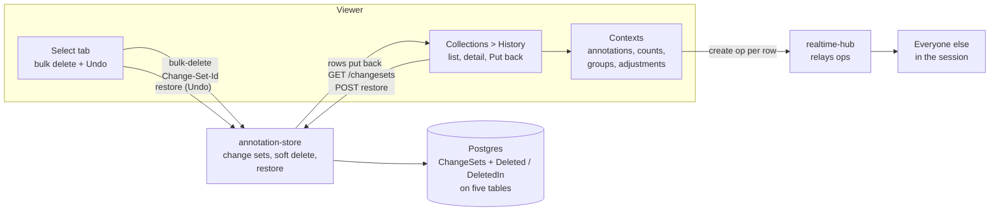
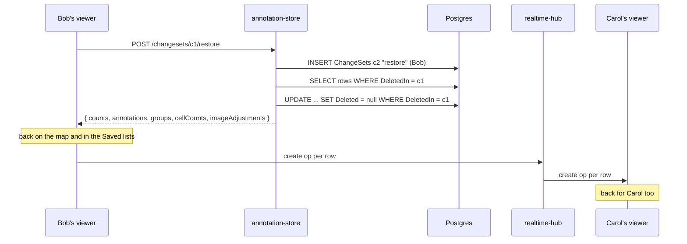

# Version control breakdown

Version control is the dissertation's focus: every change to a collection
is kept, said who made it, and can be taken back. It isn't one service. It
runs through annotation-store (what's kept and how it comes back), the
viewer (the History tab, Undo, live updates) and realtime-hub (telling
everyone else). This page follows it across all three. The per-service
breakdowns have the detail for each part, and
[todo.md](../todo.md#1-version-control) has the plan and the decisions
still to make.

## Contents

1. [Where it's up to](#1-where-its-up-to)
2. [How the pieces fit](#2-how-the-pieces-fit)
3. [Change sets](#3-change-sets)
4. [Deletes only hide](#4-deletes-only-hide)
5. [Putting a change back](#5-putting-a-change-back)
6. [In the viewer](#6-in-the-viewer)
7. [Who can put things back](#7-who-can-put-things-back)
8. [Test data](#8-test-data)
9. [Tests](#9-tests)
10. [What's next](#10-whats-next)
11. [Known gaps](#11-known-gaps)
12. [Files](#12-files)
13. [Glossary](#13-glossary)

## 1. Where it's up to

The steps from [todo.md](../todo.md#the-steps-in-order), each building on
the one before:

| # | Step | State |
|---|------|-------|
| 1 | Soft delete | Done - deletes only hide, every write is in a change set, and a change set's deletes can be put back any time |
| 2 | History log | Not started - before and after for every change, under its change set |
| 3 | Periodic snapshots | Not started |
| 4 | Viewing history | Half done - the collection's timeline is the History tab. A timeline per annotation or count waits for step 2 |
| 5 | Rollback | Partly there - a whole change set's deletes can be put back. Putting an edit back needs step 2 |
| 6 | Policy for two people editing at once | Not started - still last write wins |
| 7 | Evaluate it | Not started |

What works today, end to end: delete 21,000 annotations in one go, see it in
the History tab as one change, and put it all back days later - for
everyone in the session, live. What doesn't yet: seeing what an edit
changed, or putting an edit back. Nothing keeps the old value once it's
overwritten (see [What's next](#10-whats-next)).

## 2. How the pieces fit

- **annotation-store owns it all.** It decides what a change set is, keeps
  every deleted row, and puts them back. The viewer never works out what to
  restore - it asks for a change set to be put back and is told what came
  back.
- **realtime-hub is only a relay.** It doesn't know about change sets. Whoever
  puts something back sends a create op per row, the same as an import, and
  the hub passes them on.
- **No polling.** The viewer doesn't watch for other people's restores; their
  create ops arrive live, and anything that wrote without telling realtime
  shows up on the next refetch.

## 3. Change sets

A change set is one change someone made, like a commit or a Perforce
changelist. It's a row in `ChangeSets`
([ChangeSet.cs](../../annotation-store/ChangeSets/ChangeSet.cs)):

| Field | What it is |
|-------|------------|
| `Id` | A GUID - chosen by the client, or made by the store |
| `CollectionId` | The collection it was made in |
| `UserId`, `UserName` | Who made it, from their token |
| `What` | What the first request in it did |
| `Created` | When |

- **Every write makes one.** Annotations, groups, cell counts, image
  adjustments, an import and deleting a collection all go through
  `ChangeSetAsync` in
  [ChangeSets.cs](../../annotation-store/ChangeSets/ChangeSets.cs) once the
  access check and validation have passed, so a turned-down write leaves no
  change set behind.
- **Several requests can be one change.** A request can send a
  `Change-Set-Id` header. Every batch of a 21k bulk delete goes with the same
  id ([bulk.ts](../../image-viewer/src/components/annotation/bulk.ts)), so
  it's one change to read and one to put back. The response always says
  which change set it went in.
- **One person, one collection.** An id already used by someone else, or in
  another collection, is a 400.
- **Batches at the same moment.** The viewer sends batches all at once, so
  two can try to make the same change set together. The second insert fails
  on the primary key and reads the first one's instead.
- **What a change can be.** `add`, `change` and `delete` for an annotation,
  a group, a cell count and an image adjustment, plus `change annotations`
  and `delete annotations` (bulk), `merge groups`, `import`,
  `delete collection` and `restore`. Renaming a collection, sharing, ending a
  session, members and invite links aren't logged - they aren't the data
  being versioned.

## 4. Deletes only hide

- **`Deleted` and `DeletedIn`.** Annotations, groups, cell counts, image
  adjustments and collections all have both (`ISoftDeletable`). A delete sets
  when, and which change set did it. The row stays.
- **Hidden everywhere at once.** A global query filter in
  [AnnotationDbContext.cs](../../annotation-store/Annotations/AnnotationDbContext.cs)
  (`HasQueryFilter(r => r.Deleted == null)`) keeps deleted rows out of every
  read - lists, totals, facets, the map's load, export, group counts. Only
  the change set list and restore look past it, with `IgnoreQueryFilters`.
- **Gone as far as the API's concerned.** Changing, deleting, merging into or
  putting an annotation in a deleted one is a 404 or 400, as if it never
  existed. `Deleted` and `DeletedIn` are never sent or taken over JSON.
- **Deleting a collection** hides it and stops its invite links. Its members
  count for nothing while it's deleted, so only its owner can bring it back.
- **Nothing's purged.** Deleted rows stay for good - the history log will
  need them. A retention rule comes with the privacy question in
  [todo.md](../todo.md#things-to-decide-before-building).

More in [annotation-store.md section 11](annotation-store.md#11-deletes-and-change-sets).

## 5. Putting a change back

`POST /changesets/{id}/restore` puts back everything that change set deleted.

- **Rollback, not undo.** Any editor can put back anyone's change, and the
  restore is a change of its own - "Put back a change" in the History list,
  made by whoever did it.
- **It answers with the rows.** As well as how many of each came back, the
  answer has the rows themselves, as the reads give them (cell counts
  without their dots). They're read before the update, since after it
  nothing marks which ones they were. The viewer shows them and tells
  everyone else without loading anything again.
- **One transaction.** All of it comes back or none of it does.
- **Again is harmless.** Putting back something already back answers zeros
  and empty lists - someone else got there first.
- **Turned down:** a viewer or guest (403), someone not in the collection or
  a change set that doesn't exist (404), an ended session (409), and a
  personal collection whose owner has a newer one for that slide (409).
- **A group comes back empty.** Deleting or merging a group ungroups what was
  in it, and which ones isn't kept until the history log.

## 6. In the viewer

### Undo on a bulk delete

The Select tab's delete asks first, takes them off the map, and sends the
delete straight away as one change set. The toast's **Undo** (8 seconds)
puts that change set back. The delete isn't held back for the 8 seconds any
more - it's in annotation-store at once, only hidden, so closing the tab
during the toast doesn't lose it. After the toast's gone, the History
tab can still put it back. See
[image-viewer.md](image-viewer.md#the-select-tab---many-at-once).

### The History tab

In the Collections panel, for the collection you're in.

- **The list** - one line a change, newest first, under day headings (Today,
  Yesterday, then the date): an icon for the kind of change, what it did
  ("Deleted 2,140 annotations"), the person's initials and the clock time.
  A red bin marks a delete that still has something to put back. Paged 50 at
  a time with the Saved lists' pager.
- **The detail** - clicking a row opens it in place of the list: who, when to
  the second and how long ago, what's still deleted, and the change set's id.
  **Put back** and **Cancel** are there for editors, with a line saying what
  will happen. This page is the confirm - there's no popup. Once put back it
  stays open and says so.
- **After a restore** the rows go back into the annotation, cell count, group
  and adjustment contexts, the Saved lists refetch, everyone else gets a
  create op per row, and a toast says what came back.

See [image-viewer.md](image-viewer.md#history---putting-deletes-back) for
how it's built.

### Small things that had to change for it

- Someone else's create op clears that id from your deleted ids - otherwise
  the Saved list kept hiding a row that had been put back.
- The Select tab forgets annotations once they're deleted, so putting them
  back doesn't pick them again.
- `POST /collections/ensure` hands back the other request's collection when
  two arrive together, instead of a 500 - the viewer's first load can send
  two.

## 7. Who can put things back

Any editor, for anyone's change. The other option is only the person who
made it plus the host. It's still to be decided (see
[todo.md](../todo.md#things-to-decide-before-building)), so it's kept to one
check each side:

- the viewer's `canRestore` in
  [history.ts](../../image-viewer/src/components/collections/history/history.ts)
- the Editor check on `POST /changesets/{id}/restore` in
  [ChangeSets.cs](../../annotation-store/ChangeSets/ChangeSets.cs)

## 8. Test data

[seed_history.py](../../scripts/seed_history.py) makes a session called
"History test" on the slide, with about 20 changes from alice, bob and carol
over the last four and a half days: an import, adds, a recolour, edits,
groups made, merged and deleted, cell counts, a bulk delete that's put back
and one that isn't. Five still have something to put back.

The changes go through the API, so the change sets are real. The store
stamps them all as now, so the script then moves them back in Postgres with
`psql`, and reads the oldest one back through the API to check it landed in
the store's database. See the
[scripts README](../../scripts/README.md#history-test-data).

## 9. Tests

| Where | Tests | Covers |
|-------|-------|--------|
| annotation-store `SoftDeleteTests` | 18 | Deletes hide everywhere, deleted rows 404, batches in one change set (and at the same moment, Postgres only), restore - its own change set only, editors only, collections by their owner, answers with the rows - who and what on every write, header rules, the change set list and total |
| annotation-store `CollectionsTests` | 1 of 19 | 20 ensures at the same moment all get the one collection (Postgres only) |
| annotation-store `PostgresPoolTests` | 1 | Every test class's connections fit in a stock Postgres |
| viewer `history.test.ts` | 25 | Labels for every kind of change, icons, initials, what's still deleted, who can put back, toast and note wording, day grouping, the ops sent to everyone else |
| viewer `bulk.test.ts` | 13 | Batches, one change set id per change, Undo only after the delete's in |
| viewer `savedDates.test.ts` | 15 | Day headings by the calendar, times, "12 minutes ago" |
| viewer `paging.test.ts` | 1 of its tests | The History list's page and total URLs |
| scripts `test_seed_history.py` | 12 | The story's order, the SQL that moves it back, reading the connection string |

The Postgres-only tests are the ones SQLite can't show: requests at the
same moment, and the real migrations. CI runs the store's suite on both.

## 10. What's next

**The history log (step 2)** is the next piece, and the one the rest leans
on. One row per item a change touched, with its fields before and after,
under its change set. It gives:

- **from -> to** on the History detail page - "Changed an annotation" can't
  say what changed today, since the edit's PUT replaces label, notes and
  colour together and the old values are gone. With the log it's one line a
  field: label `Region 4` -> `Region 4 (checked)`, notes, colour as swatches,
  "48 annotations, red -> blue" for a bulk recolour.
- **One row per edit.** The edit forms autosave every 500ms pause, each its
  own change set. An open form should send one `Change-Set-Id` for the whole
  edit, so it's one History row, before = when it opened, after = when it
  closed.
- **A timeline per annotation or count** - the other half of step 4.
- **Putting an edit back**, not just a delete - step 5.
- **Groups coming back with what was in them.**

The decisions it needs first - where the order comes from, logging the
change or the state, text fields, privacy - are listed in
[todo.md](../todo.md#things-to-decide-before-building), along with the
policies for two people editing the same thing (step 6) and the games
parallels for the write-up.

## 11. Known gaps

- **No before and after.** Updates overwrite. See [What's next](#10-whats-next).
- **Autosaves flood the list.** Every pause while typing in an edit form is
  its own "Changed an annotation" row.
- **A group comes back empty** after it's put back.
- **Only deletes can be put back** - not edits, not adds.
- **Nothing is purged**, and change sets keep names and user ids for good.
- **Not logged:** renaming a collection, sharing, ending a session, members
  and invite links.
- **The hub doesn't check ops against the store** - it trusts the viewer to
  have saved, or restored, before telling everyone.

## 12. Files

| File | What's in it |
|------|--------------|
| [annotation-store/ChangeSets/ChangeSet.cs](../../annotation-store/ChangeSets/ChangeSet.cs) | `ChangeSet`, `ISoftDeletable` |
| [annotation-store/ChangeSets/ChangeSets.cs](../../annotation-store/ChangeSets/ChangeSets.cs) | `ChangeSetAsync`, soft delete helpers, `GET /changesets`, `/total`, restore |
| [annotation-store/Annotations/AnnotationDbContext.cs](../../annotation-store/Annotations/AnnotationDbContext.cs) | The query filter on all five tables |
| [annotation-store/Migrations/20261021084951_SoftDeleteAndChangeSets.cs](../../annotation-store/Migrations/20261021084951_SoftDeleteAndChangeSets.cs) | The `ChangeSets` table and the two columns |
| [image-viewer/src/components/annotation/bulk.ts](../../image-viewer/src/components/annotation/bulk.ts) | Batches, one change set per bulk change, Undo |
| [image-viewer/src/components/collections/history/](../../image-viewer/src/components/collections/history) | History list, detail, icons, the restore hook and the plain logic in `history.ts` |
| [image-viewer/src/components/saved/savedDates.ts](../../image-viewer/src/components/saved/savedDates.ts) | Day headings, times, how long ago |
| [image-viewer/src/context/](../../image-viewer/src/context) | `addRestored` on the annotation, cell count, group and adjustment contexts |
| [scripts/seed_history.py](../../scripts/seed_history.py) | The test history |

## 13. Glossary

- **Change set** - one change someone made, as a row in `ChangeSets`. Every
  row a change deleted points at it.
- **Soft delete** - hiding a row (`Deleted`, `DeletedIn`) rather than
  removing it.
- **Restore / put back** - un-hiding everything one change set deleted. The
  UI says "put back".
- **Undo** - the toast's button on a bulk delete: a restore of that change
  set, offered for 8 seconds.
- **Rollback** - putting something back how it was, whoever changed it.
  Restore is rollback; Undo is the same thing offered straight after.
- **History log** - step 2, not built: before and after for every change.
