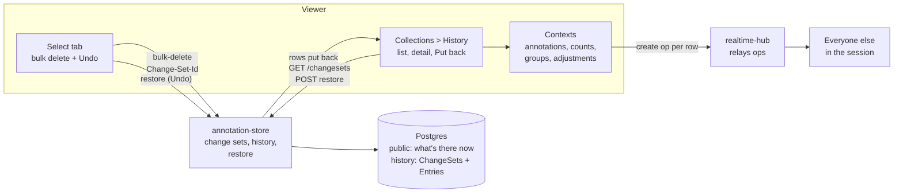
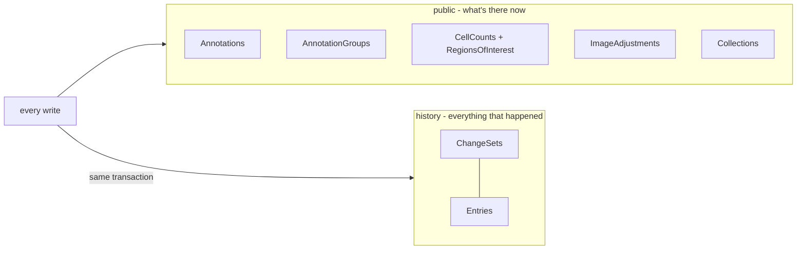
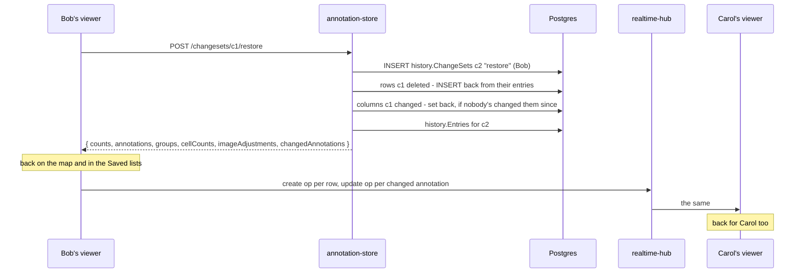
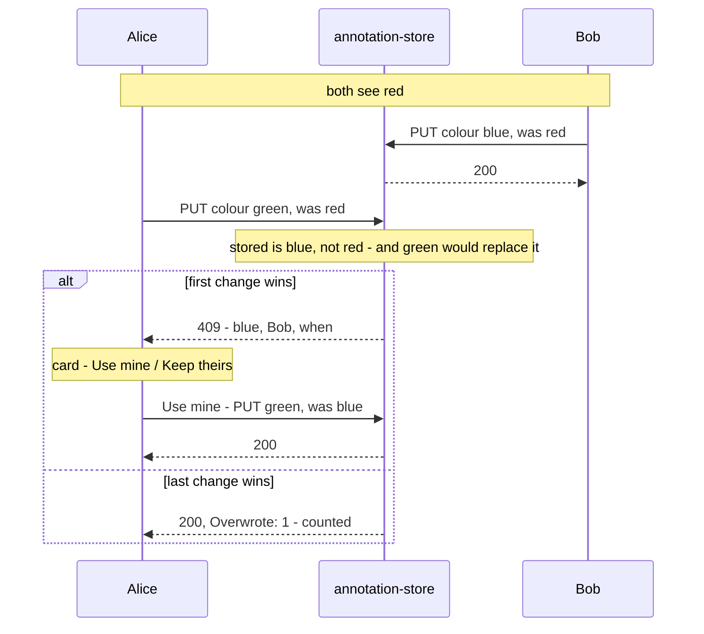

# Version control breakdown

Version control is the dissertation's focus: every change to a collection
is kept, said who made it, and can be taken back. It isn't one service. It
runs through annotation-store (what's kept and how it comes back), the
viewer (the History tab, Undo, live updates) and realtime-hub (telling
everyone else). This page follows it across all three. The per-service
breakdowns have the detail for each part, and
[todo.md](../todo.md#1-version-control) has the plan and the decisions
still to make.

## Contents

1. [Where it's up to](#1-where-its-up-to)
2. [How the pieces fit](#2-how-the-pieces-fit)
3. [Change sets](#3-change-sets)
4. [The history area](#4-the-history-area)
5. [Putting a change back](#5-putting-a-change-back)
6. [In the viewer](#6-in-the-viewer)
7. [Who can put things back](#7-who-can-put-things-back)
8. [Two people changing the same thing](#8-two-people-changing-the-same-thing)
9. [Test data](#9-test-data)
10. [Tests](#10-tests)
11. [What's next](#11-whats-next)
12. [Known gaps](#12-known-gaps)
13. [Files](#13-files)
14. [Glossary](#14-glossary)

## 1. Where it's up to

The steps from [todo.md](../todo.md#the-steps-in-order), each building on
the one before:

| # | Step | State |
|---|------|-------|
| 1 | Soft delete | Done, then replaced by step 2 - every write is in a change set, and a change set can be put back any time |
| 2 | History log | Done in the store - a `history` schema, apart from the data, with what every change did to every row: a delete keeps the whole row, an edit the columns it changed, before and after. The live tables only hold what's there now. Not shown in the viewer yet |
| 3 | Periodic snapshots | Not started |
| 4 | Viewing history | Mostly done - the collection's timeline is the History tab, and opening a change shows what it changed, from and to. A timeline per annotation or count is next |
| 5 | Rollback | Mostly there - putting a change set back brings back what it deleted and undoes what it changed, unless someone's changed it since. Putting one row back to a point in time isn't built |
| 6 | Policy for two people editing at once | Done - picked per session, last change wins or first change wins, for colour, group and a group's name and notes. Labels and notes are merged live with Yjs. See [section 8](#8-two-people-changing-the-same-thing) |
| 7 | Evaluate it | The tools are there - `simulate_conflicts.py` and the dashboard's Edits row count what each policy does. No proper runs yet |

What works today, end to end: delete 21,000 annotations in one go, see it in
the History tab as one change, and put it all back days later - for
everyone in the session, live. Delete a group and put it back, and what was
in it goes back in. Every edit's before and after is kept, and opening it in History shows
each field from and to. What doesn't yet: a timeline for one annotation (see
[What's next](#11-whats-next)).

## 2. How the pieces fit

- **annotation-store owns it all.** It decides what a change set is, writes
  the history with every save, and puts things back from it. The viewer never
  works out what to restore - it asks for a change set to be put back and is
  told what came back.
- **One API, two areas.** History is its own schema with its own tables,
  but annotation-store is the only way in. A second service with its own
  database would need its own copy of who can see what, couldn't put
  something back in one transaction, and could fall behind - see
  [Why not a separate service](#why-not-a-separate-service).
- **realtime-hub is only a relay.** It doesn't know about change sets. Whoever
  puts something back sends a create op per row, the same as an import, and
  the hub passes them on.
- **No polling.** The viewer doesn't watch for other people's restores; their
  create ops arrive live, and anything that wrote without telling realtime
  shows up on the next refetch.

## 3. Change sets

A change set is one change someone made, like a commit or a Perforce
changelist. It's a row in `history.ChangeSets`
([ChangeSet.cs](../../annotation-store/History/ChangeSet.cs)):

| Field | What it is |
|-------|------------|
| `Id` | A GUID - chosen by the client, or made by the store |
| `CollectionId` | The collection it was made in |
| `UserId`, `UserName` | Who made it, from their token |
| `What` | What the first request in it did |
| `Created` | When |

- **Every write makes one.** Annotations, groups, cell counts, image
  adjustments, an import and deleting a collection all go through
  `ChangeSetAsync` in
  [ChangeSets.cs](../../annotation-store/History/ChangeSets.cs) once the
  access check and validation have passed, so a turned-down write leaves no
  change set behind.
- **Several requests can be one change.** A request can send a
  `Change-Set-Id` header. Every batch of a 21k bulk delete goes with the same
  id ([bulk.ts](../../image-viewer/src/components/annotation/bulk.ts)), so
  it's one change to read and one to put back. The response always says
  which change set it went in.
- **One person, one collection.** An id already used by someone else, or in
  another collection, is a 400.
- **One edit is one change.** An edit form (an annotation's or a count's
  label, notes and colour, or a group's name and notes) makes a change set
  id when it opens and sends it with every autosave. The store folds a
  repeat update to a row in the same change set into the entry already
  there (`FoldRepeatsAsync` in
  [HistoryLog.cs](../../annotation-store/History/HistoryLog.cs)): the first
  before stays, the latest after wins, a column that's back where it
  started drops out, and an edit that undid itself leaves no entry. It only
  folds into the row's latest entry and only if that's an update, so
  nothing folds across a delete. Two saves of one row can't fold at the same
  moment - each has already updated the live row, and Postgres holds that
  row until the first commits.
- **Batches at the same moment.** The viewer sends batches all at once, so
  two can try to make the same change set together. The second insert fails
  on the primary key and reads the first one's instead.
- **What a change can be.** `add`, `change` and `delete` for an annotation,
  a group, a cell count and an image adjustment, plus `change annotations`
  and `delete annotations` (bulk), `merge groups`, `import`,
  `delete collection` and `restore`. Renaming a collection, sharing, ending a
  session, members and invite links aren't logged - they aren't the data
  being versioned.

## 4. The history area

- **An entry is what one change did to one row** (`history.Entries`): which
  row, create, update or delete, and `Before` / `After` as `jsonb`.
  - **Delete:** `Before` is the whole row, so it can be put back. A merged
    group's delete also says where it went (`MergedInto`).
  - **Update:** just the columns that changed, before and after - a recolour
    of 20,000 shapes is 20,000 small entries, not 20,000 copies of GeoJSON.
  - **Create:** nothing. The live row has it, or a later delete's copy will.
- **Written with every save.** The context's `SaveChanges` reads EF's change
  tracker and writes the entries in the same transaction as the change
  ([HistoryLog.cs](../../annotation-store/History/HistoryLog.cs)), for
  annotations, groups, cell counts, ROIs and image adjustments. A versioned
  row changing outside a change set throws, so nothing can change without
  its history.
- **Bulk changes in bulk.** Up to 20,000 annotations at once go through
  [AnnotationBulk.cs](../../annotation-store/History/AnnotationBulk.cs):
  before values in one query, the change in one statement, the history in
  one Postgres `COPY`.
- **The live tables only hold what's there now.** A delete takes the row
  out. No `Deleted` column, no query filter - nothing reading the tables has
  to remember to skip anything.
- **A collection is the exception.** It holds everything in it, so deleting
  one hides it (`Collections.Deleted`) rather than copying the lot into the
  history. Its owner can bring it back.
- **Moving off soft delete.** The `HistoryArea` migration turned every
  soft-deleted row into a delete entry, using Postgres' own `to_jsonb` - the
  same shape `HistoryLog` writes - then took them out of the live tables and
  dropped the columns. It can be run back down.
- **Nothing's purged.** History stays for good. A retention rule comes with
  the privacy question in
  [todo.md](../todo.md#things-to-decide-before-building).

### Why not a separate service

The cleanest-looking split is a history service with its own database, fed
events by annotation-store. It was ruled out because the two would share
data they both need:

- **Who can see it.** Only annotation-store knows members, roles, guests and
  ended sessions. History would have to ask it every time, or keep a copy
  that goes stale - someone taken out of a session could still read it.
- **Putting back crosses the line.** The old rows would be in one service
  and the live ones in the other, so a restore could half happen.
- **It drifts.** Events need an outbox, de-duplicating and ordering, and
  history would be a moment behind - delete something, open History, and
  it isn't there yet.
- **Reads that need both.** "300 still deleted" depends on what's live now,
  and two databases can't be joined.
- **Two copies of an annotation's shape.** Old entries keep the shape from
  when they were written, and the other service can't see the migrations.

A schema of its own, behind the one API and written in the same
transaction, keeps the separation without any of that. `HistoryLog` is the
seam if it ever needs to be split out.

More in [annotation-store.md section 11](annotation-store.md#11-history-and-change-sets).

## 5. Putting a change back

`POST /changesets/{id}/restore` puts it back how it was before that change.

- **Rollback, not undo.** Any editor can put back anyone's change, and the
  restore is a change of its own - "Put back a change" in the History list,
  made by whoever did it.
- **What comes back.** Every row the change deleted, unless it's back
  already. And every column it changed on a row that's still here - but only
  if it's still what the change made it, so a later edit is never undone.
- **So groups work.** A deleted group comes back with what was in it (the
  delete ungrouped them, and each of those is an update to put back). A
  merge put back takes back what was moved. An annotation whose group has
  gone since comes back ungrouped, or in the group it was merged into.
- **It answers with the rows.** How many of each came back, the rows
  themselves as the reads give them (cell counts without their dots), and
  `changedAnnotations` - ones that were already there and went back how they
  were. The viewer shows them and tells everyone else without loading
  anything again.
- **One transaction.** All of it comes back or none of it does.
- **Again is harmless.** Putting back something already back answers zeros
  and empty lists - someone else got there first.
- **Turned down:** a viewer or guest (403), someone not in the collection or
  a change set that doesn't exist (404), an ended session (409), and a
  personal collection whose owner has a newer one for that slide (409).
- **How long.** 20,000 annotations put back take about 5 seconds on
  Postgres 17 in Docker - the rows are rebuilt from their entries in the
  database, not sent through the app. Soft delete flipped a column instead,
  which was quicker; keeping deleted rows out of the live tables costs that.

## 6. In the viewer

### Undo on a bulk delete

The Select tab's delete asks first, takes them off the map, and sends the
delete straight away as one change set. The toast's **Undo** (8 seconds)
puts that change set back. The delete isn't held back for the 8 seconds any
more - it's in annotation-store at once, with its history, so closing the
tab during the toast doesn't lose it. After the toast's gone, the History
tab can still put it back. See
[image-viewer.md](image-viewer.md#the-select-tab---many-at-once).

### The History tab

In the Collections panel, for the collection you're in.

- **The list** - one line a change, newest first, under day headings (Today,
  Yesterday, then the date): an icon for the kind of change, what it did
  ("Deleted 2,140 annotations"), the person's initials and the clock time.
  A red bin marks a delete that still has something to put back. Paged 50 at
  a time with the Saved lists' pager. **Filter** narrows it to who made the
  change, the kind (added, changed, deleted, merged, imported, put back) and
  when, with the Saved lists' filter popout; **Newest first / Oldest first**
  turns it round.
- **The detail** - clicking a row opens it in place of the list: who, when to
  the second and how long ago, what's still deleted, the change set's id,
  and **what changed** - each field from and to ("Label  Region 4 ->
  Region 4 (checked)", colours as swatches, groups by name), many rows as
  one line ("10 annotations", the colours they started as -> the one they
  went to), and what it deleted by name.
  **Put back** and **Cancel** are there for editors, with a line saying what
  will happen. This page is the confirm - there's no popup. Once put back it
  stays open and says so.
- **After a restore** the rows go back into the annotation, cell count, group
  and adjustment contexts (an annotation already there is replaced, so it
  moves back into its group), the Saved lists refetch, everyone else gets a
  create op per row and an update for each changed one, and a toast says
  what came back.

See [image-viewer.md](image-viewer.md#history---putting-deletes-back) for
how it's built.

### Small things that had to change for it

- Someone else's create op clears that id from your deleted ids - otherwise
  the Saved list kept hiding a row that had been put back.
- The Select tab forgets annotations once they're deleted, so putting them
  back doesn't pick them again.
- `POST /collections/ensure` hands back the other request's collection when
  two arrive together, instead of a 500 - the viewer's first load can send
  two.

## 7. Who can put things back

Any editor, for anyone's change. The other option is only the person who
made it plus the host. It's still to be decided (see
[todo.md](../todo.md#things-to-decide-before-building)), so it's kept to one
check each side:

- the viewer's `canRestore` in
  [history.ts](../../image-viewer/src/components/collections/history/history.ts)
- the Editor check on `POST /changesets/{id}/restore` in
  [ChangeSets.cs](../../annotation-store/History/ChangeSets.cs)

## 8. Two people changing the same thing

What happens when two people change the same thing at about the same time.
The host picks it when they start a session, and it's saved on it
(`Collections.EditPolicy`). Personal collections are one person, so they're
always last change wins. The code is in
[Conflicts/EditConflicts.cs](../../annotation-store/Conflicts/EditConflicts.cs)
and [editPolicy.ts](../../image-viewer/src/components/realtime/editPolicy.ts).

| Kind of field | Policy | Why |
|---------------|--------|-----|
| Labels and notes on annotations and cell counts | Merged live (Yjs) | Two people can type in the same box at once and nothing's lost, so there's nothing to choose |
| An annotation's colour and group, a group's name and notes | Last change wins or first change wins, per session | One value - only one person's can stay |
| Deletes | Not checked | Anything deleted can be put back from History |
| Cell counts' other fields, image adjustment presets | Not checked | Fixed once saved, or one person's own |

- **Per field, not per row.** A save sends the value it started from (its
  "was") with the value it wants. It's in the way of someone else only when
  the stored value isn't its was any more - someone's changed it since -
  and the save would change it again. A row version would have called a
  regroup and a recolour of the same annotation a conflict, and counted it
  as a lost change under last change wins, which it isn't.
- **A field that isn't changing is left alone.** The viewer always sends
  colour with a label edit. When the colour is the same as its was, the
  save isn't changing it, so the stored colour - maybe someone else's newer
  one - stays. A label edit from an old copy never puts an old colour back,
  under either policy.
- **No was, no check.** Scripts and older clients leave it out and save as
  they always did.
- **One at a time.** The check and the save happen with the row locked
  (`FOR UPDATE`), so two saves from the same was can't both get through. A
  Postgres-only test sends ten together and exactly one wins; without the
  lock it fails.
- **Turned down before it joins a change set.** A refused save makes no
  change set and no history, like any other turned-down write. A bulk
  change refused for every row returns before it joins one; one partly
  through joins it for the rows that changed.
- **The viewer under first change wins:**
  - Saves to one item go one at a time
    (`oneAtATime`), and each one's was is what the store last confirmed,
    not what's on screen - otherwise dragging the colour picker would
    conflict with itself.
  - A change goes out to everyone else only once it's saved, so nobody sees
    one that's then turned down.
  - On a 409, theirs is shown straight away, and a card says who changed
    what and when - "Bob Hughes changed the colour of Region 4 just now,
    before your change got there" - with **Use mine** (save again over it)
    and **Keep theirs**.
  - A bulk change that's partly turned down changes the rest, and the card
    says how many were left alone, with **Use mine for those**.
- **The viewer under last change wins:** as before - ops go out straight
  away - but saves send their was too, so the store can count what they
  overwrite.
- **Counted.** `annotation_store.conflicting_saves` (an OpenTelemetry
  counter, by policy, entity and outcome) goes up for every save in the way
  of someone else's: "refused" under first change wins, "overwrote" under
  last change wins. The dashboard's Edits row graphs it. A single save that
  overwrote someone also answers with an `Overwrote: 1` header, and a bulk
  change with `overwrote`, so a script can count without the dashboard.
- **Measuring it.**
  [simulate_conflicts.py](../../scripts/simulate_conflicts.py) has
  simulated people recolour a few shared annotations from their own copies,
  each seeing other people's changes `--notice` seconds late. It prints how
  many saves collided and what happened to them, and save times. Run it
  against a last change wins session and a first change wins one with the
  same settings and the same number of editors.
- **Locking** - whoever starts editing holds it - is the other policy in
  [todo.md](../todo.md#policies-for-two-people-editing-the-same-thing). It's
  for the write-up rather than built: it's the most code, and worst on the
  large sessions this is for.

## 9. Test data

[seed_history.py](../../scripts/seed_history.py) makes a session called
"History test" on the slide, with about 20 changes from alice, bob and carol
over the last four and a half days: an import, adds, a recolour, edits,
groups made, merged and deleted, cell counts, a bulk delete that's put back
and one that isn't. Five still have something to put back.

The changes go through the API, so the change sets are real. The store
stamps them all as now, so the script then moves them - and the history's
copies of rows deleted since - back in Postgres with `psql`, and reads the oldest one back through the API to check it landed in
the store's database. See the
[scripts README](../../scripts/README.md#history-test-data).

## 10. Tests

| Where | Tests | Covers |
|-------|-------|--------|
| annotation-store `HistoryTests` | 46 | A delete leaves the live table and keeps the whole row, an edit keeps only what changed, a create copies nothing, nothing versioned changes outside a change set, no history columns on the live tables. Batches in one change set (and at the same moment, Postgres only). Restore - its own change set only, editors only, collections by their owner, answers with the rows, a group back with what was in it, a recolour undone but never a later edit, a count back with its dots and ROI, an annotation following a merged group, ten restores at once putting it back once (Postgres only). What a change did, from and to. A row deleted again later belonging to the later delete. Narrowing by person, kind and date, oldest first, the facets. Who and what on every write, header rules, the list and total. One edit saved many times as one entry - columns back where they started dropping out, separate edits staying separate, nothing folding across a delete, a folded edit putting back to before it, saves at the same moment (Postgres only), and the fold itself |
| annotation-store `HistoryMigrationTests` | 1 | Postgres only: soft-deleted rows become delete entries that rebuild exactly, and go back on the way down |
| annotation-store `CollectionsTests` | 1 of 19 | 20 ensures at the same moment all get the one collection (Postgres only) |
| annotation-store `PostgresPoolTests` | 1 | Every test class's connections fit in a stock Postgres |
| viewer `changes.test.ts` | 14 | From and to for every kind of field - text, (empty), colours, groups by name, flags, numbers, image adjustment settings one by one - many rows on one line, deletes by name |
| viewer `history.test.ts` | 26 | Labels for every kind of change, icons, initials, what's still deleted, who can put back, toast and note wording, day grouping, the ops sent to everyone else (creates, and updates for changed annotations) |
| annotation-store `EditConflictsTests` | 14 | The policy per session (and personal always last change wins), a colour from an old copy turned down with who and what, "use mine", last change wins letting it through and counting it, a label edit never putting back an old colour or conflicting, the same colour not a conflict, no was not checked, bulk recolour and regroup under each policy, a group rename, no change set for a refused save, checked batches at the same moment in one change set and saves from one copy at the same moment with only one through (Postgres only) |
| viewer `editPolicy.test.ts` | 11 | The option's default, reading a 409, the card's wording (fields, who, when, singular and plural), when ops go out, saves to one item in order and carrying on after one fails |
| scripts `test_simulate_conflicts.py` | 9 | Each person's copy - others' saves only once they're old enough, what they heard for themselves - picking a new colour, the summary under each policy |
| viewer `bulk.test.ts` | 14 | Batches, one change set id per change, Undo only after the delete's in, an edit form's change set on each save |
| viewer `savedDates.test.ts` | 15 | Day headings by the calendar, times, "12 minutes ago" |
| viewer `paging.test.ts` | 1 of its tests | The History list's page and total URLs |
| scripts `test_seed_history.py` | 13 | The story's order, the SQL that moves it back (history's copies included, nothing touching the old soft delete columns), reading the connection string |

The Postgres-only tests are the ones SQLite can't show: requests at the
same moment, and the real migrations. CI runs the store's suite on both.

## 11. What's next

The history has what the next pieces need; they're mostly the viewer now.

- **A timeline per annotation or count** - the other half of step 4. Every
  entry for one row, by `CollectionId`, `Entity` and `EntityId` (indexed).
- **Putting one row back to a point in time** - step 5's other half.
- **Snapshots** (step 3), if replaying entries for a big collection gets
  slow.

- **Running the comparison** (step 7) - matched sessions under each policy
  with `simulate_conflicts.py`, at a few `--notice` and `--people` settings.

The decisions still open - where the order comes from, text fields,
privacy - are listed in
[todo.md](../todo.md#things-to-decide-before-building), along with the
games parallels for the write-up.

## 12. Known gaps

- **Changes from before history was kept** show "Nothing was recorded for
  this change" - soft delete only kept deletes.
- **Someone else's typing saves under your edit.** Shared text saves from
  every open form, so in a session your edit's change set can hold what
  someone else typed in the same box while you had it open.
- **A restore can't be put back.** It reverts deletes and updates, and the
  rows a restore brings back are creates, which aren't undone.
- **A column added later.** An old delete's copy of a row won't have a column
  added since - a new non-null column needs a default.
- **Putting back 20,000 takes about 5 seconds**, where soft delete was
  near-instant.
- **Nothing is purged**, and change sets and entries keep names, user ids and
  whole rows for good.
- **Not logged:** renaming a collection, sharing, ending a session, members
  and invite links.
- **The hub doesn't check ops against the store** - it trusts the viewer to
  have saved, or restored, before telling everyone.
- **Last change wins counts can run high by a few.** Ops go out before the
  save there, so another viewer can take a change as stored a moment before
  it is, and a save of theirs in that moment counts as overwriting.
- **Keep theirs on group notes while typing.** The notes box doesn't follow
  the group while it has focus, so it keeps showing yours until you leave it.

## 13. Files

| File | What's in it |
|------|--------------|
| [annotation-store/History/ChangeSet.cs](../../annotation-store/History/ChangeSet.cs) | `ChangeSet`, `HistoryEntry`, `HistoryOp` |
| [annotation-store/History/HistoryLog.cs](../../annotation-store/History/HistoryLog.cs) | Writes history from every save, the `COPY` writer, rebuilding a row from its entry, reverting an update |
| [annotation-store/History/AnnotationBulk.cs](../../annotation-store/History/AnnotationBulk.cs) | Deleting and changing up to 20,000 annotations with their history |
| [annotation-store/History/ChangeSets.cs](../../annotation-store/History/ChangeSets.cs) | `ChangeSetAsync`, `GET /changesets`, `/total`, restore |
| [annotation-store/History/ChangeSetChanges.cs](../../annotation-store/History/ChangeSetChanges.cs) | `GET /changesets/{id}/changes` - what one change did, grouped |
| [annotation-store/Annotations/AnnotationDbContext.cs](../../annotation-store/Annotations/AnnotationDbContext.cs) | The `history` schema, and the save that writes history with every change |
| [annotation-store/Migrations/20261021133213_HistoryArea.cs](../../annotation-store/Migrations/20261021133213_HistoryArea.cs) | The history schema, and moving soft-deleted rows into it |
| [annotation-store/Conflicts/EditConflicts.cs](../../annotation-store/Conflicts/EditConflicts.cs) | `EditPolicy`, the per field check, the row locks, the 409 and the counter |
| [image-viewer/src/components/realtime/editPolicy.ts](../../image-viewer/src/components/realtime/editPolicy.ts) | The policy choices, reading a 409, the card's wording, saves one at a time |
| [scripts/simulate_conflicts.py](../../scripts/simulate_conflicts.py) | Simulated people changing the same things, and the tally |
| [image-viewer/src/components/annotation/bulk.ts](../../image-viewer/src/components/annotation/bulk.ts) | Batches, one change set per bulk change, Undo |
| [image-viewer/src/components/collections/history/](../../image-viewer/src/components/collections/history) | History list, detail, icons, the restore hook and the plain logic in `history.ts` |
| [image-viewer/src/components/saved/savedDates.ts](../../image-viewer/src/components/saved/savedDates.ts) | Day headings, times, how long ago |
| [image-viewer/src/context/](../../image-viewer/src/context) | `addRestored` on the annotation, cell count, group and adjustment contexts |
| [scripts/seed_history.py](../../scripts/seed_history.py) | The test history |

## 14. Glossary

- **Change set** - one change someone made, as a row in `history.ChangeSets`.
  Its entries say what it did to each row.
- **History entry** - what one change did to one row: the whole row for a
  delete, the changed columns before and after for an edit.
- **Restore / put back** - undoing one change set: what it deleted comes
  back, and what it changed goes back if nobody's changed it since. The UI
  says "put back".
- **Undo** - the toast's button on a bulk delete: a restore of that change
  set, offered for 8 seconds.
- **Edit policy** - what happens when two people change the same thing in
  a session: last change wins (the later save stays) or first change wins
  (the later one is turned down and asked).
- **Was** - the value a save started from, sent with it so the store can
  tell whether someone else changed it since.
- **Rollback** - putting something back how it was, whoever changed it.
  Restore is rollback; Undo is the same thing offered straight after.
- **Soft delete** - what step 1 did: hiding a row instead of removing it.
  Replaced by the history schema - only collections are still hidden.
