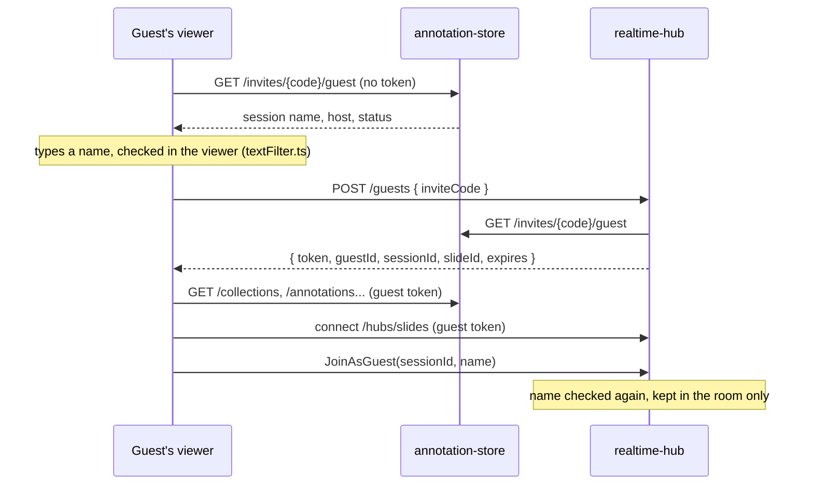

# Guests

People without an account can join a session from its invite link, as view
only, under a name they type in. The rule everything here follows: **the
name a guest types is never saved anywhere on the server.** It goes over the
wire and sits in the hub's memory while they're connected, and that's it.
Saving it would need ethical approval (it could be a real name).

How that's kept:

- The name isn't in the guest's token. It's sent once, in `JoinAsGuest`, and
  only the hub's room (in memory) holds it.
- annotation-store never sees the name at all. It only sees the token, which
  is a random id and a session id.
- Guests are always view only, with no row in `CollectionMembers`. Nothing a
  guest does can write a row, so nothing can carry their name into one
  (annotations and counts save `CreatedByName`).
- Logs only ever have the guest id.

The guest's own browser keeps the token and name in `sessionStorage`, so a
reload doesn't throw them out. That goes when the tab closes.

## Flow

## Contract

### Guest token

Minted by realtime-hub, checked by realtime-hub and annotation-store.

| | |
| --- | --- |
| Algorithm | HS256 |
| Key | `GuestTokens:SigningKey`, base64, 32 bytes. Same value in both services. The dev key is in each `appsettings.json` and the root `docker-compose.yml` - replace it before deploying |
| `iss` | `realtime-hub` |
| `aud` | `diss-guest` |
| `sub` | `guest-` + 16 random bytes, base64url without padding (22 characters) |
| `guest_session` | the session's collection id, `D` format guid |
| `exp` | the invite's expiry or 4 hours from now, whichever is sooner |
| `iat`, `nbf` | now |

No name claim, ever. A token is for one session only.

### annotation-store

- `GET /invites/{code}/guest` - no sign-in. 404 for an unknown code, otherwise
  200 `{ collectionId, slideId, collectionName, hostName, status, expires }`.
  `status` is `open`, `expired`, `stopped` or `ended`, the same as
  `GET /invites/{code}`. Anyone with the code can already join, so it shows
  no more than the code gets you.
- Guest tokens are accepted on these, and only these:
  - `GET /collections?slideId=` - just the guest's session, as a
    `CollectionView` with `myRole: viewer`, if it's on that slide. Otherwise
    `[]`
  - `GET /collections/{id}/membership` - `role: viewer` for their session
  - `GET /annotations`, `/annotations/total`, `/annotations/facets`
  - `GET /cellcounts`, `/cellcounts/total`, `/cellcounts/facets`,
    `/cellcounts/{id}`
  - `GET /annotationgroups`
- On those, a guest is Viewer on their own session, while it's a session, and
  404 on anything else. Every other endpoint is 401 for a guest token.

### realtime-hub

- `POST /guests` - no sign-in. Body `{ inviteCode }`. Asks annotation-store's
  `GET /invites/{code}/guest`. 404 if it's unknown, 410 with `{ status }` if
  it isn't open, otherwise 200
  `{ token, guestId, sessionId, slideId, expires }`. At most 60 a minute from
  one address, then 429.
- `/hubs/slides` takes a Keycloak or a guest token. `/hubs/presence` and
  everything else stays Keycloak only.
- `JoinAsGuest(roomId, name)` - guest tokens only, and only for the session
  in the token. Joins as Viewer. `JoinSession` with a guest token is refused.
- Names are checked on the hub as well: NFC, trimmed, runs of whitespace made
  one space, 2 to 24 characters, only letters, marks and numbers in any
  script plus space `.` `_` `'` `-`, and at least one letter or number. The
  profanity check is in the viewer only.
- `Participant` has `guest: true` for a guest. Guests aren't members, so the
  viewer's Collaboration panel shows them on its **Active** tab - everyone in
  the room right now, from the hub, in two groups: **Signed in** (host,
  then editors, then viewers) and **Guests**. The tab is only there while
  you're in a session. **Members**, on the Session tab, is everyone in the
  session, here or not, and never has guests in it.
- `RefreshRole` does nothing for a guest.
- `SendAnnotationOp` and `SendDocUpdate` are refused for anyone view only,
  guest or not. Before this, the hub passed them on from anyone in the room.

## From looking to editing

Guests can't be made editors - anything they added would be saved with
their name, which is the thing this is avoiding. They're asked to make an
account instead:

- A guest's Collaboration tab has **Make an account**. The host's has
  **Ask to edit** next to each guest, which sends them a `SendRequest` of
  kind `edit` - the same host-only call as "look here". The guest gets a
  dialog with Make an account, Sign in and Not now.
- Either way they go to Keycloak (`prompt=create` for its sign-up page, see
  [auth/README.md](../auth/README.md#making-an-account)), and come back to
  `?invite=<the same code>`. The guest pass is dropped on the way out.
- Back with an account, it's the normal invite card. They join as the link
  allows, and the host can make them an editor from the Members list.

## The name filter

In the viewer only, before the name goes anywhere -
[textFilter.ts](../image-viewer/src/textFilter.ts) and the
[image-viewer README](../image-viewer/README.md#text-filter). The hub checks
length and characters again, which covers SQL and HTML (`;`, `<`, `>` and
quotes other than `'` aren't allowed), but not swearing.

- "Dick" is let through as a whole word in a name ("Dick Turpin"), but not
  inside one ("Dickhead"). The cost: "Big Dick" gets through too.
- Real names with a rude word inside (Dickinson, Cumming, Penistone...) are
  let through by `REAL_NAMES`. "Tit" and "Twatt" are still blocked.

## Known gaps

- **Keycloak ids are visible.** `GET /collections` gives guests each
  member's Keycloak `sub` along with their name and role, and the hub sends
  every participant's `userId` to everyone in the room. The Members list also
  shows a member's id as the hover text when there's no viewport to point
  at (`RealTimePanel.tsx`, `title={... : member.userId}`) - for everyone,
  not just guests. A `sub` is a random UUID - it can't be used to sign in or
  look anyone up without Keycloak's admin API - but it does let someone
  spot the same person across sessions. The fix if it's wanted: a stand-in
  id per session (a keyed hash of the real id and the session id, using the
  key the hub and store already share), and no ids in hover text.

## Not done

- A host can't stop guests on one link but not another - every link lets
  guests in. Would need a flag on `CollectionInvites` and a switch in the
  invite UI.
- Profanity is only checked in the viewer. Someone calling the hub directly
  can pick a rude name - it still only lasts while they're connected.
