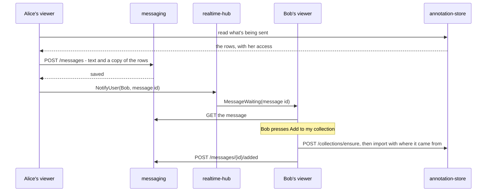
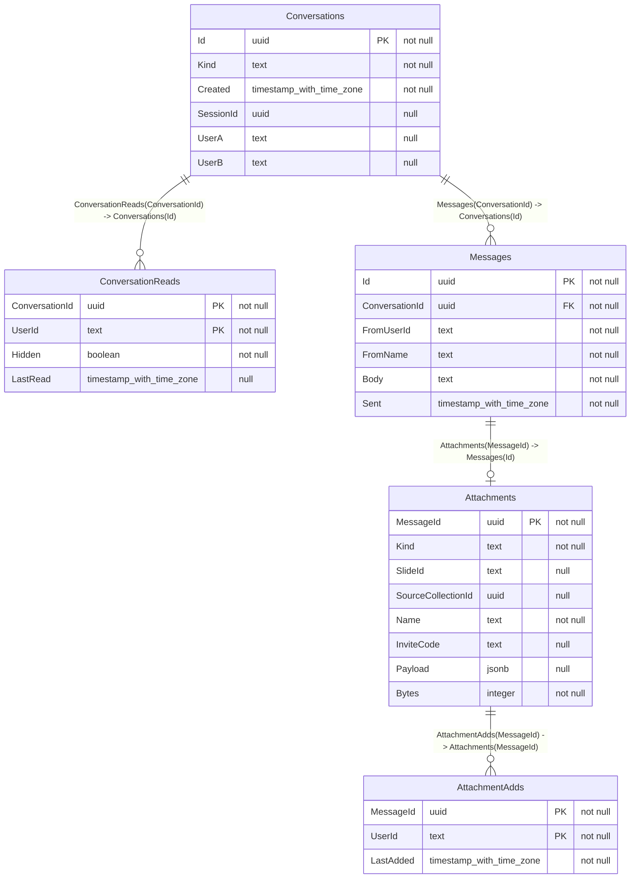

# Messaging and sending things

**Status: built, apart from replacing `InviteUser`** - see [Building it](#building-it). The
API and the tables are in [messaging/README.md](../messaging/README.md), which is what's right
if this page ever disagrees.

People with an account can message each other one to one, and chat in a session, and
send a group, some annotations, a collection or an invite link. Today the only thing
anyone can send someone is an invite code, and only while they're online.

## What gets better

- Someone can be asked about a region, or sent it, without being in a session
  with them at the same moment.
- An invite reaches someone who's offline, instead of failing.
- People in a session can talk in it, instead of needing a call alongside.
- Work can move between people's collections with a record of where it came from,
  which is what the [personal vs session as branches](todo.md#things-to-decide-before-building)
  idea needs. Without that record it's a copy and paste, and adds nothing to the
  version control argument.

Measured by: how long a message takes to arrive, from a counter of sends by kind,
and from how many sent items get added.

## What's there, and what gets in the way

| What                                       | Where                            | What it means here                                                     |
| ------------------------------------------ | -------------------------------- | ---------------------------------------------------------------------- |
| Everyone with an account, and who's online | Presence hub, `UsersList.tsx`    | Who to send to already exists                                          |
| Passing a code to someone online           | `InviteUser` on the presence hub | Fails if they're offline, and nothing's saved. Becomes a saved message |
| Saving many rows as one change             | `POST /collections/{id}/import`  | Adding something sent can use it, with the changes below               |
| Reading a whole collection                 | `GET /collections/{id}/export`   | Copying a collection can use it                                        |

Things found that the design has to work round:

- **Making an invite stops the session's working link.** `POST .../invites` stops any
  earlier one, so sending an invite must reuse the working link from
  `GET .../invites`, or it breaks links people already have.
- **Only the host can make or see invites.** An editor can't send a link.
- **A personal collection can't be joined at all** - invites are for sessions. All
  it has is `Shared`, which lets anyone signed in look at it read only.
- **Import stamps the importer as the author**, and records nothing about where rows
  came from. It also clears ids and groups, then matches groups by name, so a group
  sent to someone who has one of the same name joins theirs and adds its notes.
- **Saved list counts come without their dots**, so sending a count has to fetch it
  whole with `GET /cellcounts/{id}`.
- **The viewer only opens one slide**, set in `index.tsx`. `InviteGate` already says
  so when a link's for another slide. Anything sent from another slide can be added
  to your collection for it, but you can't go and look until the viewer can change
  slide. Fine while everything's on one slide, and it wants saying in the UI.

## The shape of it

- **messaging only holds messages.** It checks tokens, and that you're in the
  conversation you're reading. The one time it talks to annotation-store is to ask
  whether you're in a session, with your own token, the same as the hub does with
  `GET /collections/{id}/membership`.
- **The viewer does the sending and adding**, with each person's own token, so
  annotation-store's access checks stay the only ones: you can only send what you can
  read, and only add to what you can edit.
- **The hub says something's waiting and nothing more.** `NotifyUser` only passes a
  message id, and whoever gets it still has to fetch it as themselves, so a faked
  notify shows nothing. Someone offline finds it on their next load.

## Session chat

A chat per session, with everyone in it, as well as one to one.

- **Who's in it comes from the session.** messaging doesn't keep a list: it asks
  annotation-store for your membership when you read or send, so someone taken out of
  a session loses the chat straight away.
- **Viewers can read and write.** Being view only is about the slide's data, and
  someone looking on may well have a question. A one line change if not.
- **Guests can't use it.** They're not named people, and their names aren't saved.
- **An ended session's chat is read only**, and stays for looking back, like the session.
- **Live through the session's room.** `NotifySession(messageId)` on the slide hub tells
  everyone else in the room something's waiting. Anyone not in the room finds it next
  time they open the session.
- **Sending things in it works the same**, as a copy with Add to my collection.
- **It isn't in the collection's history.** A chat isn't the data being versioned, so it
  doesn't appear in the History tab, and putting a collection back leaves it alone.

## What each kind of send does

| Sending                | What happens                                                                             | Why                                                                                                              |
| ---------------------- | ---------------------------------------------------------------------------------------- | ---------------------------------------------------------------------------------------------------------------- |
| Text                   | Saved, up to 4,000 characters                                                            |                                                                                                                  |
| Annotations or a group | A copy is kept in the message. They press **Add to my collection**                       | It's what you meant when you sent it, even if you change or delete it later, and they don't need access to yours |
| A cell count           | The same, dots included                                                                  | Fetched whole first                                                                                              |
| A session              | The invite code, from its working link. The preview shows what it's for before they join | Host only, the same as today. Anyone else gets told to ask the host                                              |
| A whole collection     | A copy, up to the size limit                                                             | A personal collection can't be joined, so it's the only way to give someone one                                  |
| An area of the slide   | Where you're looking. They press **View** and their map goes there, with a dashed box    | Pointing someone at something shouldn't mean copying anything, and it works with nothing in common but the slide |
| Too big to copy        | Turned down, saying how big and what the limit is                                        | 27,000 annotations is 25MB, and a count can be 80MB. A message isn't the place. A session is                     |

**The limit** is 5MB a message to start with, about 5,000 annotations, and worth
changing once it's been used.

## Where it came from

The part that matters for the dissertation. Adding something sent makes a change set
in the usual way, and says where it came from:

- **`history.ChangeSets` has a nullable `Source`** (`jsonb`): who sent it, the message, the
  collection, what it was called and how many of each it added. **`SourceRows`** beside it
  has which row each new one was copied from. Apart, since that's two ids a row and the
  History list reads `Source` for every line.
- **annotation-store can't check it**, since messages are another service's. It's what the
  adder's viewer read from the message, held only to the rows being in that import. So it's
  a record of where something came from, not proof.
- **Rows get new ids and the adder as `CreatedBy`**, as an import does. The original
  author is in `Source`.
- **`What` is `add from message`**, so the History tab says "Added 12 annotations from
  Alice", and opening it links to what it came from if you've access to that too.
- **Adding twice** adds them twice, since someone may have changed the first lot. The
  button says when you last added it, per person, since everyone in a session's chat can
  add the same thing.

So a copy between collections has a recorded parent, which is what a merge needs, and
a real answer for the write-up on personal collections as branches.

## messaging's data

- **`Kind`** is `direct` or `session`. A direct one has `UserA` and `UserB`, in a fixed
  order with a unique index, so two people only ever have one conversation. A session's
  has `SessionId`, also unique, which is annotation-store's collection id and not a
  foreign key, since that's a different database.
- **`Hidden`** is someone deleting a direct conversation for themselves. Its rows go once
  both have. A host deleting a session's chat removes it for everyone.
- **`Messages.Id`** comes from the viewer, so sending again after a dropped connection
  doesn't send twice.
- **User ids are Keycloak's**, not foreign keys, the same as annotation-store.

## API

| Call                                           | What it does                                                                                                                                                 |
| ---------------------------------------------- | ------------------------------------------------------------------------------------------------------------------------------------------------------------ |
| `GET /conversations`                           | Your direct ones, newest first, with the last message and how many are unread                                                                                |
| `GET /sessions/{id}/conversation`              | A session's chat, if you're in the session                                                                                                                   |
| `DELETE /conversations/{id}`                   | Hides a direct one for you, or removes a session's if you're the host                                                                                        |
| `GET /conversations/{id}/messages?skip=&take=` | A page of messages, newest first, without attachments' payloads                                                                                              |
| `POST /messages`                               | `{ id, toUserId or sessionId, body, attachment? }`. Finds or makes the conversation. 413 past the limit, 403 if you're not in the session, 409 if it's ended |
| `GET /messages/{id}/attachment`                | The copy, only if you're in the conversation                                                                                                                 |
| `POST /messages/{id}/added`                    | Records that it was added                                                                                                                                    |
| `POST /conversations/{id}/read`                | Marks it read up to now                                                                                                                                      |

Hub: `NotifyUser(userId, messageId)` on the presence hub and `NotifySession(messageId)`
on the slide hub, both sending `MessageWaiting`. `InviteUser` and `InviteReceived` go once
invites are messages.

## In the viewer

- **A Messages tool on the toolbar**, with a badge for how many are unread. Guests don't
  get it.
- **An inbox in its panel**, wider than the others and solid so text isn't read over the slide.
  Your conversations run down the side with the thread beside them, the pencil finds anyone with
  an account, and the chat of the session you're in sits at the bottom of the list while you're in
  one. The side folds down to a rail of initials, with unread counts, so the panel covers less of
  the slide. In a side dock, which is only 20em, it stays a rail.
- **The Users tab** has a **Message** button on each person, which opens it on them.
- **A conversation** has its messages, a box to type in, and anything sent as a card with
  **Add to my collection**, or **Have a look** for an invite. You don't get those on your own.
- **Send** is where things are saved: on a row of the Saved tabs, a group of annotations or cell
  counts, what's picked on the Select tab, and a collection. It asks who to, opens that conversation
  with it attached, and you can add words before it goes. The rows are read when it goes, and
  something over the limit is turned down before uploading.
- **Attach** by the box is only for what has no Saved tab: the area you're looking at, which is
  where you are when you pick it, and if you're hosting an invite to your session.
- **View** on a card takes the map to it and draws it in its own colours, without adding it to anything,
  so someone can see what they've been sent before deciding. **Stop showing** or shutting the
  panel takes it off. Not offered for something from another slide.
- **A small preview** on each card shows that part of the slide with what was sent drawn on it in
  its own colours, turned as it was seen, and pressing it does the same as **View**. It's drawn in the browser from
  the tiler's tiles, since the tiler can't render a region. It's fetched once the card's on screen,
  and anything over 1MB waits for **Preview**, so scrolling past doesn't download megabytes. It works
  for another slide's too, which is the one way to see those for now.
- **A toast** says who it's from if a message arrives with the panel shut.
- **The name filter** (`censorText`) runs over messages and names as they're shown.

## What can go wrong

| What                                            | What happens                                                                       |
| ----------------------------------------------- | ---------------------------------------------------------------------------------- |
| The hub's down                                  | Saved anyway, and it turns up on their next load                                   |
| messaging is down                               | The panel says so. Everything else works, since nothing depends on it              |
| annotation-store is down                        | Direct messages still work. Session chat says it can't check you're in the session |
| Taken out of a session mid-chat                 | The next read or send is a 403, and the tab closes                                 |
| Sent twice after a dropped connection           | The same id, so one message                                                        |
| A link's stopped or run out before they open it | The invite preview already says so                                                 |
| The session ended                               | The same                                                                           |
| They've lost access to what was sent            | They still have the copy. That's a choice, and it's in the privacy question below  |
| A row sent from another slide                   | Adds to their collection for that slide, and says they can't see it from here      |
| Someone's deleted in Keycloak                   | Their messages stay, under the name they had then                                  |

## Building it

Each is its own piece, and useful without the next. All built, apart from taking `InviteUser` out
in step 2. It's still there next to invites as messages, and can go once those have been used.

1. **messaging service and text messages** - `messaging/` with its own database, tests,
   CI and Dockerfile, in `run_all.py` and `docker-compose.yml`. Users tab and the panel.
   A few days.
2. **Invites as messages** - works offline, and `InviteUser` goes. An afternoon.
3. **Sending annotations and groups** - the copy, the limit, Add to my collection. A few
   days.
4. **Where it came from** - `Source`, migration, the History tab showing it. A day or two.
5. **Session chat** - the membership check, `NotifySession`, the Chat tab. A few days.
6. **Cell counts and whole collections** - mostly the size limit. A day.

Tests with each: access (only the two people can read a direct conversation, and only people
in a session can read its chat, including straight after being taken out), the limit, sending
twice, an ended session being read only, adding a copy keeps nothing of the sender's access,
and `Source` surviving a rollback.

## Decisions

| Decision                                | Picked                                          | Why                                                                                                                                                                                                                                  |
| --------------------------------------- | ----------------------------------------------- | ------------------------------------------------------------------------------------------------------------------------------------------------------------------------------------------------------------------------------------ |
| Its own service, or in annotation-store | Its own, under `messaging/`                     | A separate concern that shares no data, and the reasons a history service was [ruled out](breakdown/version-control.md#why-not-a-separate-service) don't apply. It's a fifth service to run, deploy and cost in [azure.md](azure.md) |
| A copy, or a live link                  | A copy                                          | A link would need per row access annotation-store doesn't have, and it would change under them. A copy also gives a recorded parent for the write-up                                                                                 |
| One to one, or session chat too         | Both                                            | One to one comes first, since session chat builds on it                                                                                                                                                                              |
| How long things are kept                | Until someone deletes the conversation, for now | Test data only until there's a retention rule. Notes and shapes may describe patient slides, and a sent copy outlives losing access to the original, so this goes in the ethics question before any real data                        |

Still open:

- **Viewers in session chat.** Drafted as able to write. Worth a second look if view only is
  meant to mean silent.
- **The 5MB limit**, which is a starting guess.

Left out for now: **Send to...** on a Saved row, the Select tab, a group or a collection, since
**Attach...** reaches all of them from the conversation.

Left out on purpose: group chats beyond sessions, attachments other than these, read receipts
shown to the sender, blocking people, and guests using any of it.
