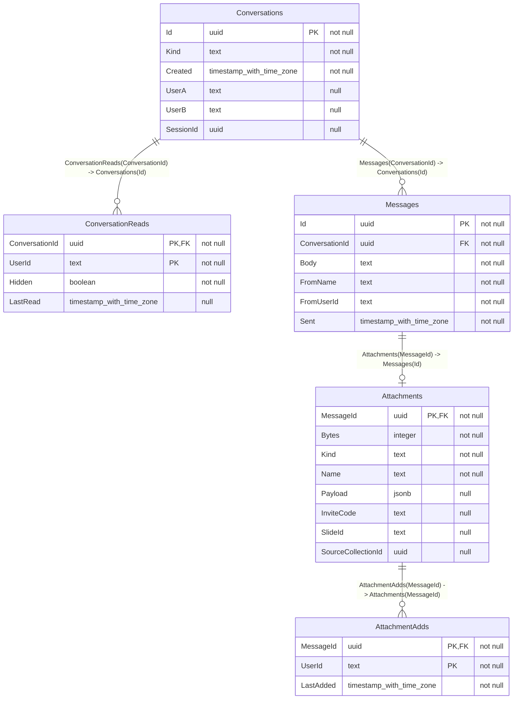

# messaging

Messages between people with an account: one to one, and a chat per session, with
anything sent kept as a copy. Holds messages and nothing else. The viewer reads what's
being sent from annotation-store and adds what's received to it, with each person's own
token, so annotation-store's access checks stay the only ones. See
[docs/messaging.md](../docs/messaging.md) for why it's shaped like this.

## Running

```bash
cp .env.example .env
```

```bash
dotnet run --urls http://localhost:5260
```

`.env` is gitignored, and holds `ConnectionStrings__Messaging`. In Development it makes the
database and brings it up to date when it starts. It needs Keycloak running to check tokens,
and annotation-store for session chat. `python scripts/run_all.py` runs it with everything else.

The viewer reaches it through its own dev server at `/messaging`, and the Messages tool is
built on this - see `image-viewer/src/context/MessagingContext.tsx`.

### Tests

```bash
dotnet test Tests/Messaging.Tests.csproj
```

They run on SQLite. With `MESSAGING_TEST_POSTGRES` set to a connection string they run on
Postgres, including the tests of requests at the same moment. CI runs both.

## API

Every call needs a Keycloak token. Guests get a 401. Times are ISO 8601, and ids are GUIDs
apart from user ids, which are Keycloak's.

```ts
type ConversationKind = 'direct' | 'session'
type AttachmentKind = 'annotations' | 'group' | 'cellCount' | 'collection' | 'invite' | 'area'

interface Conversation {
  id: string
  kind: ConversationKind
  // Direct only: who it's with. Their name comes from the Users tab's list, since
  // they may not have sent anything yet.
  withUserId: string | null
  // Session only.
  sessionId: string | null
  created: string
  lastMessage: Message | null
  unread: number
}

interface Message {
  id: string
  conversationId: string
  fromUserId: string
  // Their name when they sent it.
  fromName: string
  body: string
  sent: string
  attachment: Attachment | null
}

// What's sent, without the rows themselves - those come from GET /messages/{id}/attachment.
interface Attachment {
  kind: AttachmentKind
  // What to call it on the card, e.g. "Tumour" or "12 annotations".
  name: string
  slideId: string | null
  sourceCollectionId: string | null
  // Invites only. Open it with the invite preview, as a link would.
  inviteCode: string | null
  bytes: number
  // When you last added it to a collection, or null.
  lastAddedByMe: string | null
}

interface SendMessage {
  // Made by the viewer, so sending again after a dropped connection doesn't send twice.
  id: string
  // One or the other.
  toUserId?: string
  sessionId?: string
  // Up to 4,000 characters. Can be empty if there's an attachment.
  body: string
  attachment?: {
    kind: AttachmentKind
    name: string // up to 200 characters
    slideId?: string
    sourceCollectionId?: string
    inviteCode?: string // invites
    // Everything else: any JSON object, up to 5MB. Rows, or for an area where it
    // is - { center, resolution, rotation, extent }. messaging doesn't read it, so
    // whoever gets it has to check it before using it.
    payload?: unknown
  }
}
```

| Call | Answers | Notes |
|---|---|---|
| `GET /conversations` | `Conversation[]` | Your direct ones you haven't hidden, most recent first |
| `GET /sessions/{id}/conversation` | `Conversation` | The session's chat, made if it's the first time. 404 if you're not in the session |
| `GET /conversations/{id}/messages?skip=&take=` | `{ messages: Message[], total: number }` | Newest first. `take` is 1 to 100, 50 by default |
| `POST /messages` | `Message`, 201 | Makes the conversation if needed. The same `id` again answers the first one with a 200 |
| `GET /messages/{id}/attachment` | `Attachment & { payload: unknown }` | With the rows. 404 if there's none |
| `POST /messages/{id}/added` | `Attachment` | Say you've added it to a collection, after the store's said yes. A 400 for an invite or an area, which can't be added |
| `POST /conversations/{id}/read` | 204 | Marks it read up to now |
| `DELETE /conversations/{id}` | 204 | Direct: hides it for you, and it's gone once you both have. A new message brings it back. Session: the host removes it for everyone |

What can go wrong:

- **400** - saying you added an invite or an area, nothing to send, too long, a bad invite code, messaging yourself, an id that isn't a GUID, or both or neither of `toUserId` and `sessionId`.
- **403** - deleting a session's chat when you're not the host.
- **404** - it doesn't exist, or you're not in it. The two aren't told apart.
- **409** - the session's ended, so its chat is read only. Or that message `id` is someone else's.
- **413** - the attachment's over 5MB. It says how big it was.
- **503** - session chat only, when annotation-store can't be asked whether you're in the session. Direct messages carry on.

## Live updates

messaging doesn't push anything. After a `POST /messages`, the viewer tells the hub, which only
says something's waiting. It carries ids and nothing else, so faking one shows nobody anything.

| Hub | Call | Who hears `MessageWaiting({ conversationId, messageId })` |
|---|---|---|
| Presence | `NotifyUser(userId, conversationId, messageId)` | Every tab they have open, and your other tabs. Nothing happens if they're offline - they find it on their next load |
| Slides | `NotifySession(conversationId, messageId)` | Everyone else in your session's room |

## Schema

<!-- schema:start - written by scripts/db_docs.py, don't edit by hand -->



### Reading the diagram and tables

The diagram puts underscores in a type with spaces, since it can't draw them otherwise.

| Type | What it is |
|---|---|
| `uuid` | A 128-bit random id, like `33afa424-ed8b-4489-ab20-ee917f31880c`. Used for most ids, since the viewer can make one itself before saving |
| `integer` | A 32-bit whole number |
| `boolean` | True or false |
| `text` | A string of any length. Can also hold JSON that's only stored and handed back |
| `jsonb` | JSON that Postgres has parsed and checked, so the database can read inside it |
| `timestamp with time zone` | A moment in time, kept in UTC. Postgres also calls it `timestamptz` |

| Term | What it means |
|---|---|
| PK | Primary key - what identifies a row. Two together means the pair is what's unique |
| FK | Foreign key - a column pointing at another table's row. The database won't let it point at one that isn't there |
| PK, FK | Both - part of what identifies the row, and pointing at another table |
| not null / null | Whether a column has to have a value, or can be empty |
| Index | A lookup kept by the database, so finding rows by that column doesn't read the whole table |
| Unique index | An index that also refuses two rows with the same value |
| Set by | Where a value comes from: `client` is in the request, `server` is the service itself, `host` or `owner` is that person choosing it through the API |

| Line end | How many rows of the table it's next to |
|---|---|
| Two bars | Exactly one |
| A bar and a circle | Zero or one |
| A circle and three prongs | Zero or more |

### Conversations

Who's talking: either two people, or everyone in a session. Two people only ever have one between them, whichever of them wrote first.

**To make one:** Made by the first `POST /messages` between two people, or the first time a session's chat is opened or written in.

| Column | Type | Key | Set by | Notes |
|---|---|---|---|---|
| `Id` | uuid | PK | server |  |
| `Kind` | text |  | server | `Direct` or `Session` |
| `Created` | timestamp with time zone |  | server |  |
| `UserA` | text, null |  | server | Direct only. The two people's Keycloak ids, in a fixed order so the unique index means one conversation between them |
| `UserB` | text, null |  | server | See `UserA` |
| `SessionId` | uuid, null |  | client | A session's chat only. annotation-store's collection id, not a foreign key, since that's a different database. Who's in it is asked of annotation-store each time, not kept here |

- Unique index on `SessionId`
- Index on `UserB`
- Unique index on `UserA, UserB`

### ConversationReads

One person's place in a conversation: how far they've read, and whether they've deleted it. There's only a row once they've done one of those.

**To make one:** `POST /conversations/{id}/read`, or `DELETE /conversations/{id}` on a direct one.

| Column | Type | Key | Set by | Notes |
|---|---|---|---|---|
| `ConversationId` | uuid | PK, FK | server | Half of the key |
| `UserId` | text | PK | server | Their Keycloak id. The other half of the key |
| `Hidden` | boolean |  | server | They've deleted it for themselves. A new message clears this, and once both have it set the conversation goes |
| `LastRead` | timestamp with time zone, null |  | server | Anything from someone else after this counts as unread |

- `ConversationId` points at `Conversations.Id`. Deleted with it

### Messages

One message. Who sent it comes from their token, along with their name when they sent it, so a list doesn't have to ask Keycloak.

**To make one:** `POST /messages` with an `id` the viewer made, `toUserId` or `sessionId`, and `body`.

| Column | Type | Key | Set by | Notes |
|---|---|---|---|---|
| `Id` | uuid | PK | client | Made by the viewer, so sending again after a dropped connection is the same message |
| `ConversationId` | uuid | FK | server | Found or made from who it's to |
| `Body` | text |  | client | Up to 4,000 characters. Can be empty if there's an attachment |
| `FromName` | text |  | server | Their name then |
| `FromUserId` | text |  | server | Their Keycloak id, from their token |
| `Sent` | timestamp with time zone |  | server |  |

- Index on `ConversationId, Sent`
- `ConversationId` points at `Conversations.Id`. Deleted with it

### Attachments

What was sent with a message, as it was when it was sent. It's a copy, so it stays the same if the original changes or goes, and whoever gets it doesn't need access to the original. messaging doesn't read the rows - the viewer sends them, and annotation-store checks them when they're added.

**To make one:** Sent inside the message, as `attachment`. Up to 5MB.

| Column | Type | Key | Set by | Notes |
|---|---|---|---|---|
| `MessageId` | uuid | PK, FK | client | The message it came with |
| `Bytes` | integer |  | server | The size of `Payload` |
| `Kind` | text |  | client | `Annotations`, `Group`, `CellCount`, `Collection`, `Invite` or `Area` |
| `Name` | text |  | client | What to call it on the card. Up to 200 characters |
| `Payload` | jsonb, null |  | client | Everything but invites: the rows, or for an area where it is, as a JSON object. Only sent by `GET /messages/{id}/attachment`, since it can be megabytes |
| `InviteCode` | text, null |  | client | Invites only. Opened with annotation-store's invite preview, as a link would be |
| `SlideId` | text, null |  | client | Which slide it's from. Not a foreign key |
| `SourceCollectionId` | uuid, null |  | client | Which collection it was copied from, for where it came from. Not a foreign key |

- `MessageId` points at `Messages.Id`. Deleted with it

### AttachmentAdds

Someone adding what was sent to a collection of theirs. Per person, since everyone in a session's chat can add the same thing, and each should see when they did.

**To make one:** `POST /messages/{id}/added`, after annotation-store has said yes.

| Column | Type | Key | Set by | Notes |
|---|---|---|---|---|
| `MessageId` | uuid | PK, FK | server | Half of the key |
| `UserId` | text | PK | server | Their Keycloak id. The other half of the key |
| `LastAdded` | timestamp with time zone |  | server | Moves on if they add it again |

- `MessageId` points at `Attachments.MessageId`. Deleted with it

<!-- schema:end -->
